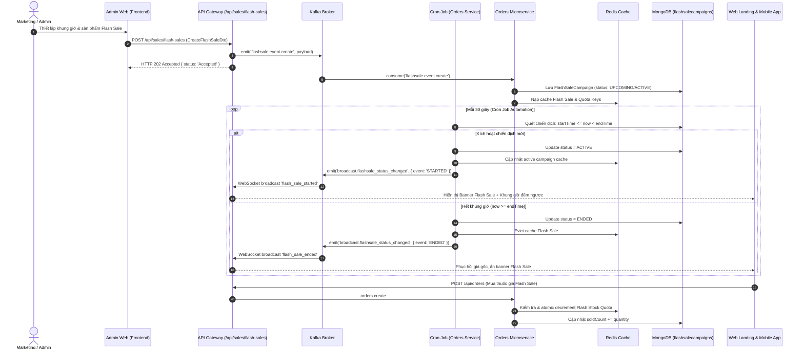

# Kế Hoạch Triển Khai: Thiết Lập Chương Trình Flash Sale Theo Khung Giờ & Cron Job Tự Động Hóa (UC-74)

Tài liệu này đặc tả chi tiết kế hoạch kỹ thuật toàn diện để phát triển tính năng **Thiết lập chương trình Flash Sale theo khung giờ (Time-limited Flash Sale Management - UC-74)** kèm **Cron Job Function** tự động kích hoạt, kết thúc, đối soát quota tồn kho và phục hồi giá gốc (Automatic Price Reversion upon Expiry), tuân thủ nghiêm ngặt **Fullstack Implementation Playbook v2.0** và tiêu chuẩn **Zero Mock Data**.

---

## 1. Mô Tả Mục Tiêu (Goal Description)

Xây dựng hệ thống quản lý và vận hành chương trình **Flash Sale Giờ Vàng** cho chuỗi nhà thuốc:

1. **Thiết lập chiến dịch Flash Sale theo khung giờ linh hoạt (Time Slots)**: Hỗ trợ các khung giờ vàng tiêu chuẩn của chuỗi bán lẻ dược phẩm (08:00 - 12:00, 12:00 - 18:00, 18:00 - 22:00) hoặc khung giờ tùy chỉnh theo sự kiện/ngày lễ.
2. **Cấu hình sản phẩm Flash Sale**: Lựa chọn thuốc từ kho dược phẩm thật, cấu hình giá gốc, đơn giá Flash Sale sốc, hạn mức số lượng suất bán (Stock Quota), và giới hạn số lượng tối đa trên mỗi khách hàng (`maxQtyPerUser`) nhằm ngăn chặn đầu cơ thuốc.
3. **Cron Job Function Tự Động Hóa Vòng Đời Chiến Dịch**:
   - Tự động chuyển trạng thái từ `UPCOMING` sang `ACTIVE` khi chạm mốc `startTime`, nạp dữ liệu vào Redis Cache và phát tín hiệu Realtime (Socket.IO/Kafka) tới toàn bộ Client.
   - Tự động kiểm soát quota: Nếu sản phẩm chạm mốc `soldCount >= flashStockQuota`, tự động ngắt giá Flash Sale và chuyển về giá niêm yết chuẩn.
   - Tự động chuyển từ `ACTIVE` sang `ENDED` khi hết khung giờ (`endTime`), xóa cache Redis và **tự động phục hồi giá gốc niêm yết (Automatic Price Reversion)** trên toàn hệ thống POS và Online.
4. **Đồng bộ dữ liệu thật (Zero Mock Data)**:
   - Xóa bỏ toàn bộ dữ liệu mock cứng hiện tại trên **Web Landing Page** (`Landing.tsx`) và **Mobile App** (`CustomerScreen.tsx`), kết nối trực tiếp với API Gateway để hiển thị chiến dịch Flash Sale thực tế đang chạy kèm đồng hồ đếm ngược (Live Countdown Timer).
5. **Giao diện Quản trị Admin Web (Frontend 3-Tier Layer)**: Trang quản lý Flash Sale trực quan cho Marketing Specialist / Admin với đầy đủ thao tác Tạo, Sửa, Tạm dừng, Hủy và Báo cáo tiến độ bán.

---

## 2. Kiến Trúc Kỹ Thuật & Luồng Dữ Liệu (Architecture & Sequence Diagram)



---

## 3. Các Điểm Cần Người Dùng Xác Nhận (User Review Required)

> [!IMPORTANT]
> **1. Quy Tắc Trừ Quota Flash Sale:**
> Khi khách hàng đặt đơn hàng trực tuyến (PayOS QR):
>
> - **Phương án A (Khuyến nghị):** Giữ quota ngay khi đơn hàng được tạo (`PENDING`). Nếu sau 15 phút khách không thanh toán (bị cancel bởi background job), hệ thống hoàn lại quota cho chiến dịch.
> - **Phương án B:** Chỉ trừ quota khi thanh toán thành công (`PAID`). Điểm yếu là nếu nhiều khách đặt cùng lúc có thể bị bán vượt hạn mức (overselling) trong vài giây cuối.
>   *Kế hoạch sẽ áp dụng Phương án A để bảo đảm tính chặt chẽ của hạn mức Flash Sale.*

> [!NOTE]
> **2. Tần Suất Chạy Cron Job:**
> Chu kỳ quét tự động của Cron Job sẽ thiết lập ở mức **30 giây** (`setInterval` hoặc Cron pattern) để đảm bảo độ trễ chuyển giao khung giờ thấp nhất mà không gây quá tải CPU MongoDB.

---

## 4. Chi Tiết Thay Đổi Mã Nguồn (Proposed Changes)

### 4.1. Tầng Backend: `orders-service` (Core Domain & Cron Job)

#### [NEW] `backend/apps/orders-service/src/schemas/flash-sale-campaign.schema.ts`

- Định nghĩa Schema MongoDB `FlashSaleCampaign` và sub-schema `FlashSaleItem`:
  - `name`: Tên chiến dịch (VD: "Flash Sale Khung Giờ Vàng 12h")
  - `description`: Mô tả chi tiết
  - `timeSlot`: Chuỗi mô tả khung giờ (VD: `"08:00 - 12:00" | "12:00 - 18:00" | "18:00 - 22:00" | "CUSTOM"`)
  - `startTime`: `Date`
  - `endTime`: `Date`
  - `status`: `'UPCOMING' | 'ACTIVE' | 'ENDED' | 'CANCELLED'`
  - `targetBranches`: `string[]` (mặc định `['ALL']` hoặc danh sách ID chi nhánh)
  - `items`: Danh sách sản phẩm:
    - `medicineId`: string
    - `medicineName`: string
    - `sku`: string
    - `image`: string
    - `originalPrice`: number
    - `flashPrice`: number
    - `discountPercent`: number
    - `flashStockQuota`: number (Hạn mức số suất bán)
    - `soldCount`: number (Số suất đã bán thực tế, mặc định 0)
    - `maxQtyPerUser`: number (Tối đa số lượng mua/khách, mặc định 2)
  - `isActive`: boolean
  - Indexes: `{ status: 1, startTime: 1, endTime: 1 }`, `{ 'items.medicineId': 1 }`.

#### [NEW] `backend/apps/orders-service/src/flash-sale.service.ts`

- Cung cấp toàn bộ nghiệp vụ Flash Sale:
  - `createCampaign(dto)`: Tạo chiến dịch Flash Sale mới.
  - `updateCampaign(id, dto)`: Cập nhật thông tin chiến dịch.
  - `deleteCampaign(id)`: Xóa chiến dịch.
  - `toggleStatus(id, isActive)`: Bật/tắt khẩn cấp.
  - `getAllCampaigns(query)`: Lấy danh sách phân trang, lọc theo status, branchId.
  - `getActiveCampaigns()`: Lấy chiến dịch đang `ACTIVE` và `UPCOMING` cho Client (Web/Mobile).
  - `getCampaignById(id)`: Lấy chi tiết chiến dịch.
  - `decrementFlashStock(campaignId, medicineId, quantity)`: Trừ quota an toàn.
  - `runFlashSaleCronJob()`: Hàm cron job quét tự động chuyển trạng thái `UPCOMING` -> `ACTIVE` -> `ENDED`, xóa cache và phát event phục hồi giá gốc.

#### [MODIFY] `backend/apps/orders-service/src/orders-service.module.ts`

- Đăng ký `FlashSaleCampaign` schema vào `MongooseModule.forFeature`.
- Khai báo `FlashSaleService` trong `providers` và `exports`.

#### [MODIFY] `backend/apps/orders-service/src/orders-service.controller.ts`

- Đăng ký các Message/Event Pattern Kafka:
  - `@EventPattern('flashsale.event.create')`
  - `@EventPattern('flashsale.event.update')`
  - `@EventPattern('flashsale.event.delete')`
  - `@MessagePattern('flashsale.get.all')`
  - `@MessagePattern('flashsale.get.active')`
  - `@MessagePattern('flashsale.get.by.id')`
  - `@MessagePattern('flashsale.toggle.status')`

#### [MODIFY] `backend/apps/orders-service/src/orders-service.service.ts`

- Khởi động Cron Job chu kỳ 30s trong `onModuleInit()`:
  ```typescript
  // Khởi động cron job tự động kích hoạt / kết thúc Flash Sale theo khung giờ
  setInterval(() => {
    this.flashSaleService.runFlashSaleCronJob().catch(err => {
      this.logger.error('Lỗi khi chạy Flash Sale Cron Job:', err);
    });
  }, 30 * 1000);
  ```
- Tích hợp kiểm tra giá Flash Sale trong luồng `createOrder`:
  - So khớp các mặt hàng trong giỏ với các sản phẩm đang có Flash Sale `ACTIVE`.
  - Nếu hợp lệ và còn quota: áp dụng đơn giá `flashPrice`, ghi nhận `soldCount += quantity`.

---

### 4.2. Tầng Backend: `api-gateway` (Routing & REST Endpoints)

#### [NEW] `backend/apps/api-gateway/src/dto/flash-sale.dto.ts`

- DTO kiểm định dữ liệu đầu vào bằng `class-validator`:
  - `CreateFlashSaleDto`: `name`, `timeSlot`, `startTime`, `endTime`, `targetBranches`, `items`.
  - `UpdateFlashSaleDto`: Partial của `CreateFlashSaleDto`.
  - `FlashSaleItemDto`: `medicineId`, `medicineName`, `originalPrice`, `flashPrice`, `flashStockQuota`, `maxQtyPerUser`.

#### [NEW] `backend/apps/api-gateway/src/controllers/flash-sale.controller.ts`

- API Controller chuẩn Playbook v2.0:
  - `POST /api/sales/flash-sales`: Tạo mới (Async Kafka `emit`, trả về HTTP 202 Accepted, Role: `admin`, `director`, `head_branch`).
  - `GET /api/sales/flash-sales`: Lấy danh sách chiến dịch quản trị (Kafka `send`).
  - `GET /api/sales/flash-sales/active`: Lấy danh sách Flash Sale đang chạy cho Landing Web / Mobile (Cache-Aside Redis).
  - `GET /api/sales/flash-sales/:id`: Lấy chi tiết chiến dịch.
  - `PUT /api/sales/flash-sales/:id`: Cập nhật chiến dịch (Async Kafka `emit`, trả về HTTP 202 Accepted, evict cache).
  - `PATCH /api/sales/flash-sales/:id/toggle`: Đổi trạng thái kích hoạt.
  - `DELETE /api/sales/flash-sales/:id`: Xóa chiến dịch (Async Kafka `emit`, trả về HTTP 202 Accepted, evict cache).

#### [MODIFY] `backend/apps/api-gateway/src/app.module.ts`

- Đăng ký `FlashSaleController` vào `controllers`.

#### [MODIFY] `backend/apps/api-gateway/src/websocket/websocket.controller.ts`

- Lắng nghe Kafka event `broadcast.flashsale_status_changed` và broadcast Socket.IO:
  ```typescript
  @EventPattern('broadcast.flashsale_status_changed')
  handleFlashSaleStatusChanged(@Payload() data: any) {
    this.logger.log(`⚡ Flash sale status changed: ${data.campaignName} -> ${data.status}`);
    this.websocketGateway.server.emit('flashsale_status_changed', data);
  }
  ```

---

### 4.3. Tầng Frontend Web (3-Tier Layer: Service -> Hook -> UI Component)

#### [NEW] `frontend/src/services/sales/flashSale.service.ts` (Tầng 1 - Service)

- Interface chuẩn: `FlashSaleCampaign`, `FlashSaleItem`, `CreateFlashSalePayload`.
- Các hàm gọi API Gateway:
  - `getFlashSales(params)`: `GET /api/sales/flash-sales`
  - `getActiveFlashSales()`: `GET /api/sales/flash-sales/active`
  - `getFlashSaleById(id)`: `GET /api/sales/flash-sales/:id`
  - `createFlashSale(payload)`: `POST /api/sales/flash-sales` (Trả về 202 Accepted)
  - `updateFlashSale(id, payload)`: `PUT /api/sales/flash-sales/:id`
  - `toggleFlashSale(id, isActive)`: `PATCH /api/sales/flash-sales/:id/toggle`
  - `deleteFlashSale(id)`: `DELETE /api/sales/flash-sales/:id`

#### [NEW] `frontend/src/hooks/useFlashSaleManagement.ts` (Tầng 2 - Custom Hook)

- Quản lý state `campaigns`, `activeCampaign`, `loading`, `submitting`, `error`.
- Xử lý delayed re-fetch 1s sau khi gửi sự kiện Kafka để đảm bảo consumer đã ghi DB.
- Lọc theo khung giờ và trạng thái: `ALL`, `UPCOMING`, `ACTIVE`, `ENDED`.

#### [NEW] `frontend/src/pages/admin/FlashSaleManagement.tsx` (Tầng 3 - UI Component)

- Giao diện quản trị hiện đại, chuẩn thẩm mỹ y tế:
  - Thẻ thống kê KPI: Tổng chiến dịch, Đang diễn ra (Hiệu ứng lửa nhấp nháy), Tổng suất bán đã cấu hình, Tỷ lệ bán hết (Sell-through rate).
  - Bộ lọc khung giờ: 08:00 - 12:00, 12:00 - 18:00, 18:00 - 22:00, Tùy chỉnh.
  - Danh sách bảng chiến dịch: Hiển thị tên, thời gian diễn ra, trạng thái (Badge rực rỡ), số lượng SKU tham gia, tiến độ bán (% sold bar).
  - Modal tạo/sửa chiến dịch Flash Sale:
    - Nhập tên chiến dịch, mô tả.
    - Chọn khung giờ (Time Slot Preset hoặc Date/Time Picker).
    - Chọn chi nhánh áp dụng (Toàn chuỗi hoặc chi nhánh chỉ định).
    - Bộ chọn thuốc thông minh (Searchable Combobox) từ cơ sở dữ liệu thuốc thật:
      - Tự động điền giá gốc.
      - Nhập giá Flash Sale hoặc % giảm giá (tự động tính ngược).
      - Nhập hạn mức số lượng suất bán (Quota).
      - Giới hạn số lượng mua tối đa cho mỗi khách (`maxQtyPerUser`).
    - Nút Lưu (gửi Kafka 202 và thông báo Toast tiếp nhận).

#### [MODIFY] `frontend/src/App.tsx`

- Đăng ký route mới:
  - `<Route path="flash-sales" element={<FlashSaleManagement />} />` trong cả `/admin` và `/director`.

#### [MODIFY] `frontend/src/layouts/AdminLayout.tsx` & `frontend/src/layouts/DirectorLayout.tsx`

- Bổ sung menu item:
  - `{ name: "Flash Sale Giờ Vàng", href: "/admin/flash-sales", icon: <Flame size={20} className="text-amber-500" /> }`

#### [MODIFY] `frontend/src/components/common/Landing.tsx` (Xóa bỏ Mock Data)

- Thay thế đoạn code nạp thuốc tĩnh mock bằng `flashSaleService.getActiveFlashSales()`.
- Hiển thị danh sách sản phẩm thật từ chiến dịch `ACTIVE` đang chạy.
- Đồng hồ đếm ngược (Countdown) đồng bộ chính xác với `endTime` của chiến dịch thực tế.
- Hiển thị tỷ lệ thanh tiến độ bán (`soldCount / flashStockQuota * 100%`).
- Lắng nghe sự kiện Socket.IO `flashsale_status_changed` để tự động làm mới giao diện khi khung giờ mới bắt đầu hoặc kết thúc mà người dùng không cần F5.

---

### 4.4. Tầng Mobile App: `mobile` (Zero Mock Data)

#### [NEW] `mobile/src/services/sales/flashSale.service.ts`

- Cung cấp hàm gọi `getActiveFlashSales()` từ API Gateway trên thiết bị di động.

#### [MODIFY] `mobile/src/screens/customer/CustomerScreen.tsx`

- Kết nối `flashSaleService.getActiveFlashSales()` vào phần `Flash Sale Section`:
  - Hiển thị đúng sản phẩm trong khung giờ đang active.
  - Đồng hồ đếm ngược `FlashSaleCountdown` đếm ngược theo thời gian thực tới `endTime` của chiến dịch.
  - Hiển thị đúng tiến độ suất bán thực tế từ database.

---

## 5. Kế Hoạch Kiểm Thử & Xác Minh (Verification Plan)

### 5.1. Kiểm Thử Tự Động & Build Kiểm Tra (Automated Tests)

1. **Kiểm tra biên dịch Backend**:
   - `npm run build api-gateway`
   - `npm run build orders-service`
2. **Kiểm tra biên dịch Frontend**:
   - `npm run build` trong `frontend/`
3. **Kiểm tra Luồng API & Cron Job (Integration Script)**:
   - Viết kịch bản kiểm thử `backend/scripts/test-flash-sale-cron.ts`:
     - Tạo một chiến dịch Flash Sale với khung giờ bắt đầu sau 2 giây và kết thúc sau 10 giây.
     - Kiểm tra trạng thái ban đầu: `UPCOMING`.
     - Chạy Cron Job: Trạng thái tự động chuyển thành `ACTIVE`, Redis Cache được nạp.
     - Tạo đơn hàng mua thuốc với giá Flash Sale: Kiểm tra đơn giá được giảm đúng mức và quota bị trừ.
     - Đợi 10 giây cho hết giờ, chạy lại Cron Job: Trạng thái chuyển thành `ENDED`, cache bị xóa, giá tự động phục hồi về giá gốc niêm yết (Automatic Price Reversion).

### 5.2. Kiểm Thử Giao Diện Thủ Công (Manual Verification)

1. **Admin Web**:
   - Đăng nhập với tài khoản Admin (`admin@pharmacy.com`).
   - Vào mục menu **Flash Sale Giờ Vàng**.
   - Tạo mới một chiến dịch Flash Sale với khung giờ hôm nay, chọn 3 sản phẩm thuốc thật, đặt quota 50 suất, giảm giá 30%.
   - Kiểm tra Toast hiển thị tiếp nhận 202 Accepted và chiến dịch xuất hiện trên bảng danh sách.
2. **Web Landing Page**:
   - Mở trang chủ (`/`), cuộn xuống khu vực **FLASH SALE GIỜ VÀNG**.
   - Xác nhận đúng 3 sản phẩm thuốc thật vừa cấu hình xuất hiện kèm đúng giá giảm, nhãn % giảm và số suất bán.
   - Xác nhận đồng hồ đếm ngược hiển thị đúng số giờ:phút:giây còn lại của chiến dịch.
3. **Thao tác Đặt Hàng**:
   - Bấm "Chọn mua" sản phẩm Flash Sale vào giỏ hàng và tiến hành tạo đơn hàng.
   - Kiểm tra tổng tiền đơn hàng được tính đúng giá Flash Sale ưu đãi.
