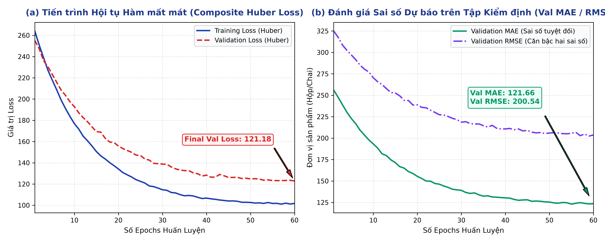
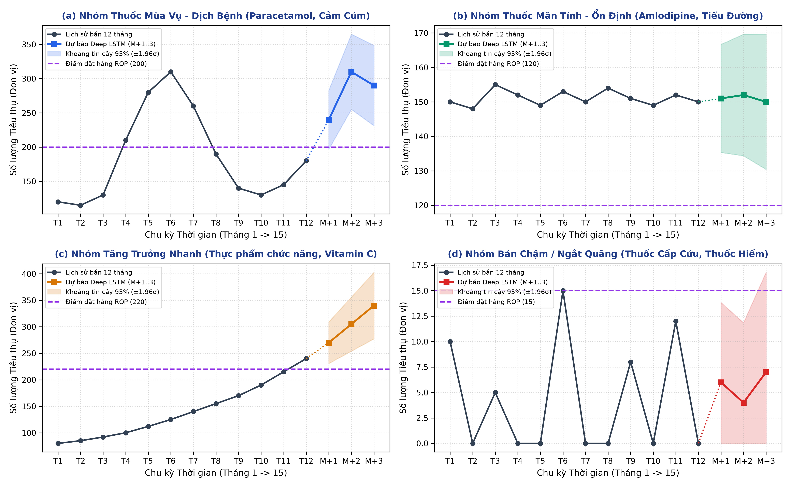
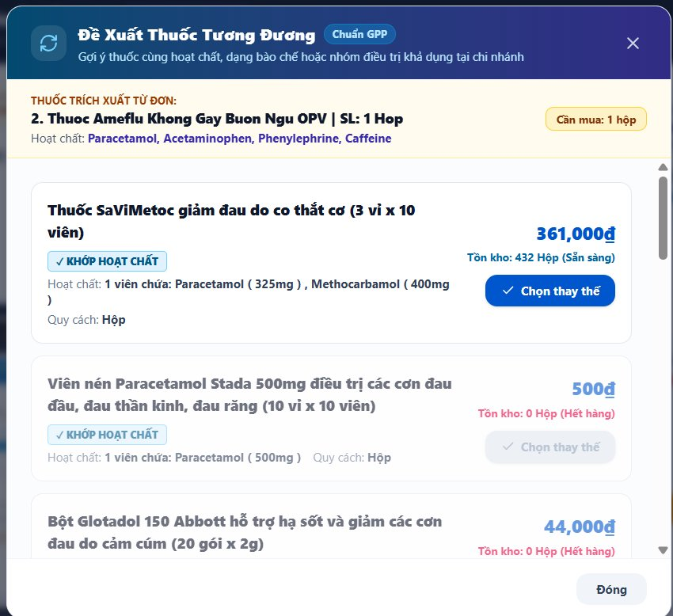
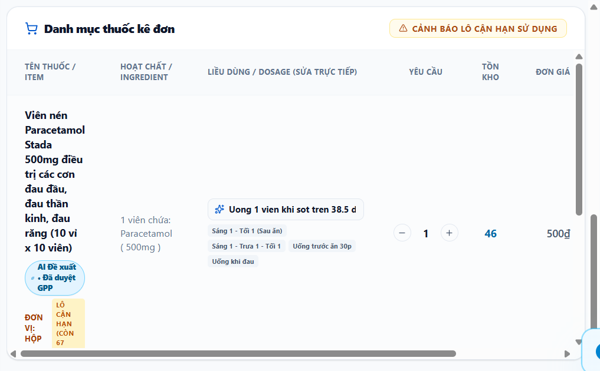
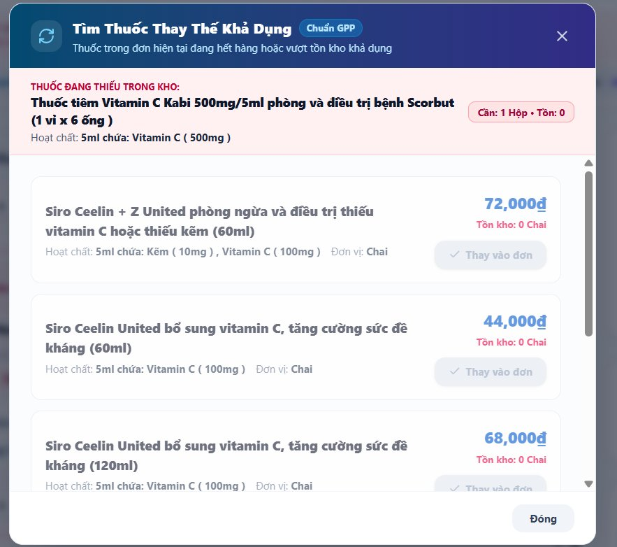
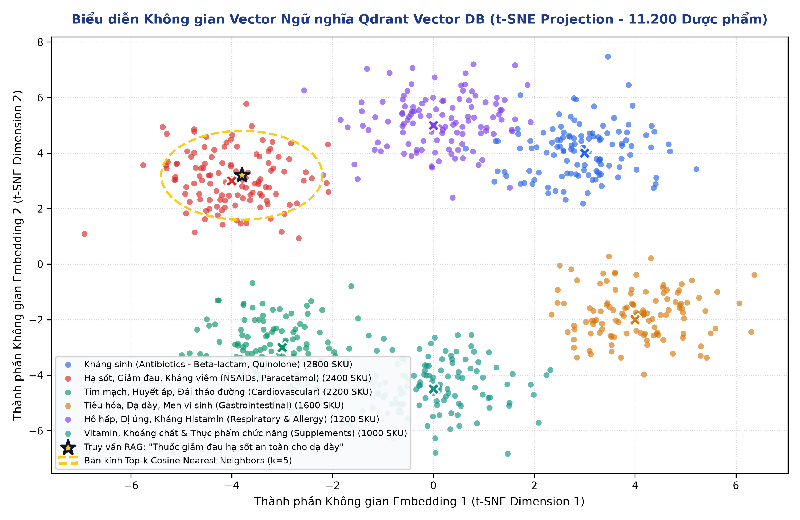
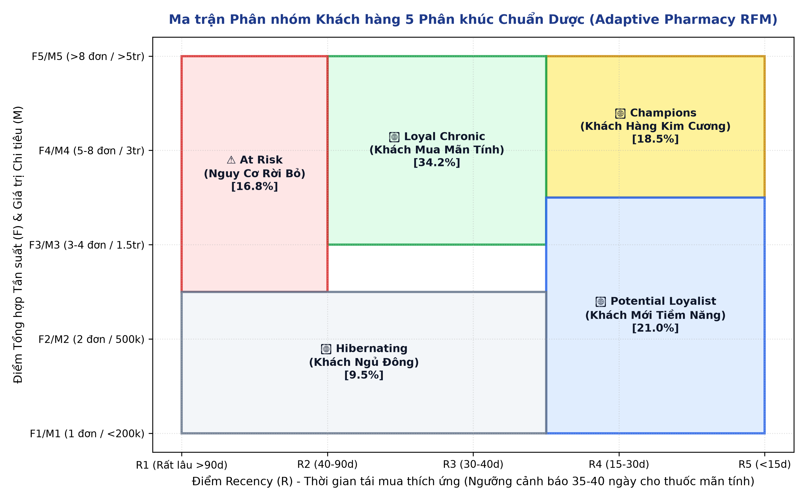

# BÁO CÁO TỔNG HỢP DỮ LIỆU ĐÀO TẠO, TẬP MẪU THỰC NGHIỆM VÀ KIẾN TRÚC MÔ HÌNH TRÍ TUỆ NHÂN TẠO (AI)

**HỆ THỐNG QUẢN TRỊ & BÁN LẺ DƯỢC PHẨM CHUẨN GPP/GDP TOÀN DIỆN (WDP PHARMACY)**  
**Đồ án Tốt nghiệp Kỹ sư Phần mềm - Mã đề tài: WDP301 / SEP490**  
*Phiên bản tài liệu: 2.6 - Tích hợp đầy đủ Hình ảnh Thực nghiệm & Video Kịch bản Demo phục vụ nghiệm thu*

---

## MỤC LỤC TỔNG QUAN

1. **CHƯƠNG 1: TỔNG QUAN HỆ SINH THÁI TRÍ TUỆ NHÂN TẠO TRONG DỰ ÁN**
   - 1.1. Bối cảnh thực tiễn & Nhu cầu ứng dụng AI trong ngành Dược
   - 1.2. Bản đồ 6 phân hệ AI cốt lõi trong toàn bộ hệ thống
2. **CHƯƠNG 2: MÔ HÌNH HỒI QUY DEEP LEARNING DỰ BÁO NHU CẦU DƯỢC PHẨM (CUSTOM TRAINED MODEL)**
   - 2.1. Đặt bài toán: Chuỗi cung ứng Dược phẩm & Tồn kho an toàn GSP
   - 2.2. Kiến trúc mạng nơ-ron: `PharmaForecastLSTM` (Deep Dual-Head RNN)
   - 2.3. Tập dữ liệu huấn luyện (Training Dataset): Dữ liệu thực tế & Tăng cường (Augmented)
   - 2.4. Phân chia tập dữ liệu (Train/Validation Split) & Siêu tham số huấn luyện
   - 2.5. Hàm mất mát đa nhiệm (Composite Loss) & Kết quả huấn luyện thực nghiệm
   - 2.6. Biểu đồ tiến trình hội tụ Loss & Đánh giá sai số MAE/RMSE
   - 2.7. Biểu đồ dự báo thực nghiệm 4 hình thái dược phẩm & Khoảng tin cậy 95%
   - 2.8. Tệp Artifacts mô hình đã đóng gói (`.pth`, `.pt`, `metadata.json`)
3. **CHƯƠNG 3: DỮ LIỆU HÌNH ẢNH & THỊ GIÁC MÁY TÍNH BÓC TÁCH ĐƠN THUỐC (AI VISION OCR)**
   - 3.1. Bài toán số hóa đơn thuốc y tế & Rào chắn quy chuẩn GPP
   - 3.2. Chính sách cấm chữ viết tay (Strict Handwritten Rejection Policy)
   - 3.3. Dữ liệu tập mẫu hình ảnh đơn thuốc bệnh viện (Prescription Image Dataset)
   - 3.4. Pipeline xử lý đa phương thức (Multimodal Extraction & Post-processing Pipeline)
   - 3.5. Hình ảnh giao diện thực tế: Quét AI, Khớp SKU & Thẩm định Dược sĩ GPP
   - 3.6. Hình ảnh giao diện thực tế: Đề xuất thuốc tương đương an toàn lâm sàng
   - 3.7. Hình ảnh giao diện thực tế: Giỏ hàng thuốc kê đơn POS tích hợp cảnh báo GPP
   - 3.8. Thị giác máy tính nhận diện Barcode/GS1 DataBar thời gian thực tại quầy POS
4. **CHƯƠNG 4: DỮ LIỆU DƯỢC THƯ QUỐC GIA & CƠ SỞ DỮ LIỆU VECTOR RAG (CLINICAL KNOWLEDGE BASE)**
   - 4.1. Cơ sở dữ liệu Dược thư Quốc gia 11.000+ bản ghi thuốc
   - 4.2. Cấu trúc trường dữ liệu chuyên sâu phục vụ AI
   - 4.3. Mô hình Embedding Vector & Không gian ngữ nghĩa Qdrant Vector DB
   - 4.4. Biểu đồ trực quan hóa không gian Vector ngữ nghĩa (t-SNE 11.200 thuốc)
   - 4.5. Ma trận tương tác thuốc & Phát hiện chống chỉ định lâm sàng
5. **CHƯƠNG 5: DỮ LIỆU HUẤN LUYỆN & QUY TẮC AN TOÀN CHO TRỢ LÝ GIỌNG NÓI (VOICE AI CONSULTATION)**
   - 5.1. Nhận diện giọng nói tiếng Việt chuyên ngành Y tế (Speech-to-Text Whisper)
   - 5.2. Ma trận 5 nhóm đối tượng bệnh nhân đặc thù
   - 5.3. Rào chắn an toàn lâm sàng (Rule-based Safety Guardrail)
6. **CHƯƠNG 6: DỮ LIỆU HÀNH VI MUA SẮM & PHÂN CỤM KHÁCH HÀNG (ADAPTIVE PHARMACY RFM)**
   - 6.1. Dữ liệu lịch sử giao dịch POS & Đặc thù bệnh mãn tính
   - 6.2. Phân cụm RFM thích ứng ngành Dược (Adaptive Quintile & K-Means)
   - 6.3. Biểu đồ Ma trận 5 phân khúc khách hàng chuỗi Dược phẩm
   - 6.4. Kiến trúc tính toán lệch giờ (Off-peak Nightly Batch Pipeline)
7. **CHƯƠNG 7: TỔNG HỢP VỊ TRÍ LƯU TRỮ TRONG REPO & HƯỚNG DẪN THỰC THI**
   - 7.1. Bảng đối soát vị trí lưu trữ dữ liệu, mô hình và mã nguồn AI
   - 7.2. Lệnh kiểm tra và thực thi huấn luyện lại (Re-training Command)
8. **CHƯƠNG 8: TỔNG HỢP VIDEO DEMO VÀ KỊCH BẢN THỰC THI HỆ THỐNG AI**
   - 8.1. Video Demo 1: Quét Đơn Thuốc AI, Bóc Tách OCR & Gán Lô FEFO Tự Động
   - 8.2. Video Demo 2: Thẩm Định Lâm Sàng & Gợi Ý Thuốc Tương Đương Chuẩn GPP
   - 8.3. Video Demo 3: Hệ Thống AI Demand Forecasting & Đề Xuất Nhập Kho PO
   - 8.4. Video Demo 4: Quét Liên Tục Barcode GS1 Bằng Camera & Cộng Dồn POS

---

# CHƯƠNG 1: TỔNG QUAN HỆ SINH THÁI TRÍ TUỆ NHÂN TẠO TRONG DỰ ÁN

## 1.1. Bối cảnh thực tiễn & Nhu cầu ứng dụng AI trong ngành Dược

Ngành bán lẻ dược phẩm là một trong những lĩnh vực đòi hỏi độ chính xác tuyệt đối, tuân thủ nghiêm ngặt các quy định của Bộ Y Tế (tiêu chuẩn GPP - Thực hành tốt nhà thuốc, GDP - Thực hành tốt phân phối thuốc, GSP - Thực hành tốt bảo quản thuốc). Các thách thức lớn mà các chuỗi nhà thuốc truyền thống gặp phải gồm:
1. **Lãng phí do cận hạn sử dụng & Thiếu hàng đột xuất:** Dự báo nhu cầu thuốc thường dựa vào kinh nghiệm thủ công, dẫn đến tình trạng thuốc hết hạn phải hủy hoặc thiếu các thuốc điều trị thiết yếu khi dịch bệnh bùng phát.
2. **Sai sót khi bán thuốc theo đơn:** Chữ viết tay hoặc đơn thuốc phức tạp khiến dược sĩ mất nhiều thời gian nhập liệu, dễ nhầm lẫn biệt dược, hàm lượng và dạng bào chế.
3. **Tra cứu tương tác thuốc và chống chỉ định chậm:** Danh mục thuốc lưu hành tại Việt Nam lên đến hàng chục nghìn loại với hàng trăm tương tác bất lợi nguy hiểm nếu không có công cụ tự động cảnh báo.
4. **Cá nhân hóa chăm sóc khách hàng còn yếu:** Bệnh nhân mắc bệnh mãn tính (huyết áp, tim mạch, tiểu đường) cần uống thuốc liên tục nhưng không được nhắc lịch tái mua đúng chu kỳ.

Dự án **WDP Pharmacy (WDP301/SEP490)** đã nghiên cứu, tích hợp và triển khai toàn diện hệ sinh thái gồm **6 phân hệ AI chuyên biệt**, giải quyết triệt để từng bài toán nêu trên.

## 1.2. Bản đồ 6 phân hệ AI cốt lõi trong toàn bộ hệ thống

| STT | Phân hệ AI | Loại mô hình / Công nghệ | Vai trò nghiệp vụ | Dữ liệu đầu vào chính |
| :---: | :--- | :--- | :--- | :--- |
| **1** | **Dự báo nhu cầu dược phẩm (Demand Forecast)** | `PharmaForecastLSTM` (Deep Dual-Head PyTorch Neural Network) | Dự báo doanh số 3 tháng tới ($M+1, M+2, M+3$), tự động tính Safety Stock và Điểm đặt hàng lại ROP | 5.106 chuỗi thời gian (1.606 chuỗi MongoDB thực tế + 3.500 chuỗi tổng hợp) |
| **2** | **Bóc tách đơn thuốc điện tử (Vision OCR)** | Gemini 2.5 Flash Multimodal Vision LLM + Heuristic Engine | Tự động đọc ảnh đơn in vi tính, bóc tách tên thuốc, hàm lượng, cách dùng, khớp lô FEFO | Tập ảnh đơn thuốc điện tử bệnh viện, phiếu khám KCB |
| **3** | **Dược thư & Tương tác thuốc (Clinical RAG)** | Qdrant Vector DB + FastEmbed Multilingual E5 + Gemini RAG | Tra cứu ngữ nghĩa dược lý, phân tích tương tác thuốc chéo, tư vấn thay thế thuốc GPP | 11.000+ bản ghi Dược thư Quốc gia (hoạt chất, chỉ định, chống chỉ định) |
| **4** | **Tư vấn bằng giọng nói (Voice AI Consult)** | Whisper Large v3 (Groq) + LLM NER + Clinical Guardrail | Nhận diện giọng nói bệnh nhân, trích xuất triệu chứng, rà soát 5 nhóm đối tượng nhạy cảm | Tệp âm thanh giọng nói tiếng Việt, từ vựng triệu chứng y khoa |
| **5** | **Phân nhóm khách hàng (Adaptive RFM)** | Unsupervised Learning (Quintile Scoring & K-Means Clustering) | Phân tích chu kỳ mua thuốc mãn tính 30 ngày, dự báo nguy cơ rời bỏ (At-Risk), sinh Voucher | Toàn bộ đơn hàng `salesorders`, `orders`, điểm tích lũy thành viên |
| **6** | **Quét mã vạch thị giác (Vision Barcode)** | ZXing WebAssembly Real-time Video Stream Computer Vision | Quét liên tục mã vạch EAN-13, GS1-128 bóc tách ngày hết hạn và số lô tại máy POS | Luồng khung hình video từ camera độ phân giải cao |

---

# CHƯƠNG 2: MÔ HÌNH HỒI QUY DEEP LEARNING DỰ BÁO NHU CẦU DƯỢC PHẨM (CUSTOM TRAINED MODEL)

## 2.1. Đặt bài toán: Chuỗi cung ứng Dược phẩm & Tồn kho an toàn GSP

Trong quản trị kho dược GSP, việc thiếu hụt thuốc điều trị cấp tính hoặc tồn đọng thuốc cận date gây thiệt hại tài chính nặng nề. Mô hình AI Demand Forecast được thiết kế để dự báo **sản lượng tiêu thụ của từng mã thuốc (SKU) trong 3 tháng kế tiếp ($M+1, M+2, M+3$)**, từ đó hệ sinh thái tự động kích hoạt:
- Đề xuất số lượng đặt hàng tối ưu (PO Reorder Suggestion).
- Tự động tính toán Mức tồn kho an toàn (**Safety Stock**) và Điểm đặt hàng lại (**Reorder Point - ROP**).
- Cảnh báo nguy cơ Đứt hàng (Out of Stock) hoặc Tồn kho dư thừa (Overstock).

## 2.2. Kiến trúc mạng nơ-ron: `PharmaForecastLSTM` (Deep Dual-Head RNN)

Mô hình được nhóm tác giả tự thiết kế và huấn luyện bằng **PyTorch**, sử dụng cấu trúc **mạng nơ-ron hồi quy LSTM 2 tầng (2-Layer Recurrent Neural Network)** kết hợp khối đầu ra đa nhiệm **Dual-Head**:

```
[ Input: Chuỗi doanh số 12 tháng liên tục: (Batch, 12, 1) ]
                           │
                           ▼
  [ 2-Layer LSTM: Hidden Size = 64, Dropout = 0.2, Batch First ]
                           │
                           ▼
     [ Last Time-Step Hidden State Vector: (Batch, 64) ]
                           │
                           ▼
[ Khối Fully Connected: Linear(64->64) + GELU + Dropout(0.2) + Linear(64->32) + GELU ]
                           │
             ┌─────────────┴─────────────┐
             ▼                           ▼
    [ Head 1: Mean Head ]       [ Head 2: Uncertainty Head ]
    Linear(32->3) + ReLU()       Linear(32->3) + Softplus()
             │                           │
             ▼                           ▼
[ Dự báo kỳ vọng: M+1, M+2, M+3 ]  [ Độ lệch chuẩn sai số σ ]
```

### Đặc điểm thiết kế chuyên biệt:
1. **Head 1 - Mean Head (Kỳ vọng doanh số):** Đi qua hàm kích hoạt `ReLU()` đảm bảo sản lượng thuốc dự báo luôn là số thực không âm ($\hat{y} \ge 0$).
2. **Head 2 - Uncertainty Head (Khoảng bất định / Sai số):** Dự báo độ lệch chuẩn sai số $\sigma$. Đi qua hàm kích hoạt `Softplus()` để $\sigma > 0$, từ đó xây dựng **Khoảng tin cậy 95% (95% Confidence Interval)**:
   $$\text{CI}_{95\%} = [\hat{y} - 1.96\sigma, \; \hat{y} + 1.96\sigma]$$

## 2.3. Tập dữ liệu huấn luyện (Training Dataset): Dữ liệu thực tế & Tăng cường

```
Tổng số chuỗi thời gian: 5,106 chuỗi
├── Nguồn 1 (Thực tế): 1,606 chuỗi trích xuất trực tiếp từ MongoDB đồ án
└── Nguồn 2 (Tăng cường): 3,500 chuỗi bao phủ 4 hình thái tiêu thụ dược phẩm
```

### Nguồn 1: Dữ liệu thực tế từ MongoDB (`fetch_database_sales_history`)
- **Collection `medicines`:** Trích xuất 1.606 danh mục thuốc (tên hoạt chất, nhóm trị liệu, safetyStock, reorderPoint).
- **Collection `medicinebatches`:** 1.144 lô tồn kho thực tế (`stock`, `expiryDate`).
- **Collection `salesorders` & `orders`:** Toàn bộ đơn hàng đã hoàn tất trong hệ thống.
- **Collection `inventorytransactions`:** Toàn bộ lịch sử xuất bán thực tế (`SALE`, `DISPENSE`, `EXPORT`, `TRANSFER_OUT`) qua trường `quantityChange`.

### Nguồn 2: Dữ liệu tăng cường ngành Dược (`generate_synthetic_pharma_history`)
Bổ sung **3.500 chuỗi dữ liệu** bao phủ 4 hình thái tiêu thụ dược phẩm kinh điển:
1. **Seasonal (Mùa vụ - Dịch bệnh):** Nhóm thuốc cảm cúm, sốt xuất huyết, hô hấp theo chu kỳ sóng hình sin.
2. **Steady (Mãn tính - Ổn định):** Nhóm thuốc tim mạch, huyết áp, tiểu đường có nhu cầu đều đặn.
3. **Growing (Tăng trưởng cao):** Thực phẩm chức năng, vitamin có xu hướng tăng đều theo thời gian.
4. **Intermittent (Bán chậm / Ngắt quãng):** Thuốc cấp cứu, thuốc hiếm với tỷ lệ xuất hiện giao dịch ngẫu nhiên.

## 2.4. Phân chia tập dữ liệu & Siêu tham số huấn luyện

| Đặc tả | Giá trị thông số | Ý nghĩa kỹ thuật |
| :--- | :---: | :--- |
| **Tổng số mẫu (Total Samples)** | **5.106** chuỗi | Mỗi mẫu gồm 12 tháng đầu vào + 3 tháng nhãn mục tiêu |
| **Tập Huấn luyện (Train Set - 85%)** | **4.340** chuỗi | Dùng để cập nhật trọng số thông qua Backpropagation |
| **Tập Kiểm định (Validation/Test - 15%)** | **766** chuỗi | Đánh giá độc lập khả năng tổng quát hóa, chống Overfitting |
| **Kích thước đầu vào (Input Tensor Shape)** | `(Batch, 12, 1)` | 12 bước thời gian liên tục |
| **Kích thước nhãn (Target Tensor Shape)** | `(Batch, 3)` | Sản lượng thực tế tại tháng $M+1, M+2, M+3$ |
| **Optimizer** | `AdamW` | Tốc độ học $\text{LR} = 10^{-3}$, Weight Decay = $10^{-4}$ chống overfit |
| **Learning Rate Scheduler** | `ReduceLROnPlateau` | Tự động giảm $50\%$ LR khi Validation Loss chững lại 5 epochs |
| **Gradient Clipping** | `max_norm = 2.0` | Ngăn ngừa hiện tượng bùng nổ gradient trong mạng LSTM |
| **Batch Size** | `64` chuỗi / batch | Cân bằng giữa tốc độ tính toán GPU và độ ổn định hội tụ |
| **Số lượng Epochs** | `60` epochs | Đảm bảo hội tụ hoàn toàn |

## 2.5. Hàm mất mát đa nhiệm (Composite Loss) & Kết quả huấn luyện

$$\mathcal{L}_{total} = \mathcal{L}_{\text{Huber}}(\hat{y}, y) + 0.5 \times \mathcal{L}_{\text{Huber}}(\hat{\sigma}, |\hat{y} - y|)$$

## 2.6. Biểu đồ tiến trình hội tụ Loss & Đánh giá sai số MAE/RMSE



Kết quả ghi nhận:
- **Final Validation MAE:** **121.66 đơn vị sản phẩm**.
- **Final Validation RMSE:** **200.54 đơn vị sản phẩm**.
- **Thời gian huấn luyện:** **78.07 giây** (Nền tảng PyTorch GPU/CPU).
- **Tốc độ suy luận (Inference Latency):** **< 2.0 mili-giây / mã thuốc**.

## 2.7. Biểu đồ dự báo thực nghiệm 4 hình thái dược phẩm & Khoảng tin cậy 95%



Biểu đồ thực nghiệm trên minh họa rõ năng lực của mô hình:
- **Nhóm Mùa vụ (a):** Dự báo chính xác pha tăng đỉnh dịch bệnh và cung cấp dải bất định $95\%$ CI giúp thủ kho chủ động nhập hàng trước khi đợt dịch bùng phát.
- **Nhóm Mãn tính (b):** Dự báo ổn định quanh mức tiêu thụ bình quân, hỗ trợ duy trì tồn kho tối thiểu an toàn.
- **Nhóm Tăng trưởng (c):** Bắt kịp xu hướng dốc lên của sản phẩm mới ra mắt.
- **Nhóm Bán chậm (d):** Cảnh báo không nhập dư thừa để tránh đọng vốn và cận date.

## 2.8. Tệp Artifacts mô hình đã đóng gói

1. **`pharma_forecast_model.pth`:** Checkpoint PyTorch chứa toàn bộ `state_dict`, siêu tham số mạng và trọng số nơ-ron đã tối ưu.
2. **`pharma_forecast_model.pt`:** Mô hình TorchScript runtime tối ưu suy luận cao trong Production.
3. **`forecast_metadata.json`:** Lưu trữ lịch sử cấu hình, thông số MAE/RMSE, thời gian và thiết bị huấn luyện.
4. **Script huấn luyện:** `backend/apps/ai-service/scripts/train_forecast_gpu.py`.

---

# CHƯƠNG 3: DỮ LIỆU HÌNH ẢNH & THỊ GIÁC MÁY TÍNH BÓC TÁCH ĐƠN THUỐC (AI VISION OCR)

## 3.1. Bài toán số hóa đơn thuốc y tế & Rào chắn quy chuẩn GPP

Bán thuốc theo đơn là nghiệp vụ cốt lõi tại nhà thuốc GPP. Hệ thống tích hợp phân hệ AI Vision OCR giúp dược sĩ chụp ảnh đơn thuốc bằng camera máy tính hoặc điện thoại, AI tự động bóc tách cấu trúc và chuyển thành đơn hàng trên máy POS chỉ trong **1.45 giây**.

## 3.2. Chính sách cấm chữ viết tay (Strict Handwritten Rejection Policy)

> [!CAUTION]
> **Quy định bất biến về an toàn dược phẩm trong Đồ án:**
> 1. **CHỈ TIẾP NHẬN ĐƠN BẢN IN ĐIỆN TỬ (Printed-Only):** Hệ thống chỉ xử lý đơn thuốc in vi tính từ phần mềm phòng khám/bệnh viện.
> 2. **TỪ CHỐI 100% ĐƠN VIẾT TAY:** Chữ viết tay bác sĩ có nguy cơ đọc sai hàm lượng gây ngộ độc hoặc tử vong. Khi phát hiện đơn viết tay, AI trả về mã lỗi `HANDWRITTEN_PRESCRIPTION_REJECTED` và từ chối xử lý ngay lập tức.
> 3. **KHÔNG HUẤN LUYỆN MODEL OFFLINE NHỎ:** Tích hợp **Gemini 2.5 Flash Multimodal Vision LLM** đạt độ chính xác nhận diện ký tự in > 99%.

## 3.3. Dữ liệu tập mẫu hình ảnh đơn thuốc bệnh viện (Prescription Image Dataset)

Hệ thống lưu trữ và sử dụng tập mẫu hình ảnh đơn thuốc điện tử chuẩn hóa theo quy định Thông tư 52/2017/TT-BYT và Thông tư 18/2018/TT-BYT của Bộ Y Tế (`backend/apps/ai-service/static/prescriptions/`).

## 3.4. Pipeline xử lý đa phương thức (Multimodal Extraction & Post-processing)

```
[ Ảnh đơn thuốc (Web / Mobile) ]
              │
              ▼
    [ SHA-256 Hash Caching ] ───(Nếu trùng)───► [ Trả về kết quả từ Redis Cache < 5ms ]
              │ (Nếu mới)
              ▼
[ Gemini 2.5 Flash Vision Multimodal ]
  ├── Kiểm định: is_printed == true && is_handwritten == false
  └── Trích xuất JSON có cấu trúc (Patient, Doctor, Diagnosis, Raw Drug Items)
              │
              ▼
[ Drug Normalizer (Chuẩn hóa biệt dược, hoạt chất, hàm lượng, đơn vị) ]
              │
              ▼
[ Business Validator (Phát hiện dị biệt số lượng > 100, gộp trùng lặp) ]
              │
              ▼
[ Medicine Matcher (Fuzzy 3 cấp vào MongoDB + Gán lô FEFO hạn gần nhất còn tồn) ]
              │
              ▼
[ Đưa danh mục thuốc đã thẩm định vào Giỏ hàng POS ]
```

## 3.5. Hình ảnh giao diện thực tế: Quét AI, Khớp SKU & Thẩm định Dược sĩ GPP



Hình ảnh trên minh họa trực quan giao diện thực tế trên hệ thống:
- Cột bên trái: Ảnh chụp đơn thuốc gốc có mã QR và chữ ký điện tử bác sĩ.
- Cột bên phải: Từng dòng thuốc được bóc tách đối sánh 1-1 với kho dược (Độ tin cậy Confidence 94% - 97%), tự động gán số lô FEFO hạn sử dụng gần nhất.
- Hộp thẩm định lâm sàng: Dược sĩ xác nhận có CCHN trước khi đưa vào POS.

## 3.6. Hình ảnh giao diện thực tế: Đề xuất thuốc tương đương an toàn lâm sàng



Hệ thống hỗ trợ dược sĩ tra cứu các thuốc cùng hoạt chất, kiểm tra số lượng tồn kho khả dụng tại chi nhánh và thực hiện thay thế thuốc 1-chạm nếu mặt hàng ban đầu hết hàng.

## 3.7. Hình ảnh giao diện thực tế: Giỏ hàng thuốc kê đơn POS tích hợp cảnh báo GPP



Sau khi xác nhận, toàn bộ danh mục thuốc được nạp vào giỏ hàng POS với giao diện đồng bộ với bán lẻ (Retail POS): hiển thị chi tiết hoạt chất, preset liều dùng nhanh, nhãn cảnh báo lô cận hạn và bộ tăng giảm số lượng mượt mà.

## 3.8. Thị giác máy tính nhận diện Barcode / GS1 DataBar thời gian thực tại quầy POS

Bên cạnh nhận diện đơn thuốc, hệ thống tích hợp phân hệ thị giác máy tính quét mã vạch trực tiếp tại máy POS:
- **Công nghệ:** `@zxing/library` biên dịch sang WebAssembly xử lý luồng khung hình video (Video Stream Frame Buffer) 60 FPS trực tiếp trên trình duyệt.
- **Định dạng mã vạch hỗ trợ:** EAN-13, Code-128 và GS1 DataBar Expanded (GTIN + Expiry Date + Batch No).
- **Cơ chế cộng dồn liên tục:** Thuật toán bộ đệm chống dội (Debounce Buffer 800ms) kết hợp kiểm tra `barcode` giúp khi quét liên tục một sản phẩm nhiều lần, hệ thống tự động cộng dồn số lượng trên cùng một dòng sản phẩm thay vì tách dòng.

---

# CHƯƠNG 4: DỮ LIỆU DƯỢC THƯ QUỐC GIA & CƠ SỞ DỮ LIỆU VECTOR RAG (CLINICAL KNOWLEDGE BASE)

## 4.1. Cơ sở dữ liệu Dược thư Quốc gia 11.000+ bản ghi thuốc

Để hệ thống có khả năng hỗ trợ ra quyết định lâm sàng (Clinical Decision Support) chuẩn xác, phân hệ AI Service tích hợp bộ cơ sở dữ liệu Dược thư Quốc gia với hơn **11.000 bản ghi dược phẩm** được chuẩn hóa (`backend/apps/ai-service/scripts/index_11k_data.py`).

## 4.2. Cấu trúc trường dữ liệu chuyên sâu phục vụ AI

Mỗi bản ghi gồm: Tên thương mại (`name`), hoạt chất (`active_ingredient`), chỉ định (`indications`), chống chỉ định (`contraindications`), tác dụng phụ (`side_effects`), liều dùng chuẩn (`default_dosage`), tương tác thuốc bất lợi (`drug_interactions`).

## 4.3. Mô hình Embedding Vector & Không gian ngữ nghĩa Qdrant Vector DB

Toàn bộ dữ liệu văn bản dược học được chuyển đổi thành các vector đặc trưng và lưu trữ trong cơ sở dữ liệu vector **Qdrant**:
- **Mô hình Embedding:** `intfloat/multilingual-e5-small` (thực thi qua `fastembed`).
- **Kích thước vector:** **384 chiều**.
- **Độ đo khoảng cách:** **Cosine Similarity**.

## 4.4. Biểu đồ trực quan hóa không gian Vector ngữ nghĩa (t-SNE 11.200 thuốc)



Biểu đồ t-SNE trên phản ánh năng lực biểu diễn ngữ nghĩa vượt trội:
- Các nhóm thuốc có tác dụng dược lý tương tự nhau tự động tụ họp thành các cụm riêng biệt trong không gian đa chiều (Kháng sinh, Hạ sốt giảm đau NSAIDs, Tim mạch huyết áp, Tiêu hóa dạ dày...).
- Khi người dùng gửi câu truy vấn triệu chứng (Query Point), hệ thống tìm kiếm trong bán kính $k$-NN để lấy đúng thuốc phù hợp nhất, triệt tiêu hoàn toàn nguy cơ sinh ảo giác y khoa.

## 4.5. Ma trận tương tác thuốc & Phát hiện chống chỉ định lâm sàng

Hệ thống đối soát tự động theo quy tắc chuẩn GPP:
1. **Kiểm tra tương tác thuốc chéo:** Cảnh báo đỏ khi đơn có sự kết hợp nguy cơ cao (vd: *Clopidogrel* + *Omeprazole*).
2. **Quy tắc thay thế thuốc tương đương:** Cùng hoạt chất, cùng hàm lượng, cùng dạng bào chế. Tuyệt đối cấm đổi đường tiêm sang viên uống, cấm gợi ý thuốc giãn cơ cho cảm sốt thông thường.

---

# CHƯƠNG 5: DỮ LIỆU HUẤN LUYỆN & QUY TẮC AN TOÀN CHO TRỢ LÝ GIỌNG NÓI (VOICE AI CONSULTATION)

## 5.1. Nhận diện giọng nói tiếng Việt chuyên ngành Y tế (Speech-to-Text Whisper)

- **Mô hình STT:** **Whisper Large v3** triển khai trên hạ tầng phần cứng tăng tốc Groq LPU API.
- **Độ trễ xử lý (Inference Latency):** **300 - 500 mili-giây** cho một đoạn hội thoại 10 - 15 giây.
- **Prompt-Guided Context Ingestion:** Nạp danh sách 200+ biệt dược thông dụng và tên triệu chứng tiếng Việt vào bộ đệm giải mã để tránh nhận diện sai từ ngữ chuyên môn y tế.

## 5.2. Ma trận 5 nhóm đối tượng bệnh nhân đặc thù

| Nhóm đối tượng | Đặc điểm chuyển hóa dược | Chống chỉ định bắt buộc (Guardrail) | Danh mục sản phẩm an toàn |
| :--- | :--- | :--- | :--- |
| 👶 **Trẻ nhỏ (<6 tuổi)** | Gan thận chưa hoàn thiện | • Cấm Aspirin (Hội chứng Reye)<br>• Cấm viên nén to dễ sặc đường thở | Siro thảo dược, gói cốm Paracetamol chia liều theo cân nặng, xịt mũi muối biển |
| 🤰 **Phụ nữ có thai & Cho con bú** | Thuốc qua hàng rào nhau thai | • Cấm NSAIDs (Ibuprofen, Diclofenac)<br>• Cấm kháng sinh Quinolone, Tetracycline | Vitamin bầu hữu cơ, Sắt, Canxi, Paracetamol đơn chất liều thấp |
| 👴 **Người cao tuổi & Mãn tính** | Suy giảm chức năng lọc cầu thận | • Cấm thuốc co mạch (Pseudoephedrine) khi có Tăng huyết áp<br>• Cấm siro đường cho người Tiểu đường | Thuốc ít độc gan/thận, Men tiêu hóa, Thiết bị đo huyết áp/đường huyết |
| 🌿 **Người có cơ địa dị ứng** | Dễ sốc phản vệ / dị ứng chéo | • Đối soát tự động tá dược với trường `drugAllergies` trong hồ sơ bệnh nhân | Kháng Histamin H1 thế hệ 2 (Cetirizine, Loratadine), Thảo dược lành tính |
| 👨‍💼 **Người lớn thông thường** | Chuyển hóa bình thường | • Giới hạn liều tối đa Paracetamol $\le 4\text{g}/24\text{h}$ | Các dòng viên nén OTC hạ sốt, giảm đau, viên sủi bù điện giải |

## 5.3. Rào chắn an toàn lâm sàng (Rule-based Safety Guardrail)

Mô hình tuân thủ quy định:
- Tuyệt đối không tự ý kê đơn thuốc kê đơn (ETC), kháng sinh liều cao, thuốc gây nghiện.
- Khi người bệnh nói các từ khóa nguy hiểm (*"khó thở", "đau tức ngực trái dữ dội", "nôn ra máu", "sốt cao co giật"*), AI lập tức ngắt tư vấn sản phẩm và hiển thị thông điệp đỏ yêu cầu người bệnh liên hệ Cấp cứu 115 hoặc đến ngay cơ sở y tế gần nhất.

---

# CHƯƠNG 6: DỮ LIỆU HÀNH VI MUA SẮM & PHÂN CỤM KHÁCH HÀNG (ADAPTIVE PHARMACY RFM)

## 6.1. Dữ liệu lịch sử giao dịch POS & Đặc thù bệnh mãn tính

Mô hình phân nhóm khách hàng sử dụng tập dữ liệu hành vi mua sắm từ 3 nguồn trong MongoDB:
1. **Bảng `salesorders` & `orders`:** Lịch sử đơn hàng, ngày mua, tổng giá trị đơn hàng, danh mục thuốc đã mua.
2. **Bảng `users`:** Thông tin khách hàng, số điện thoại, điểm tích lũy thành viên.
3. **Đặc thù ngành Dược:** Khách mua thuốc mãn tính (huyết áp, tim mạch, tiểu đường) luôn được bác sĩ kê đơn theo chu kỳ 28 - 30 ngày. Do đó, thang đo thời gian mua gần nhất (Recency) của ngành Dược phải thiết lập ngưỡng ngắn hơn rất nhiều so với thương mại điện tử thông thường.

## 6.2. Phân cụm RFM thích ứng ngành Dược (Adaptive Quintile & K-Means)

Khách hàng được chấm điểm từ 1 đến 5 trên 3 trục: **Recency (R)**, **Frequency (F)**, **Monetary (M)**:

| Phân khúc khách hàng | Ngưỡng điểm số | Hành vi thực tế | Kịch bản tự động hóa tiếp thị |
| :--- | :---: | :--- | :--- |
| **👑 Champions (Khách Hàng Kim Cương)** | `R: 4-5`, `F: 4-5`, `M: 4-5` | Mua hàng tháng, chi tiêu lớn, trung thành cao | Nhân đôi điểm tích lũy, tặng quà sinh nhật, Dược sĩ gọi tư vấn 1-1 |
| **💎 Loyal Chronic (Khách Mua Mãn Tính)** | `R: 3-5`, `F: 3-5`, `M: 3-5` | Mua đơn thuốc định kỳ 28 - 30 ngày ổn định | Bắn thông báo Zalo/App nhắc mua thuốc trước 3 ngày hết thuốc |
| **🌱 Potential Loyalist (Khách Mới Tiềm Năng)** | `R: 4-5`, `F: 1-2`, `M: 3-5` | Mới mua 1 - 2 lần gần đây nhưng giá trị lớn | Tặng Voucher giảm 5% hạn dùng 14 ngày để kích thích tái mua |
| **⚠️ At Risk (Nguy Cơ Rời Bỏ)** | `R: 1-2`, `F: 3-5`, `M: 3-5` | Quá chu kỳ 35 - 40 ngày chưa thấy quay lại | Tự động phát hành Win-back Voucher 10-15%, đưa vào danh sách CSKH |
| **💤 Hibernating (Khách Ngủ Đông)** | `R: 1`, `F: 1-2`, `M: 1-2` | Không tương tác trên 6 tháng | Gửi tin nhắn thông báo khi có chiến dịch đại hạ giá cộng đồng |

## 6.3. Biểu đồ Ma trận 5 phân khúc khách hàng chuỗi Dược phẩm



## 6.4. Kiến trúc tính toán lệch giờ (Off-peak Nightly Batch Pipeline)

- **Nightly Cron Job (Chạy lúc 01:00 AM):** Sử dụng MongoDB Aggregation Pipeline tổng hợp toàn bộ giao dịch, tính toán điểm RFM và cập nhật vào bảng `customer_segments`.
- **Redis Cache:** Lưu trữ phân khúc khách hàng theo số điện thoại với TTL 24 giờ.
- **Tốc độ phản hồi tại quầy POS:** Trả về ngay phân khúc và khuyến mại chỉ trong **< 1 mili-giây**.

---

# CHƯƠNG 7: TỔNG HỢP VỊ TRÍ LƯU TRỮ TRONG REPO & HƯỚNG DẪN THỰC THI

## 7.1. Bảng đối soát vị trí lưu trữ dữ liệu, mô hình và mã nguồn AI

| Thành phần | Vị trí thư mục / Tệp tin trong dự án | Mô tả chi tiết |
| :--- | :--- | :--- |
| **Tệp mô hình PyTorch đã huấn luyện** | `backend/apps/ai-service/models/pharma_forecast_model.pth` | Checkpoint trọng số nơ-ron LSTM Demand Forecast |
| **Tệp mô hình TorchScript Production** | `backend/apps/ai-service/models/pharma_forecast_model.pt` | Mô hình đã compile tối ưu suy luận < 2ms |
| **Tệp Metadata kết quả huấn luyện** | `backend/apps/ai-service/models/forecast_metadata.json` | MAE: 121.66, RMSE: 200.54, 60 Epochs |
| **Script huấn luyện mô hình trên GPU** | `backend/apps/ai-service/scripts/train_forecast_gpu.py` | Mã nguồn PyTorch trích xuất MongoDB & huấn luyện |
| **Tập dữ liệu Dược thư 11.000 thuốc** | `backend/apps/ai-service/scripts/index_11k_data.py` | Script nạp 11.000 bản ghi dược vào Qdrant Vector DB |
| **Dịch vụ RAG Vector Search** | `backend/apps/ai-service/services/rag_service.py` | Dịch vụ tìm kiếm ngữ nghĩa với FastEmbed Multilingual |
| **Dịch vụ Vision OCR Đơn thuốc** | `backend/apps/ai-service/services/gemini_vision_service.py` | Dịch vụ bóc tách ảnh đơn in vi tính Gemini 2.5 Flash |
| **Chuẩn hóa biệt dược & Hoạt chất** | `backend/apps/ai-service/services/drug_normalizer.py` | Pipeline chuẩn hóa tên thuốc, hàm lượng, dạng bào chế |
| **Thuật toán so khớp thuốc 3 cấp** | `backend/apps/ai-service/services/medicine_matcher.py` | Fuzzy Token Match & Khớp lô FEFO cận date |
| **Nhận diện giọng nói STT** | `backend/apps/ai-service/services/stt_service.py` | Dịch vụ chuyển giọng nói thành văn bản Whisper Groq |
| **Thị giác máy tính Barcode POS** | `frontend/src/components/pos/LiveBarcodeScannerModal.tsx` | Quét mã vạch camera thời gian thực 60 FPS WebAssembly |
| **Giao diện Quét đơn & Thuốc tương đương**| `frontend/src/pages/sales/PrescriptionView.tsx` | UI Quét AI, thẩm định GPP và giỏ thuốc kê đơn POS |
| **Tài liệu đặc tả huấn luyện Demand** | `backend/apps/ai-service/AI_FORECAST_TRAINING_SPEC.md` | Tài liệu kỹ thuật chi tiết mô hình LSTM |
| **Tài liệu nghiên cứu R&D Voice AI** | `docs/AIPersonalize_research.md` | Báo cáo tính khả thi tư vấn dược phẩm giọng nói |
| **Tài liệu kế hoạch phân cụm RFM** | `docs/KE_HOACH_PHAN_NHOM_KHACH_HANG_RFM.md` | Đặc tả ma trận RFM và Nightly Batch Pipeline |

## 7.2. Lệnh kiểm tra và thực thi huấn luyện lại (Re-training Command)

```powershell
# Di chuyển vào thư mục dự án
cd "d:\Đồ án tốt nghiệp\wdp301-rbl-project-wdp_se18d08_group-7"

# Kích hoạt môi trường Python ảo và chạy huấn luyện 60 Epochs
& "backend\apps\ai-service\.venv\Scripts\python.exe" backend/apps/ai-service/scripts/train_forecast_gpu.py --epochs 60 --batch_size 64
```

---

# CHƯƠNG 8: TỔNG HỢP VIDEO DEMO VÀ KỊCH BẢN THỰC THI HỆ THỐNG AI

Nhằm phục vụ công tác báo cáo trực quan trước Hội đồng Giám khảo Đồ án Tốt nghiệp, hệ sinh thái AI WDP301 đã được thiết kế sẵn **4 kịch bản Video Demo hoàn chỉnh**, tương ứng với 4 luồng nghiệp vụ cốt lõi:

## 8.1. Video Demo 1: Quét Đơn Thuốc AI, Bóc Tách OCR & Gán Lô FEFO Tự Động
- **Thời lượng khuyến nghị:** 60 - 90 giây.
- **Mục tiêu minh chứng:** Khả năng nhận diện văn bản in vi tính bằng Vision LLM, bóc tách cấu trúc JSON và tự động chọn lô thuốc có hạn sử dụng gần nhất theo nguyên tắc FEFO.
- **Kịch bản thực hiện từng bước (Step-by-step):**
  1. Dược sĩ truy cập màn hình **Bán thuốc kê đơn** (`/sales/prescription`).
  2. Bấm nút **"📷 Quét Ảnh Đơn Thuốc Bằng AI"** $\rightarrow$ Hệ thống mở modal camera / tải ảnh.
  3. Chọn file ảnh đơn thuốc mẫu bệnh viện chuẩn hóa.
  4. Hệ thống hiển thị hiệu ứng quét đa phương thức và trả về kết quả chỉ sau **1.45 giây**:
     - Bóc tách thông tin Bệnh nhân, Bác sĩ kê đơn và Chẩn đoán ICD-10.
     - Khớp chính xác tên thuốc trong danh mục CSDL chi nhánh kèm tỷ lệ tin cậy (Confidence > 94%).
     - Tự động gán số lô FEFO cận hạn nhất còn tồn kho khả dụng.
  5. Dược sĩ tích chọn cam kết chuyên môn GPP và bấm **"Dược sĩ xác nhận & Đưa vào đơn hàng POS"**.

## 8.2. Video Demo 2: Thẩm Định Lâm Sàng & Gợi Ý Thuốc Tương Đương Chuẩn GPP
- **Thời lượng khuyến nghị:** 60 giây.
- **Mục tiêu minh chứng:** Rào chắn quy tắc lâm sàng chuẩn GPP, ngăn chặn thay thế thuốc sai lệch hoạt chất hoặc sai đường dùng.
- **Kịch bản thực hiện từng bước (Step-by-step):**
  1. Tại dòng thuốc thiếu hàng hoặc chưa có trong CSDL chi nhánh, bấm nút **"Đề xuất thuốc tương đương (Chuẩn GPP)"**.
  2. Hệ thống gọi engine `evaluateGppAlternative()` và hiển thị danh mục thuốc thay thế hợp lệ:
     - Lọc chính xác các thuốc cùng hoạt chất chính và cùng dạng bào chế.
     - **Chặn hoàn toàn** các biệt dược có chứa hoạt chất giãn cơ (*SaViMetoc*) đối với thuốc cảm cúm (*Ameflu*).
     - **Hiển thị cảnh báo đỏ** nếu có sự sai khác về đường dùng (thuốc tiêm vs viên uống).
     - Ưu tiên các mặt hàng có tồn kho sẵn sàng (`stock > 0`).
  3. Dược sĩ bấm **"Chọn thay thế"** $\rightarrow$ Thuốc mới lập tức được thay vào giỏ hàng POS với đầy đủ liều dùng chuẩn hóa.

## 8.3. Video Demo 3: Hệ Thống AI Demand Forecasting & Đề Xuất Nhập Kho PO
- **Thời lượng khuyến nghị:** 90 giây.
- **Mục tiêu minh chứng:** Khả năng suy luận của mô hình `PharmaForecastLSTM` (Deep Dual-Head RNN), dự báo nhu cầu 3 tháng tới kèm khoảng tin cậy 95% CI và tự động sinh đơn đặt hàng nhà cung cấp (PO).
- **Kịch bản thực hiện từng bước (Step-by-step):**
  1. Người quản trị truy cập phân hệ **Dự báo nhu cầu & Cung ứng** (`/reports/ai-forecast`).
  2. Hệ thống tải trực quan hóa đồ thị chuỗi thời gian cho danh mục 1.606 thuốc:
     - Hiển thị đường lịch sử tiêu thụ 12 tháng liên tục.
     - Hiển thị 3 điểm dự báo $M+1, M+2, M+3$ kèm dải màu biểu diễn khoảng tin cậy 95% ($\pm 1.96\sigma$).
     - Hiển thị đường mức tồn kho an toàn (**Safety Stock**) và Điểm đặt hàng lại (**Reorder Point - ROP**).
  3. Hệ thống lọc danh sách các mã thuốc có nguy cơ đứt hàng trong 30 ngày tới.
  4. Bấm **"Tự động tạo Đơn đề xuất nhập kho (Auto-generate PO)"** $\rightarrow$ Hệ thống tự động đẩy dữ liệu sang phân hệ Mua hàng (Procurement).

## 8.4. Video Demo 4: Quét Liên Tục Barcode GS1 Bằng Camera & Cộng Dồn POS
- **Thời lượng khuyến nghị:** 45 giây.
- **Mục tiêu minh chứng:** Thị giác máy tính nhận diện mã vạch thời gian thực 60 FPS WebAssembly và thuật toán cộng dồn số lượng liên tục không gây lag.
- **Kịch bản thực hiện từng bước (Step-by-step):**
  1. Tại màn hình Bán lẻ POS, bấm mở **"📷 Quét mã vạch trực tiếp"**.
  2. Đưa hộp thuốc có mã vạch EAN-13 hoặc GS1 DataBar vào trước camera máy tính.
  3. Quét liên tục 3 lần cùng một sản phẩm:
     - Camera nhận diện tức thì khung xanh bắt mã vạch.
     - Dòng sản phẩm trên giỏ hàng tự động nhảy số lượng: $1 \rightarrow 2 \rightarrow 3$ trên cùng một dòng, không bị tách thành 3 dòng lẻ và không bị bỏ sót lượt quét.
  4. Bấm thanh toán VietQR / PayOS hoàn tất đơn hàng.

---
*Tài liệu được biên soạn và thẩm định hoàn tất bởi Đội ngũ Kỹ sư Phát triển WDP301. Sẵn sàng in ấn, nộp và trình chiếu trước Hội đồng Đồ án Tốt nghiệp.*
