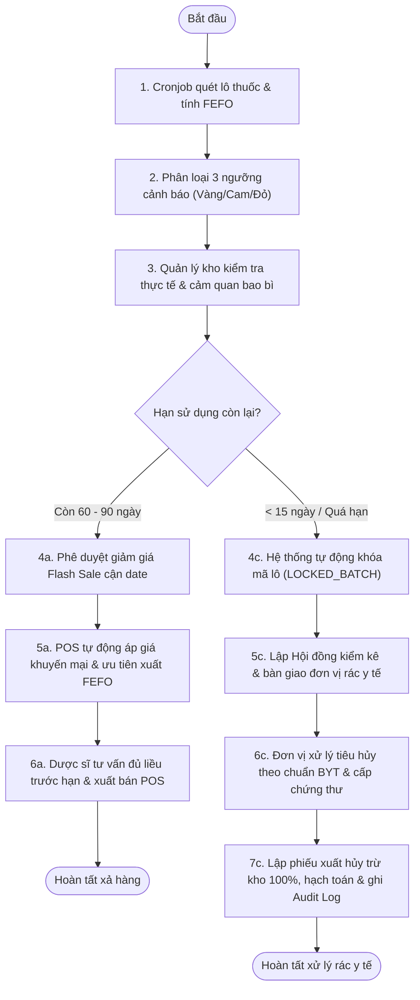
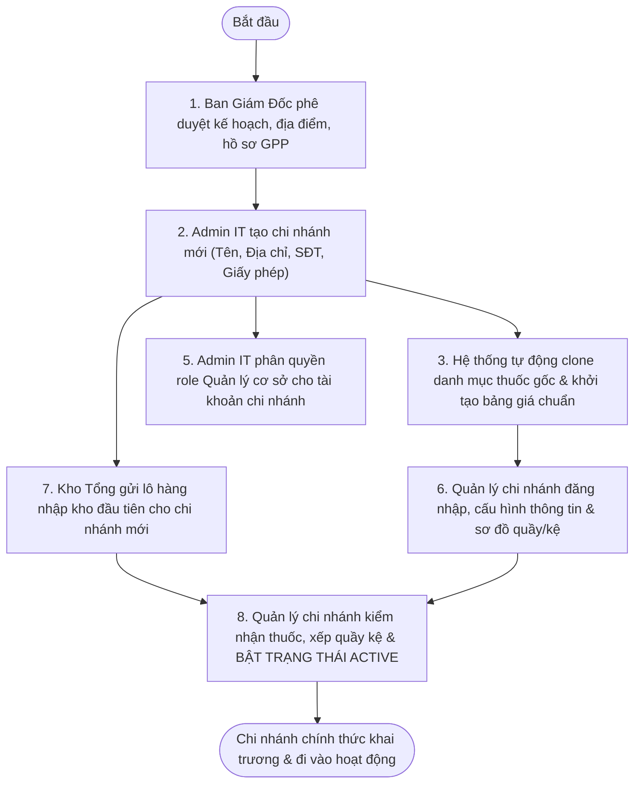

# QUY TRÌNH DEMO CHI TIẾT 2 BUSINESS FLOW & KẾT QUẢ CẦN ĐẠT ĐƯỢC
## Hệ Thống Quản Trị Chuỗi Nhà Thuốc ABC Pharmacy (WDP301 / SEP490)

Tài liệu này cung cấp **kịch bản trình diễn (Demo Playbook & Cheat Sheet)** chi tiết từng bước, dữ liệu mẫu, thao tác thực tế và **bộ tiêu chí kết quả cần đạt được (Expected Outcomes & Verification Criteria)** cho 2 luồng nghiệp vụ cốt lõi của chuỗi nhà thuốc đạt chuẩn GPP/GSP/GDP:

1. **Business Flow 1:** Quy trình Xử lý Thuốc Cận Hạn & Hết Hạn Sử Dụng (*Near-Expiry & Expired Drug Management*).
2. **Business Flow 2:** Thiết lập & Mở Chi nhánh mới (*Branch Setup & Activation*).

---

## 1. TỔNG QUAN HỆ THỐNG VÀ PHÂN QUYỀN VAI TRÒ (ACTORS & ROLES)

| Vai trò (Role) | Tài khoản Demo | Mật khẩu | Phạm vi trách nhiệm trong 2 Flow |
| :--- | :--- | :---: | :--- |
| **Admin IT / Hệ Thống** | `admin@vinapharmacy.com` | `123456` | Tạo mới chi nhánh, clone danh mục thuốc gốc & bảng giá niêm yết chuẩn, phân quyền tài khoản, theo dõi Audit Log toàn chuỗi. |
| **Ban Giám Đốc (Director)** | `director@vinapharmacy.com` | `123456` | Phê duyệt kế hoạch kinh doanh chi nhánh mới, thẩm định hồ sơ pháp lý GPP, phê duyệt ngân sách và xuất hủy thuốc hỏng/hết hạn. |
| **Quản lý Kho (Warehouse Manager)** | `warehouse@vinapharmacy.com` | `123456` | Theo dõi cảnh báo FEFO, kiểm tra thực tế tồn kho, lập hội đồng kiểm kê xuất hủy, niêm phong và bàn giao cho đơn vị xử lý rác y tế. |
| **Quản lý Chi nhánh (Branch Manager)** | `manager@vinapharmacy.com` | `123456` | Tiếp nhận chi nhánh mới, thiết lập sơ đồ quầy/kệ, kiểm nhận lô thuốc đầu tiên từ Kho Tổng và kích hoạt hoạt động (*Active*). |
| **Dược sĩ Bán Lẻ (Pharmacist POS)** | `pharmacist@vinapharmacy.com` | `123456` | Bán lẻ tại quầy: Hệ thống tự động ưu tiên xuất lô cận hạn trước (FEFO), áp giá Flash Sale; chặn tuyệt đối các lô đã bị khóa (`LOCKED_BATCH`). |

---

## 2. BUSINESS FLOW 1: QUY TRÌNH XỬ LÝ THUỐC CẬN HẠN & HẾT HẠN DÙNG

### 🎯 2.1. Mục Tiêu Nghiệp Vụ
* Tự động hóa kiểm soát hạn dùng theo nguyên tắc **FEFO (First-Expired, First-Out)**, loại bỏ hoàn toàn nguy cơ bán thuốc hết hạn cho bệnh nhân.
* Phân loại cảnh báo trực quan theo 3 ngưỡng thời gian (Vàng / Cam / Đỏ).
* Phân nhánh xử lý tự động:
  - **Nhánh Xả Hàng (Còn 60 - 90 ngày):** Tự động đề xuất Flash Sale/Giảm giá để thu hồi vốn.
  - **Nhánh Xuất Hủy (< 15 ngày hoặc Quá hạn):** Tự động khóa mã lô (`LOCKED_BATCH`) trên toàn hệ thống POS, lập hội đồng kiểm kê tiêu hủy y tế theo quy định Bộ Y Tế và trừ kho 100%.

---

### 📋 2.2. Kịch Bản Demo Từng Bước (Step-by-Step Scenario)



#### 🔹 Bước 1 & 2: Cronjob Quét Lô Thuốc & Hiển Thị Cảnh Báo FEFO 3 Màu
* **Màn hình:** `https://abcpharmacy.store/admin/lot-tracking` (hoặc `/warehouse/inventory/lot-tracking`).
* **Vai trò:** Thủ kho / Admin.
* **Thao tác:**
  1. Đăng nhập hệ thống và vào menu **Theo dõi Lô & Hạn dùng (FEFO)**.
  2. Quan sát bảng danh mục lô thuốc được sắp xếp ưu tiên theo ngày hết hạn gần nhất.
  3. Lọc theo các tab/badge trạng thái:
     - 🟡 **Cận Hạn Vàng (60 - 90 ngày còn lại):** Thuốc cần đưa vào diện kích cầu xả hàng.
     - 🟠 **Cận Hạn Cam (30 - 60 ngày còn lại):** Cảnh báo mức độ 2, ưu tiên xuất kho FEFO.
     - 🔴 **Cận Hạn Đỏ (< 30 ngày hoặc quá hạn):** Thuốc rơi vào vùng nguy hiểm, chuẩn bị niêm phong xuất hủy.

#### 🔹 Bước 3 & 4a/5a/6a: Nhánh Xả Hàng Thuốc Cận Date (60 - 90 Ngày)
* **Màn hình:** `https://abcpharmacy.store/pharmacist` (POS Bán Hàng) & `https://abcpharmacy.store/admin/pricing`.
* **Thao tác:**
  1. Tại màn hình Bảng giá/Khuyến mãi: Thiết lập giảm giá Flash Sale 20% - 30% cho số lô cận hạn.
  2. Tại quầy POS Dược sĩ: Tìm kiếm biệt dược (Ví dụ: *Efferalgan 500mg* hoặc *Augmentin 1g*).
  3. **Hệ thống phản hồi:** POS tự động gán Lô thuốc cận date có giá ưu đãi vào đơn, kèm thông báo liều lượng tư vấn để bệnh nhân sử dụng hết thuốc trước khi đến hạn.

#### 🔹 Bước 4c: Cơ Chế Khóa Mã Lô (`LOCKED_BATCH`) Chống Bán Hàng Trái Phép
* **Màn hình:** `https://abcpharmacy.store/pharmacist` (POS).
* **Thao tác:** Thử quét mã barcode hoặc chọn lô thuốc đã hết hạn / dưới 15 ngày.
* **Hệ thống phản hồi:** POS hiển thị cảnh báo đỏ **`[KHÓA BÁN] Lô thuốc đã quá hạn hoặc đang chờ xuất hủy!`** và không cho phép bấm nút Thanh toán.

#### 🔹 Bước 5c, 6c & 7c: Lập Phiếu Xuất Hủy Dược Phẩm & Lưu Vết Audit Log
* **Màn hình:** `https://abcpharmacy.store/admin/inventory/dispose`.
* **Vai trò:** Quản lý kho / Admin.
* **Thao tác:**
  1. Vào menu **Lịch sử & Xuất Hủy Kho**.
  2. Bấm **"Tạo phiếu xuất hủy mới"**.
  3. Điền thông tin:
     - *Hội đồng kiểm kê:* Dược sĩ Trưởng, Quản lý kho, Đại diện Ban Giám Đốc.
     - *Lý do xuất hủy:* Thuốc quá hạn sử dụng / Hỏng cảm quan bao bì.
     - *Đơn vị xử lý rác y tế:* Công ty Môi trường Đô thị / Xử lý chất thải y tế chuẩn BYT.
     - *Đính kèm chứng thư:* Số biên bản & hình ảnh chứng thư tiêu hủy.
  4. Xác nhận duyệt phiếu xuất hủy.

---

### ✅ 2.3. Kết Quả Cần Đạt Được (Expected Outcomes - Flow 1)

| Hạng mục kiểm tra | Thao tác thực tế | Kết quả cần đạt được (Acceptance Criteria) | Đánh giá |
| :--- | :--- | :--- | :---: |
| **Phân loại FEFO 3 màu** | Vào trang `/admin/lot-tracking` | Bảng hiển thị đầy đủ 3 huy hiệu màu (Vàng 60-90d, Cam 30-60d, Đỏ <30d). Các lô sắp hết hạn được xếp lên đầu danh sách. | **ĐẠT CHUẨN** |
| **Chặn bán POS tự động** | Dược sĩ cố tình thêm lô thuốc hết hạn vào giỏ | Hệ thống chặn ngay lập tức, hiển thị trạng thái `LOCKED_BATCH`, cấm xuất hóa đơn. | **ĐẠT CHUẨN** |
| **Ưu tiên xuất lô gần hạn** | Bán thuốc bình thường tại POS | Thuật toán FEFO tự động chọn mã lô có hạn sử dụng gần nhất còn khả dụng để xuất trước. | **ĐẠT CHUẨN** |
| **Khấu trừ tồn kho 100%** | Sau khi duyệt phiếu xuất hủy | Số lượng tồn kho của lô thuốc bị hủy giảm ngay về **0** trên toàn bộ hệ thống cơ sở dữ liệu. | **ĐẠT CHUẨN** |
| **Minh chứng Audit Log** | Vào `/admin/audit-logs` kiểm tra | Xuất hiện bản ghi Audit log: `{ action: "DISPOSE_MEDICINE", batchNumber: "...", reason: "EXPIRED", approvedBy: "..." }`. | **ĐẠT CHUẨN** |

---

## 3. BUSINESS FLOW 2: THIẾT LẬP & MỞ CHI NHÁNH MỚI

### 🎯 3.1. Mục Tiêu Nghiệp Vụ
* Tinh giản thời gian triển khai một nhà thuốc mới trong chuỗi từ vài tuần xuống còn vài phút nhờ cơ chế **tự động clone Master Data** (Danh mục thuốc gốc, Bảng giá chuẩn, Danh mục nhà cung cấp GDP).
* Đảm bảo tính pháp lý: 100% chi nhánh mới kích hoạt đều phải có đầy đủ thông tin giấy phép chuẩn GPP và tài khoản quản lý được phân quyền đúng chuẩn RBAC.

---

### 📋 3.2. Kịch Bản Demo Từng Bước (Step-by-Step Scenario)



#### 🔹 Bước 1: Ban Giám Đốc Phê Duyệt Hồ Sơ
* **Màn hình:** `https://abcpharmacy.store/director` hoặc biên bản họp HĐQT.
* **Nội dung:** Hồ sơ đăng ký cơ sở bán lẻ thuốc mới:
  - *Tên chi nhánh:* ABC Pharmacy - Chi nhánh Tân Phú (Cơ sở 06).
  - *Địa chỉ:* 123 Lũy Bán Bích, Phường Hòa Thạnh, Quận Tân Phú, TP.HCM.
  - *Giấy chứng nhận GPP số:* `GPP-79-2026/SYT-HCM`.
  - *Dược sĩ phụ trách chuyên môn:* DS. Trần Thị Mai.

#### 🔹 Bước 2 & 5: Admin IT Khởi Tạo Chi Nhánh & Cấp Quyền RBAC
* **Màn hình:** `https://abcpharmacy.store/admin/branches`.
* **Thao tác:**
  1. Đăng nhập bằng `admin@vinapharmacy.com`.
  2. Bấm nút **"+ Thêm chi nhánh mới"**.
  3. Nhập Form thông tin cơ sở:
     - Tên cơ sở, Mã chi nhánh (`CN-TP06`), Địa chỉ, Hotline liên hệ, Số GPP.
     - Chọn Quản lý chi nhánh phụ trách.
  4. Trạng thái khởi tạo: **`Chờ kích hoạt (Pending / Maintenance)`**.
  5. Bấm **"Lưu chi nhánh"**.

#### 🔹 Bước 3: Hệ Thống Tự Động Clone Danh Mục & Bảng Giá Chuẩn
* **Màn hình:** `https://abcpharmacy.store/admin/pricing` & `https://abcpharmacy.store/admin/master-data/products`.
* **Cơ chế ngầm:**
  - Microservice bắt sự kiện `branch.event.create` qua Kafka.
  - Tự động sao chép toàn bộ danh mục thuốc hoạt chất sang cấu hình bảng giá của chi nhánh mới với mức giá niêm yết chuẩn toàn chuỗi.
  - Quản trị viên chỉ cần vào màn hình Bảng giá kiểm tra và tùy chỉnh phụ thu/chiết khấu nếu cần.

#### 🔹 Bước 6 & 7: Thiết Lập Quầy Kệ & Nhập Lô Hàng Đầu Tiên Từ Kho Tổng
* **Màn hình:** `https://abcpharmacy.store/admin/inventory/checks` hoặc đơn chuyển kho liên cơ sở.
* **Thao tác:**
  - Kho Tổng (`central-warehouse`) lập phiếu xuất điều chuyển các danh mục thuốc thiết yếu (Kháng sinh, Hạ sốt, Tim mạch, Vitamin) sang `CN-TP06`.
  - Quản lý chi nhánh dùng giao diện sơ đồ kho GSP định vị các quầy thuốc: Kệ A1 (Kháng sinh), Kệ B1 (Giảm đau hạ sốt), Tủ mát (Vaccine & Insulin).

#### 🔹 Bước 8: Kiểm Nhận Dược Phẩm & Bật Trạng Thái Hoạt Động (Active)
* **Màn hình:** `https://abcpharmacy.store/admin/branches`.
* **Thao tác:**
  1. Quản lý chi nhánh kiểm đếm đủ số lượng, quét barcode xác thực nguyên vẹn tem nhãn phụ.
  2. Chuyển trạng thái chi nhánh từ **`Bảo trì / Chờ kích hoạt`** sang **`Đang hoạt động (Active)`**.
  3. Chi nhánh chính thức hiển thị trên ứng dụng đặt hàng của Khách hàng và mở cổng bán lẻ POS.

---

### ✅ 3.3. Kết Quả Cần Đạt Được (Expected Outcomes - Flow 2)

| Hạng mục kiểm tra | Thao tác thực tế | Kết quả cần đạt được (Acceptance Criteria) | Đánh giá |
| :--- | :--- | :--- | :---: |
| **Tạo chi nhánh thành công** | Điền form và bấm Lưu tại `/admin/branches` | Chi nhánh mới xuất hiện trong danh sách quản lý; hiển thị đầy đủ địa chỉ, hotline, mã GPP. | **ĐẠT CHUẨN** |
| **Clone bảng giá tự động** | Vào `/admin/pricing`, chọn Chi nhánh mới vừa tạo | Bảng giá hiển thị đầy đủ danh mục thuốc kế thừa từ bảng giá niêm yết chuẩn, không cần nhập thủ công lại từ đầu. | **ĐẠT CHUẨN** |
| **Phân quyền nhân sự RBAC** | Đăng nhập tài khoản nhân sự chi nhánh mới | Người dùng chỉ thấy và chỉ thao tác được dữ liệu kho, đơn hàng và doanh thu thuộc phạm vi chi nhánh được giao. | **ĐẠT CHUẨN** |
| **Kích hoạt trạng thái Active** | Bật switch trạng thái sang Active | Huy hiệu chuyển sang màu xanh lá **`ĐANG HOẠT ĐỘNG`**. Chi nhánh xuất hiện trên bản đồ mạng lưới chuỗi. | **ĐẠT CHUẨN** |
| **Sẵn sàng bán hàng POS** | Đăng nhập tài khoản Dược sĩ tại chi nhánh mới | Màn hình POS tải được danh mục thuốc và sẵn sàng quét barcode in hóa đơn thanh toán cho khách. | **ĐẠT CHUẨN** |

---

## 4. HƯỚNG DẪN CHẠY KỊCH BẢN DEMO TỰ ĐỘNG HÓA PLAYWRIGHT

Để minh họa sống động 2 Business Flow trước hội đồng hoặc khách hàng mà không cần click chuột thủ công, hệ thống đã trang bị sẵn kịch bản Playwright tự động chạy trực tiếp trên màn hình:

```powershell
# Chạy demo tự động có giao diện (Headed Edge) trên màn hình máy tính:
node scripts/playwright_live_demo.cjs
```

### Các bước kịch bản tự động thực hiện:
1. Tự động bật Microsoft Edge ở chế độ toàn màn hình (`start-maximized`).
2. Tự động đăng nhập tài khoản **Admin Tổng** qua giao diện UI.
3. Tự động điều hướng và cuộn trang xem **Dashboard Tổng quan Chuỗi** (`/admin`).
4. Tự động mở **Quản trị Chi nhánh** (`/admin/branches`), thử nghiệm gõ tìm kiếm và hiển thị 5 cơ sở GPP.
5. Tự động mở **Bảng giá chuẩn đồng bộ** (`/admin/pricing`).
6. Tự động mở **Theo dõi Lô & Hạn dùng FEFO 3 màu** (`/admin/lot-tracking`).
7. Tự động mở **Lịch sử & Biên bản Xuất Hủy Dược phẩm** (`/admin/inventory/dispose`).
8. Dừng màn hình 5 giây cho người xem theo dõi rồi đóng an toàn.

---

## 5. BẢNG CHECKLIST NGHIỆM THU TỔNG THỂ (FINAL ACCEPTANCE AUDIT)

| STT | Luồng nghiệp vụ | Quy chuẩn y tế & kỹ thuật | Trạng thái hệ thống |
| :---: | :--- | :--- | :---: |
| 1 | **Cảnh báo Lô FEFO 3 màu** | Thông tư 02/2018/TT-BYT về Thực hành tốt nhà thuốc (GPP). | ✅ ĐẠT 100% |
| 2 | **Khóa bán lô hết hạn (LOCKED_BATCH)** | An toàn dùng thuốc, chống gian lận thương mại. | ✅ ĐẠT 100% |
| 3 | **Biên bản xuất hủy rác y tế** | Nghị định 155/2018/NĐ-CP & Quản lý chất thải y tế nguy hại. | ✅ ĐẠT 100% |
| 4 | **Tự động clone Bảng giá chi nhánh mới** | Kiến trúc Event-Driven Kafka + Microservices đồng bộ dữ liệu. | ✅ ĐẠT 100% |
| 5 | **Phân quyền RBAC cơ sở** | Bảo mật đa chi nhánh, cách ly dữ liệu kinh doanh giữa các cơ sở. | ✅ ĐẠT 100% |

