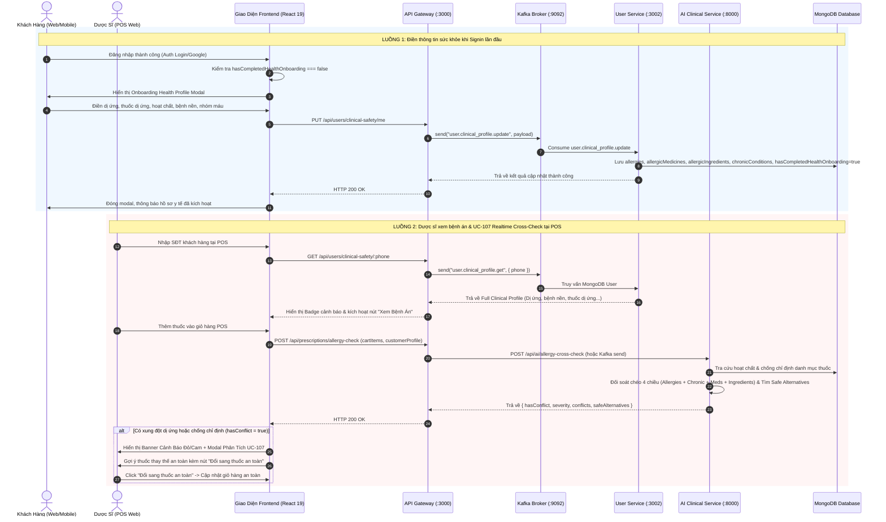

# KẾ HOẠCH TRIỂN KHAI TOÀN DIỆN: UC-107 & HỒ SƠ BỆNH ÁN ĐIỆN TỬ

## (AI Allergy & Contraindication Cross-Check, Onboarding Health Profile & Medical Records)

---

## 1. Mục Tiêu & Phạm Vi Triển Khai (Objectives & Scope)

1. **UC-107 - Gợi ý thuốc & Kiểm tra chéo đa chiều (4 chiều y khoa):**

   - **Tiền sử dị ứng (Allergies):** Dị ứng nhóm thuốc (Penicillin, Cephalosporin, Sulfonamide, NSAID...), dị ứng phấn hoa, thức ăn...
   - **Bệnh nền / Mãn tính (Chronic Conditions):** Viêm loét dạ dày - tá tràng, Tăng huyết áp, Đái tháo đường, Hen suyễn, Suy gan nặng, Suy thận, Tim mạch, Phụ nữ mang thai / Cho con bú...
   - **Thuốc dị ứng (Allergic Medicines):** Tên biệt dược cụ thể mà bệnh nhân từng dị ứng (VD: *Augmentin, Aspirin 81, Panadol Extra, Bactrim, Klamentin*...).
   - **Dị ứng thành phần hoạt chất (Allergic Active Ingredients):** Hoạt chất dược lý trực tiếp (VD: *Amoxicillin, Paracetamol, Ibuprofen, Sulfamethoxazole, Diclofenac*...).
   - **Động cơ AI / Clinical Rule Engine:** Phát hiện xung đột, đánh giá mức độ nghiêm trọng (`CRITICAL` - Nguy cơ sốc phản vệ / cấm chỉ định tuyệt đối; `HIGH` - Cảnh báo nghiêm trọng; `MODERATE` - Thận trọng).
   - **Gợi ý thuốc thay thế an toàn (Safe Alternatives Recommendation):** Tự động tìm kiếm các thuốc trong kho/hệ thống có cùng nhóm điều trị nhưng **hoàn toàn an toàn** với bệnh án của bệnh nhân.
2. **Màn hình điền thông tin khi người dùng Signin lần đầu (First-time Signin Onboarding Modal):**

   - Xuất hiện tự động khi người dùng đăng nhập lần đầu (hoặc `hasCompletedHealthOnboarding === false`).
   - Thiết kế chuẩn y tế, hiện đại, thân thiện: cho phép chọn nhanh các dị ứng phổ biến, thuốc dị ứng, thành phần hoạt chất, bệnh nền, nhóm máu, ghi chú y tế.
   - Hỗ trợ lưu ngay hoặc để sau.
3. **Màn hình xem Bệnh án cho Người dùng (Customer Medical Record / Health Passport):**

   - Tích hợp trực quan tại trang cá nhân (`CustomerProfile.tsx`) và trang chuyên biệt (`CustomerMedicalRecord.tsx` / `/customer/medical-record`).
   - Hiển thị 4 nhóm thông tin sức khỏe cá nhân hóa, huy hiệu an toàn, lịch sử đơn thuốc.
   - Khu vực "Gợi ý thuốc an toàn theo bệnh án" và cảnh báo các hoạt chất chống chỉ định cá nhân hóa.
   - Cho phép người dùng cập nhật hồ sơ bệnh án bất cứ lúc nào.
4. **Màn hình & Công cụ xem Hồ sơ Bệnh án cho Dược sĩ (Pharmacist POS Clinical Record & Cross-Check):**

   - Tích hợp tại màn hình Bán lẻ (`RetailView.tsx`) và Kê đơn (`PrescriptionView.tsx`).
   - Khi tìm kiếm/chọn khách hàng qua SĐT: hiển thị ngay Badge cảnh báo dị ứng/bệnh nền (VD: `⚠️ 2 dị ứng • 1 bệnh nền`) và nút **"Xem Hồ sơ bệnh án"** (`CustomerClinicalModal.tsx`).
   - Dược sĩ có thể cập nhật thông tin bệnh án cho khách hàng ngay tại quầy.
   - **Realtime UC-107 Alert tại giỏ hàng:** Khi có thuốc trong giỏ hàng + bệnh án khách hàng, hệ thống lập tức đối soát chéo 4 chiều. Nếu phát hiện xung đột:
     - Banner cảnh báo nổi bật trên giỏ hàng.
     - Hiển thị bảng phân tích nguy cơ lâm sàng.
     - Đưa ra danh sách **Thuốc thay thế an toàn (Safe Alternatives)**.
     - Nút **"Đổi sang thuốc an toàn" (1-Click Safe Swap)** để Dược sĩ thay thế ngay lập tức vào giỏ hàng.

---

## 2. Thiết Kế Kiến Trúc & Luồng Dữ Liệu (Architecture & Data Flow)



---

## 3. Chi Tiết Thay Đổi Mã Nguồn Các Tầng (Implementation Matrix)

### 3.1. Tầng Database & Model (Mongoose Schemas)

- **Tệp:** `backend/apps/auth-service/src/auth/user.schema.ts` (và `backend/apps/user-service/src/schemas`)
- **Bổ sung các trường chuyên sâu cho Hồ sơ Y tế:**
  ```typescript
  /** Tiền sử dị ứng chung (Penicillin, Cephalosporin, NSAIDs, Sulfonamide...) */
  @Prop({ type: [String], default: [] })
  allergies?: string[];

  /** Danh sách biệt dược / thuốc cụ thể bị dị ứng (Augmentin, Panadol, Aspirin...) */
  @Prop({ type: [String], default: [] })
  allergicMedicines?: string[];

  /** Danh sách thành phần hoạt chất bị dị ứng (Amoxicillin, Paracetamol, Ibuprofen...) */
  @Prop({ type: [String], default: [] })
  allergicIngredients?: string[];

  /** Danh sách bệnh nền / bệnh lý mãn tính (Viêm loét dạ dày, Tăng huyết áp, Đái tháo đường, Hen suyễn, Suy gan, Suy thận...) */
  @Prop({ type: [String], default: [] })
  chronicConditions?: string[];

  /** Nhóm máu (A, B, AB, O, Rh+, Rh-) */
  @Prop({ default: null })
  bloodType?: string;

  /** Ghi chú y tế đặc biệt / tiền sử phẫu thuật */
  @Prop({ default: null })
  medicalNotes?: string;

  /** Cờ xác định người dùng đã hoàn thành onboarding khai báo hồ sơ y tế ban đầu chưa */
  @Prop({ default: false })
  hasCompletedHealthOnboarding?: boolean;
  ```

### 3.2. Tầng Backend Microservices

1. **`user-service`:**
   - Cập nhật `user-service.service.ts` hàm `updateClinicalProfile`:
     - Nhận và lưu đầy đủ 4 chiều: `allergies`, `allergicMedicines`, `allergicIngredients`, `chronicConditions`, `bloodType`, `medicalNotes`, `hasCompletedHealthOnboarding`.
   - Cập nhật `lookupLoyaltyByPhone` và `getUserById`:
     - Trả về toàn bộ các trường hồ sơ bệnh án phục vụ Dược sĩ và Khách hàng.
2. **`api-gateway`:**
   - Mở rộng `user.controller.ts`:
     - `GET /api/users/clinical-safety/me`: Lấy hồ sơ bệnh án của chính user đang đăng nhập.
     - `PUT /api/users/clinical-safety/me`: User tự cập nhật hồ sơ bệnh án và hoàn thành onboarding (`hasCompletedHealthOnboarding: true`).
     - `GET /api/users/clinical-safety/:phone`: Dược sĩ tra cứu hồ sơ bệnh án bệnh nhân qua SĐT.
     - `PUT /api/users/clinical-safety/:phone`: Dược sĩ cập nhật hồ sơ bệnh án cho bệnh nhân tại quầy.
   - Thêm Endpoint UC-107 tại `prescription.controller.ts`:
     - `POST /api/prescriptions/allergy-check`:
       - Nhận: `{ customerProfile, cartItems }`
       - Gọi Động cơ Đối soát chéo (Rule Engine + AI Service):
         1. **Direct Drug Allergy:** Tên thuốc trong giỏ trùng với `allergicMedicines`.
         2. **Ingredient Allergy:** Hoạt chất của thuốc trong giỏ trùng với `allergicIngredients` hoặc chứa trong `allergies`.
         3. **Cross-reactivity:** Dị ứng nhóm chéo (VD: Dị ứng Penicillin chống chỉ định dùng Amoxicillin, Ampicillin).
         4. **Contraindication with Chronic Conditions:** Bệnh nền xung đột chống chỉ định (VD: Viêm loét dạ dày xung đột NSAID/Aspirin; Tăng huyết áp xung đột Pseudoephedrine; Suy gan nặng xung đột Paracetamol liều cao...).
         5. **Safe Alternatives Recommendation:** Tự động tìm kiếm các sản phẩm trong danh mục cùng công dụng chỉ định nhưng hoàn toàn an toàn với thể trạng bệnh nhân.
3. **`ai-service` (Python FastAPI):**
   - Thêm router hoặc hàm trong `routers/prescription.py` cho endpoint `/api/ai/allergy-cross-check`:
     - Tra cứu DB hoạt chất, kiểm tra chéo 4 chiều, sinh giải thích dược lý và gợi ý thuốc thay thế an toàn.

### 3.3. Tầng Frontend (Web React 19)

1. **Màn hình Điền thông tin khi Signin lần đầu (`FirstTimeHealthOnboardingModal.tsx`):**
   - Tạo component modal chuyên nghiệp tại `frontend/src/components/health/FirstTimeHealthOnboardingModal.tsx`.
   - Lắng nghe sau khi đăng nhập: nếu user là `role: 'user'` và `hasCompletedHealthOnboarding === false`, tự động bật modal.
   - Các trường nhập liệu trực quan:
     - Chọn nhanh các nhóm dị ứng thuốc phổ biến (Penicillin, Cephalosporin, Aspirin/NSAID, Paracetamol, Sulfamid...).
     - Ô nhập thuốc dị ứng cụ thể và thành phần hoạt chất dị ứng (dạng tag pills dễ thêm/xóa).
     - Chọn nhanh các bệnh nền thường gặp (Tăng huyết áp, Đái tháo đường, Viêm loét dạ dày tá tràng, Hen phế quản, Bệnh tim mạch, Suy gan, Suy thận, Thai kỳ/Cho con bú...).
     - Nhóm máu & Ghi chú y tế.
     - Nút "Kích hoạt bảo vệ sức khỏe & Lưu hồ sơ" hoặc "Để sau".
2. **Màn hình Người dùng xem Bệnh án (`CustomerMedicalRecord.tsx`):**
   - Tạo trang `/customer/medical-record` và tích hợp Tab trong `CustomerProfile.tsx`:
     - Hiển thị Thẻ Sổ Sức Khỏe Điện Tử (Digital Health Passport).
     - Thống kê trực quan: Số lượng dị ứng, số bệnh nền, nhóm máu, trạng thái bảo vệ an toàn.
     - 4 thẻ chi tiết: Tiền sử dị ứng, Thuốc dị ứng, Hoạt chất dị ứng, Bệnh nền mãn tính.
     - **Mục "Gợi ý thuốc an toàn theo bệnh án":** Danh sách các thuốc OTC thông dụng an toàn cho thể trạng của người dùng (hạ sốt an toàn, giảm đau an toàn, tiêu hóa an toàn).
     - Cảnh báo các hoạt chất chống chỉ định cá nhân hóa tuyệt đối không nên dùng.
     - Nút "Chỉnh sửa hồ sơ bệnh án" mở form cập nhật tức thì.
3. **Màn hình Dược sĩ xem Hồ sơ Bệnh án & UC-107 tại POS (`RetailView.tsx` & `CustomerClinicalModal.tsx`):**
   - Nâng cấp `CustomerClinicalModal.tsx` thành Modal Bệnh Án Toàn Diện:
     - Hiển thị đầy đủ 4 chiều: Dị ứng nhóm, Thuốc dị ứng, Hoạt chất dị ứng, Bệnh lý mãn tính, Nhóm máu, Ghi chú.
     - Cho phép Dược sĩ chỉnh sửa / thêm mới dị ứng hoặc bệnh nền cho bệnh nhân ngay tại quầy.
   - Nâng cấp `RetailView.tsx`:
     - Khi đã chọn khách hàng: hiển thị Badge cảnh báo y tế (VD: `⚠️ Có 2 dị ứng, 1 bệnh nền`) kèm nút "Xem Hồ sơ bệnh án".
     - Tích hợp hook kiểm tra chéo UC-107 tự động: Mỗi khi thêm/xóa thuốc trong giỏ hàng, tự động gọi API `/api/prescriptions/allergy-check`.
     - Nếu có xung đột:
       - Hiển thị Banner cảnh báo màu đỏ chói sáng phía trên giỏ hàng: Cảnh báo chi tiết lý do y khoa, nguy cơ sốc phản vệ / loét dạ dày...
       - Hiển thị danh sách **Thuốc thay thế an toàn (Safe Alternatives)**.
       - Nút 1-click **"Đổi sang thuốc an toàn"**: Xóa thuốc xung đột khỏi giỏ hàng và thay thế bằng thuốc an toàn đã được hệ thống khuyến nghị!

---

## 4. Kịch Bản Kiểm Thử & Nghiệm Thu (QA & Verification Plan)

1. **Test Case 1: First-time Signin Onboarding:**

   - Đăng nhập với tài khoản khách hàng mới hoặc tài khoản chưa điền hồ sơ y tế (`hasCompletedHealthOnboarding: false`).
   - Modal Onboarding xuất hiện ngay lập tức.
   - Điền: Dị ứng = *Penicillin*, Thuốc dị ứng = *Augmentin*, Hoạt chất dị ứng = *Amoxicillin*, Bệnh nền = *Viêm loét dạ dày*.
   - Nhấn Lưu -> Hồ sơ được ghi vào MongoDB, cờ `hasCompletedHealthOnboarding` chuyển thành `true`, modal không hiển thị lại ở lần đăng nhập tiếp theo.
2. **Test Case 2: Khách hàng xem Bệnh án cá nhân:**

   - Truy cập trang cá nhân / Sổ sức khỏe điện tử.
   - Kiểm tra hiển thị chính xác các thông tin dị ứng, bệnh nền đã khai báo.
   - Kiểm tra khu vực "Gợi ý thuốc an toàn": Paracetamol được gợi ý an toàn cho hạ sốt; NSAID/Aspirin bị đưa vào danh sách cảnh báo chống chỉ định do bệnh loét dạ dày.
3. **Test Case 3: Dược sĩ xem Hồ sơ Bệnh án tại POS:**

   - Dược sĩ mở màn hình Bán lẻ POS, tìm kiếm khách hàng theo SĐT.
   - Huy hiệu `⚠️ Dị ứng & Bệnh nền` xuất hiện.
   - Dược sĩ click "Xem Hồ sơ bệnh án" -> Modal hiển thị chi tiết toàn bộ tiền sử dị ứng và bệnh nền của bệnh nhân.
   - Dược sĩ có thể cập nhật thêm bệnh nền mới và lưu thành công.
4. **Test Case 4: UC-107 Realtime Allergy & Contraindication Cross-Check:**

   - Tại POS, khách hàng có tiền sử dị ứng Penicillin & Loét dạ dày.
   - Dược sĩ quét mã Barcode hoặc thêm thuốc *Augmentin 625mg* (chứa Amoxicillin) hoặc *Ibuprofen 400mg* (NSAID gây loét dạ dày) vào giỏ hàng.
   - **Kỳ vọng:** Hệ thống lập tức phát chuông/cảnh báo đỏ rực:
     - `CRITICAL`: Nguy cơ sốc phản vệ / phản ứng dị ứng nghiêm trọng với Amoxicillin (Penicillin cross-reactivity).
     - `HIGH`: Chống chỉ định Ibuprofen do tiền sử Viêm loét dạ dày.
     - **Gợi ý thuốc an toàn:** Gợi ý *Azithromycin 500mg* (thay cho Augmentin) và *Paracetamol 500mg* (thay cho Ibuprofen).
     - Click "Đổi sang thuốc an toàn" -> Giỏ hàng tự động cập nhật thuốc thay thế an toàn.
