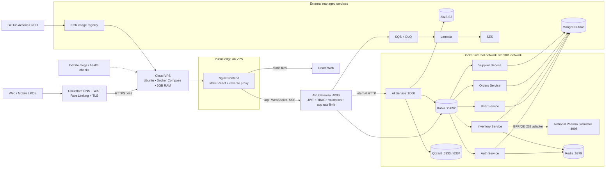

# WDP301 — Kiến trúc triển khai VPS + Cloudflare (v2)

> Bản này phản ánh cấu hình hiện có trong `docker-compose.prod.yml`, `backend/docker/nginx.frontend.conf` và tài liệu triển khai VPS. Cloudflare là lớp biên chịu DNS/WAF/Rate Limiting; VPS chạy Docker Compose và các bounded context.

## Vị trí của Cloudflare Rate Limiting

- **Lớp Cloudflare:** giới hạn theo IP, route, quốc gia hoặc đặc tính request trước khi traffic chạm VPS; áp dụng cho các route công khai như đăng nhập, tìm kiếm, upload và API nhạy cảm.
- **Lớp API Gateway:** giới hạn theo user, JWT subject, role hoặc tenant để bảo vệ nghiệp vụ sau khi đã xác thực.
- **Lớp Redis:** lưu bộ đếm phân tán cho app rate limit, session và cache; không dùng Kafka để đếm request.
- Giữ Kafka, Redis, Qdrant và các service không public trong Docker network. Chỉ Nginx/Cloudflare-facing ports cần công khai.

## Ghi chú triển khai

- Frontend Nginx phục vụ React và proxy `/api`, WebSocket và SSE tới `backend-svc:4000`.
- VPS production chạy `api-gateway`, `auth-service`, `user-service`, `inventory-service`, `supplier-service`, `orders-service`, `ai-service`, Kafka, Redis, Qdrant và simulator CSDL Dược Quốc gia.
- MongoDB Atlas, S3, SQS/Lambda/SES và ECR nằm ngoài VPS. GitHub Actions triển khai code/container lên VPS.
- Khi bật Cloudflare proxy, origin VPS nên giới hạn firewall để chỉ nhận 80/443 từ Cloudflare IP ranges và SSH từ địa chỉ quản trị; không public trực tiếp 3000/4000/8000/9092/6333.
