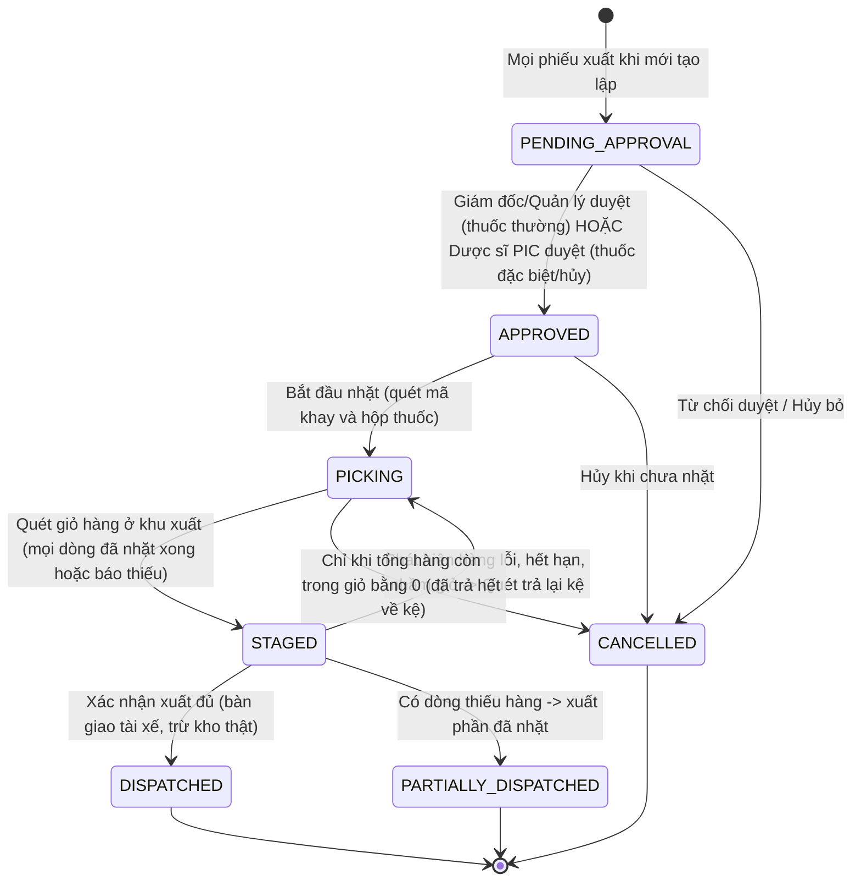

# 📋 KẾ HOẠCH TRIỂN KHAI: LUỒNG XUẤT KHO TỔNG (v6.0)

> **Bối cảnh:** Kho Tổng (Central Warehouse) chỉ **nhập và xuất thuốc**, không có quầy bán lẻ. Một nhân sự (role `warehouse`: Quản lý kho kiêm Thủ kho) thực hiện nhặt hàng, tập kết và bàn giao.
> **Kiểm soát hai người:** chỉ áp dụng cho thuốc kiểm soát đặc biệt và phiếu xuất hủy, do dược sĩ phụ trách chuyên môn (PIC) hoặc giám đốc duyệt (xem mục 2).
> **Hạ tầng CSDL:** MongoDB Atlas Replica Set (hỗ trợ transaction nhiều document qua `session.withTransaction()`).
> **Về tài liệu này:** bản gộp đầy đủ từ v2 đến v5, cập nhật theo vai trò thực tế của hệ thống và việc Kho Tổng không bán hàng. Các mục pháp lý và mã nhóm thuốc ghi rõ phần cần đối chiếu với văn bản gốc.

---

## 0. Tóm tắt luồng (bản dễ hiểu)

**Ý chính:** lấy thuốc ra khỏi kho phải có **phiếu xuất** và **bắt buộc được duyệt** trước khi nhặt. Khi nhặt chỉ **giữ chỗ**; chỉ **trừ kho thật** khi xác nhận xuất ở khu bàn giao. Giống bỏ đồ vào giỏ trước rồi mới thanh toán.

1. **Tạo phiếu.** Chuyển kho cho chi nhánh (sinh từ yêu cầu PR của chi nhánh) hoặc xuất hủy.
2. **Duyệt phiếu (Bắt buộc 100%):** Giám đốc hoặc Quản lý kho duyệt thuốc thường; Dược sĩ phụ trách chuyên môn (PIC) duyệt thuốc đặc biệt và xuất hủy.
3. **Hệ thống lập danh sách nhặt:** Đi khay nào, lô nào (lô sắp hết hạn trước), bao nhiêu.
4. **Nhặt hàng:** Quét mã khay, quét mã trên hộp, bỏ vào giỏ gom hàng. Hệ thống giữ chỗ.
5. **Tập kết ở khu bàn giao:** Quét giỏ gom hàng, đối chiếu với phiếu.
6. **Xác nhận xuất:** Trừ kho thật, ghi người nhận bàn giao. Với chuyển kho, chi nhánh bấm nhận hàng thì tồn chi nhánh mới tăng.

| Thời điểm | Tồn trong kho (`stock`) | Đang giữ chỗ (`reservedQty`) | Còn bán/chuyển được (`available`) |
| :--- | :---: | :---: | :---: |
| Ban đầu (Lệnh mới duyệt) | 100 | 0 | 100 |
| Nhặt 30 vào giỏ gom hàng | 100 | 30 | 70 |
| Xác nhận xuất | 70 | 0 | 70 |

**Ghi nhớ nhanh:** có phiếu → duyệt lệnh → nhặt (giữ chỗ) → tập kết → xác nhận (trừ kho thật). Chi tiết sơ đồ trực quan và giải thích từng bước xem tại **Mục 6**.

---

## 1. Phạm vi và thuật ngữ

### 1.1 Trong phạm vi

- Loại phiếu xuất: **`TRANSFER`** (chuyển kho chi nhánh) và **`DISPOSE`** (xuất hủy thuốc hết hạn hoặc biệt trữ).
- Picking, giữ chỗ, tập kết tote, xác nhận xuất, trả hàng về khay, ghi nhận thiếu hàng, hủy phiếu.
- Bàn giao chuyển kho: trạng thái đang vận chuyển và bước chi nhánh tiếp nhận.
- Nhật ký kiểm toán bất biến.

### 1.2 Ngoài phạm vi

- Bán hàng (POS), Click & Collect và thuốc kê đơn qua ảnh đơn bác sĩ: thuộc chi nhánh và dược sĩ, không thuộc Kho Tổng.
- Xuất trả nhà cung cấp: nếu hệ thống cần thì thêm loại `RETURN_TO_SUPPLIER` ở giai đoạn sau.
- Tích hợp thật với Cơ sở dữ liệu Dược Quốc Gia (mô phỏng hoặc để ở hướng phát triển).

### 1.3 Thuật ngữ

| Thuật ngữ                       | Ý nghĩa                                                                                                                                                |
| :------------------------------ | :----------------------------------------------------------------------------------------------------------------------------------------------------- |
| Tote                            | Thùng trung chuyển có mã (ví dụ `TOTE-01`) để gom hàng khi nhặt                                                                                        |
| Khu bàn giao xuất hàng          | Chỗ đặt tote để đối chiếu và giao cho người vận chuyển (trước đây gọi là "quầy điều phối"; không có khách, không có POS). Mã gợi ý: `DISPATCH-AREA-01` |
| FEFO                            | Hết hạn trước, xuất trước                                                                                                                              |
| `reservedQty`                   | Số lượng đang nằm trong tote, đã giữ chỗ nhưng chưa xuất khỏi kho                                                                                      |
| PIC                             | Dược sĩ phụ trách chuyên môn, thuộc role `pharmacist` có cờ `isPIC`                                                                                    |
| Giữ chỗ muộn (late reservation) | Chỉ giữ chỗ khi thủ kho thực sự nhặt, không giữ lúc duyệt phiếu                                                                                        |

---

## 2. Vai trò và quyền hạn

### 2.1 Vai trò trong luồng xuất kho

| Role hệ thống                | Việc trong luồng xuất kho                                                    |
| :--------------------------- | :--------------------------------------------------------------------------- |
| `warehouse`                  | Tạo phiếu; nhặt, trả hàng, ghi thiếu, tập kết tote; xác nhận xuất; hủy phiếu |
| `branch`                     | Gửi PR yêu cầu nhập thuốc về Kho Tổng; **tiếp nhận hàng chuyển kho**         |
| `pharmacist` (có cờ `isPIC`) | Duyệt phiếu có thuốc kiểm soát đặc biệt và phiếu xuất hủy                    |
| `director`                   | Xem tổng quan; có thể duyệt phiếu xuất hủy thay PIC                          |
| `admin`                      | Cấu hình, phân quyền, xem nhật ký kiểm toán; **không** thao tác kho          |
| `user`                       | Không liên quan                                                              |

### 2.2 Ai duyệt phiếu (Nguyên tắc 100% phiếu xuất đều phải có người duyệt)

| Loại phiếu & Nhóm thuốc                                                        | Trạng thái khi tạo | Người có quyền duyệt                                          | Mục đích kiểm soát                                                                         |
| :----------------------------------------------------------------------------- | :----------------- | :------------------------------------------------------------ | :----------------------------------------------------------------------------------------- |
| `TRANSFER`, thuốc thông thường (Vitamin, Salonpas, giảm đau thông thường...)   | `PENDING_APPROVAL` | `director` (Giám đốc) HOẶC Quản lý kho                        | Kiểm tra tính hợp lý của số lượng điều chuyển, ngăn chặn thủ kho tự ý tạo đơn ảo tuồn hàng |
| `TRANSFER`, có thuốc kiểm soát đặc biệt (gây nghiện, hướng thần, tiền chất...) | `PENDING_APPROVAL` | `pharmacist` có `isPIC = true` (Dược sĩ phụ trách chuyên môn) | Kiểm tra pháp lý y tế theo Thông tư Bộ Y tế, đối chiếu định mức cấp phép của chi nhánh     |
| `DISPOSE` (Phiếu xuất hủy thuốc hết hạn, mốc ẩm, hỏng hóc)                     | `PENDING_APPROVAL` | Dược sĩ PIC HOẶC `director`, kèm `disposalReportCode`         | Kiểm tra biên bản họp hội đồng tiêu hủy trước khi loại bỏ tài sản                          |

Quy tắc kiểm soát hai người:

- Người duyệt phải **khác người lập phiếu**.
- Phiếu có thuốc kiểm soát đặc biệt chỉ do `pharmacist` có `isPIC = true` duyệt, và **duyệt trước khi nhặt** (hàng không được lấy ra trước khi có chấp thuận).
- Lưu `approvedBy`, `approvedAt`, ghi chú duyệt vào phiếu và nhật ký kiểm toán.

### 2.3 Điều kiện cần xác nhận

- PIC thuộc cấp chuỗi hay được gán riêng cho Kho Tổng. Cho đồ án: bất kỳ `pharmacist` có `isPIC`, khác người lập phiếu, đều duyệt được.
- Do một người làm hết các bước nhặt và bàn giao, bước đối chiếu ở khu bàn giao thực chất là **tự kiểm tra**. Đây là giả định của đồ án; bù lại hệ thống bắt buộc quét mã, ghi log đầy đủ, và dùng người thứ hai cho hai trường hợp rủi ro cao.

---

## 3. Vòng đời trạng thái phiếu xuất

**Ghi chú:**

- `isStale` là **cờ**, không phải trạng thái. Phiếu `PICKING` không hoạt động quá 4 giờ được bật `isStale = true`; vẫn nhặt, trả, tập kết bình thường.
- Hủy phiếu chỉ được khi `totalPicked === 0` (mọi hàng đã trả về khay).
- `totalPicked` = tổng `pickedQty` của các dòng (số lượng ròng sau khi trừ phần đã trả).
- Phiếu không thể sang `STAGED` nếu `totalPicked === 0`.

| Chuyển trạng thái               | Điều kiện bắt buộc                                                                                  |
| :------------------------------ | :-------------------------------------------------------------------------------------------------- |
| `* → PICKING` (lần nhặt đầu)    | Phiếu `APPROVED`, tote được chiếm thành công                                                        |
| `PICKING → STAGED`              | Quét đúng tote thuộc phiếu; `totalPicked > 0`; mọi dòng có `itemStatus` là `PICKED` hoặc `SHORTAGE` |
| `STAGED → PICKING`              | Thực hiện `return-item` (tự động)                                                                   |
| `STAGED → DISPATCHED`           | Mọi dòng `PICKED`; kiểm tra lại hạn dùng và trạng thái lô; đã có người nhận bàn giao                |
| `STAGED → PARTIALLY_DISPATCHED` | Có ít nhất một dòng `SHORTAGE` và ít nhất một dòng đã nhặt                                          |
| `* → CANCELLED`                 | `totalPicked === 0`                                                                                 |

---

## 4. Luồng nghiệp vụ chi tiết

### 4.1 Tạo phiếu và lập danh sách nhặt

1. `warehouse` tạo phiếu xuất: loại `TRANSFER` (liên kết `referenceId` tới PR hoặc `StockTransfer` của chi nhánh) hoặc `DISPOSE` (bắt buộc `disposalReportCode`).
2. Hệ thống tính **Picking List** theo FEFO: mỗi dòng gồm SKU, khay gợi ý (zone, rack, shelf, bin), lô gợi ý, số lượng. Một SKU nằm nhiều khay thì tách thành nhiều dòng, ưu tiên khay có lô cận hạn nhất.
3. Chỉ gợi ý lô hợp lệ theo loại phiếu (mục 5.2), dùng tồn khả dụng `stock - reservedQty`.
4. Nếu phiếu có thuốc có `special_control_type > 0`, đặt `hasControlledDrugs = true` và chuyển phiếu sang `PENDING_APPROVAL`.

### 4.2 Duyệt phiếu

- Áp dụng quy tắc ở mục 2.2. Từ chối phiếu phải ghi lý do.
- Phiếu `DISPOSE` chỉ chọn được lô quá hạn hoặc biệt trữ.

### 4.3 Nhặt hàng (scan-first)

1. Quét QR khay (`BIN-{zone}-{rack}-S{shelf}-B{bin}`). App so khớp với Picking List; **chỉ khi khay nằm trong phiếu mới mở form lấy hàng**.
2. Quét mã GS1 trên hộp để xác nhận đúng lô (mục 5.4). Hộp không có mã hoặc mã mờ thì dùng nhập tay có lý do.
3. Nhập số lượng. Hệ thống chặn nếu vượt số còn thiếu của dòng hoặc vượt tồn khả dụng của lô.
4. Gán tote: bỏ hàng vào tote; hệ thống chiếm tote cho phiếu (mục 6.5).
5. Đổi lô so với gợi ý FEFO phải có lý do (`Hàng hỏng bao bì`, `Lô thực tế không đủ`, `Khác`) và được ghi vết `isOverride`.
6. Cập nhật nguyên tử trong một transaction: tăng `reservedQty` của lô, ghi `picks[]` và `pickedQty` trên phiếu (khóa `version`), ghi `InventoryTransaction` loại `PICK_RESERVE`.

### 4.4 Trả hàng về khay (`return-item`)

Dùng khi nhặt nhầm, nhặt dư, hoặc phát hiện hàng không đạt ở khu bàn giao. Mỗi lần trả chọn một **kết cục**:

| Kết cục      | Dùng khi                                  | Tác động                                                                                             |
| :----------- | :---------------------------------------- | :--------------------------------------------------------------------------------------------------- |
| `RESTOCK`    | Hàng còn tốt                              | Giảm `reservedQty`; hàng quay lại khả dụng. Phải **quét lại khay đích**; khác khay gốc thì cần lý do |
| `DAMAGED`    | Rách bao bì, móp, hỏng                    | Giảm **cả** `stock` và `reservedQty`; ghi giao dịch điều chỉnh; chuyển hộp sang xử lý hủy            |
| `QUARANTINE` | Nghi vấn chất lượng, có thông báo cách ly | Giảm cả `stock` và `reservedQty`; chuyển khu biệt trữ                                                |

Lưu ý:

- Hàng hỏng hoặc bị cách ly **không** được quay về thành tồn khả dụng.
- Chỉ đổi trạng thái cả lô khi có quyết định thu hồi hoặc cách ly cho lô; một hộp hỏng không làm đổi trạng thái lô.
- Ghi vào `picks[].returnedQty` và `returnLogs[]`; **không xóa** bản ghi nhặt (phục vụ truy vết GSP).
- Giảm `pickedQty` của dòng; nếu `pickedQty < requestedQty` thì dòng về `PENDING`.
- Phiếu đang `STAGED` thì **tự quay về `PICKING`**.
- Khi mọi hàng của một tote đã trả hết, tote được giải phóng.

### 4.5 Thiếu hàng

- Khay không đủ hàng và không tìm thấy ở khu dự trữ: thủ kho bấm **[Ghi nhận thiếu hàng]**, dòng thành `SHORTAGE` (chấp nhận xuất với `pickedQty < requestedQty`).
- Hệ thống tạo **đề xuất bổ sung ở trạng thái `DRAFT`** (chờ duyệt, không tự phát hành đơn).

### 4.6 Tập kết ở khu bàn giao

- Mang tote ra khu bàn giao, quét mã tote. App đối chiếu tote với phiếu và hiển thị toàn bộ thuốc trong tote để rà soát.
- Đủ điều kiện (mục 3) thì phiếu sang `STAGED`.
- Phát hiện thiếu, hỏng, nhầm: dùng `return-item` hoặc `mark-shortage`; phiếu tự quay về `PICKING` khi trả hàng.

### 4.7 Xác nhận xuất kho

1. Nhập **người nhận bàn giao** (tên tài xế hoặc đơn vị vận chuyển).
2. Trong một transaction: chuyển trạng thái phiếu có điều kiện `STAGED → DISPATCHED` (hoặc `PARTIALLY_DISPATCHED`); trừ `stock` và `reservedQty` từng lô theo `picks[]`; kiểm tra lại hạn dùng và trạng thái lô; ghi `InventoryTransaction` loại `DISPATCH`.
3. Lô quá hạn giữa hai bước: chặn xuất, yêu cầu trả hàng và xử lý theo quy trình hủy.
4. Khay hết hàng (mọi lô tại khay có `stock = 0`): cập nhật `MedicineLocation.binStatus = 'EMPTY'` để sơ đồ 2D/3D đồng bộ.
5. Phiếu `TRANSFER`: sau khi commit, chuyển `StockTransfer` sang `SHIPPING`.

### 4.8 Chi nhánh tiếp nhận (`TRANSFER`)

- Tồn kho Kho Tổng đã trừ; tồn kho chi nhánh **chưa tăng** cho đến khi role `branch` quét mã và bấm **[Tiếp nhận chuyển kho]**. Như vậy không mất vết hàng trên đường vận chuyển.
- Sai khác giữa số xuất và số nhận được ghi nhận thành biên bản chênh lệch (ở hướng phát triển nếu chưa làm).

### 4.9 Hủy phiếu và phiếu treo

- **Hủy:** chỉ khi `totalPicked === 0`. Còn hàng trong tote thì phải trả hết về khay (`return-item`) rồi mới hủy. Hủy chỉ đổi trạng thái, không có gì để nhả.
- **Phiếu treo:** cron mỗi 60 phút bật `isStale = true` cho phiếu `PICKING` không hoạt động quá 4 giờ và gửi cảnh báo cho `warehouse`. Cron **không** tự nhả hàng, vì hàng vẫn nằm trong tote ngoài khay.

---

## 5. Quy tắc nghiệp vụ

### 5.1 Trừ tồn hai giai đoạn

- `available = stock - reservedQty`.
- Nhặt: chỉ tăng `reservedQty` (`PICK_RESERVE`). Xác nhận xuất: giảm `stock` và `reservedQty` (`DISPATCH`).
- Mọi nơi **đọc tồn Kho Tổng để quyết định còn hàng** (tạo phiếu xuất, gợi ý FEFO, chuyển kho, điều chỉnh) phải dùng `available`, không dùng `stock`. Nếu POS không đọc lô của Kho Tổng thì `SalesService` không bị ảnh hưởng; cần kiểm tra khi code.
- Dữ liệu cũ chưa có `reservedQty`: chạy migration đặt `0` (mục 6.1). Truy vấn nên dùng `$ifNull`.

### 5.2 Lô hợp lệ theo loại phiếu

| Loại phiếu | Lô hợp lệ                                                   | Điều kiện hạn dùng                                        | Yêu cầu kèm theo              |
| :--------- | :---------------------------------------------------------- | :-------------------------------------------------------- | :---------------------------- |
| `TRANSFER` | `status = 'ACTIVE'`                                         | `expDate > now`, kiểm tra ở **cả bước nhặt và bước xuất** | FEFO                          |
| `DISPOSE`  | `status IN ['EXPIRED','QUARANTINED']` hoặc `expDate <= now` | Không áp dụng FEFO                                        | Bắt buộc `disposalReportCode` |

Trạng thái `ACTIVE` có thể chậm cập nhật so với hạn dùng thực tế, nên luôn kiểm tra `expDate` ở câu truy vấn, không chỉ dựa vào `status`.

### 5.3 Thuốc kiểm soát đặc biệt

- Trường chuẩn: `special_control_type: number` (0: thường; các giá trị khác theo nhóm kiểm soát đặc biệt). **Ánh xạ mã nhóm cần đối chiếu với văn bản gốc của Bộ Y tế** (Thông tư 20/2017/TT-BYT quy định về thuốc phải kiểm soát đặc biệt) trước khi ghi vào báo cáo.
- Cờ suy diễn cho module AI tư vấn: `isSpecialControl = special_control_type > 0`.
- **Thuốc hạn chế bán lẻ là khái niệm khác** thuốc kiểm soát đặc biệt; giữ cờ riêng `isRestrictedRetail`, không gộp vào `special_control_type`.
- Kiểm soát hai người theo mục 2.2.

### 5.4 Quét GS1 và dự phòng nhập tay

- Bóc tách: `(01)` GTIN, `(10)` số lô, `(17)` hạn dùng (YYMMDD).
- So khớp: GTIN khớp mã vạch của thuốc trên dòng đang nhặt; số lô khớp lô đã chọn; hạn dùng khớp `expDate` của lô.
- **Ngày `00` trong `(17)` nghĩa là ngày cuối tháng**: đổi sang ngày cuối tháng trước khi so sánh để không báo lệch oan.
- Không phải hộp thuốc nào cũng có mã DataMatrix. Dự phòng: **[Nhập tay số lô và HSD]**, bắt buộc chọn lý do (`BARCODE_DAMAGED`, `NO_DATAMATRIX_ON_PACK`, `SCANNER_FAILURE`), gắn `gs1Scanned: false` để hậu kiểm.

### 5.5 Giữ chỗ muộn (đánh đổi đã chấp nhận)

Hệ thống chỉ giữ chỗ khi thủ kho thực sự nhặt, không giữ lúc duyệt. Hệ quả: nếu hai phiếu cùng được duyệt trên một lượng tồn chỉ đủ cho một, phiếu nào được nhặt trước sẽ lấy được hàng; phiếu còn lại phát hiện thiếu khi đi nhặt và chuyển sang `SHORTAGE`. Lý do chọn: tránh tồn "chết" do phiếu duyệt xong nằm lâu không nhặt. Vì Kho Tổng không bán lẻ, người tranh chấp tồn chỉ là các phiếu xuất khác nên đánh đổi này dễ chấp nhận.

### 5.6 Kiểm kê định kỳ

Hàng trong tote vẫn tính vào `stock` nhưng không còn trên khay. Quy tắc: **chỉ cho kiểm kê khi không còn phiếu ở trạng thái `PICKING` hoặc `STAGED`** tại Kho Tổng (hoặc kiểm kê phải tính cả `reservedQty`). Chọn một cách và ghi vào tài liệu thiết kế.

---

## 6. Sơ đồ quy trình trực quan & Giải thích chi tiết các bước (Bản không viết tắt)

### 6.1 Sơ đồ quy trình xuất kho tổng thể

```mermaid
flowchart TD
    %% Định dạng màu sắc trực quan
    classDef buoc fill:#E3F2FD,stroke:#1976D2,stroke-width:2px,color:#0D47A1;
    classDef renhanh fill:#FFFDE7,stroke:#FBC02D,stroke-width:2px,color:#F57F17;
    classDef luuy fill:#FBE9E7,stroke:#FF5722,stroke-width:1.5px,stroke-dasharray: 4 4,color:#BF360C;
    classDef thanhcong fill:#E8F5E9,stroke:#388E3C,stroke-width:2px,color:#1B5E20;
    classDef xuly fill:#F3E5F5,stroke:#8E24AA,stroke-width:2px,color:#4A148C;

    subgraph Buoc1 ["BƯỚC 1: LẬP VÀ DUYỆT LỆNH XUẤT THUỐC (Văn phòng / Hệ thống)"]
        TaoPhieuXuat["1. Lập lệnh xuất kho:
        - Chuyển thuốc cho chi nhánh HOẶC
        - Xuất bỏ thuốc hỏng, hết hạn"]:::buoc
        GoiYThuoc["Hệ thống tự tìm vị trí:
        Lô thuốc nào sắp hết hạn thì ưu tiên lấy trước"]:::buoc
        KiemTraLoaiThuoc{"Loại thuốc cần xuất là gì?"}:::renhanh

        GiamDocDuyet["Thuốc thông thường (Vitamin, Salonpas...):
        Giám đốc HOẶC Quản lý kho duyệt"]:::buoc
        DuocSiDuyet["Thuốc đặc biệt (gây nghiện, hướng thần) HOẶC Xuất hủy:
        Dược sĩ phụ trách chuyên môn ký duyệt"]:::buoc
        DaDuyet["Lệnh xuất chuyển sang trạng thái: ĐÃ DUYỆT
        (Mở khóa cho thủ kho vào kho lấy hàng)"]:::thanhcong
    end

    subgraph Buoc2 ["BƯỚC 2: THỦ KHO ĐI NHẶT THUỐC TRÊN KỆ (Bên trong kho)"]
        ThuKhoLayGio["2. Thủ kho cầm giỏ nhựa gom hàng đi vào trong kho"]:::buoc
        QuetMaKhayKe["Quét mã tem dán trên kệ để xác nhận đúng ô chứa thuốc"]:::buoc
        QuetMaHopThuoc["Quét mã vạch trên vỏ hộp thuốc để kiểm tra:
        - Đúng tên thuốc
        - Đúng số lô sản xuất
        - Còn hạn sử dụng"]:::buoc
        BoVaoGio["Bỏ hộp thuốc vào giỏ nhựa gom hàng"]:::buoc
        GiuChoTamThoi["HỆ THỐNG GIỮ CHỖ TẠM THỜI:
        Khoá số lượng này lại không cho người khác lấy
        (Số lượng tồn kho thực tế vẫn chưa bị trừ)"]:::luuy

        KiemTraSuCo{"Có sự cố gì trên kệ không?"}:::renhanh
        BaoThieu["Bấm nút [Báo thiếu thuốc trên kệ]"]:::xuly
        TraThuocVeKe["Quét mã cất thuốc trả lại lên kệ"]:::xuly
        NhatXong["Nhặt xong toàn bộ danh sách thuốc cần lấy"]:::buoc
    end

    subgraph Buoc3 ["BƯỚC 3: BÀN GIAO TẠI CỬA KHO VÀ TRỪ TỒN KHO THẬT"]
        GomRaCuaXuat["3. Kéo toàn bộ giỏ thuốc ra khu vực cửa xuất kho"]:::buoc
        QuetGioDoiChieu["Quét mã giỏ thuốc để kiểm tra đối chiếu lại một lượt"]:::buoc
        KiemTraTruocKhiGiao{"Kiểm tra đối chiếu cùng tài xế xe tải"}:::renhanh
        XacNhanXuatKho["Ghi tên tài xế và Bấm nút [XÁC NHẬN XUẤT KHO]"]:::buoc
        TruKhoThucTe["HỆ THỐNG CHÍNH THỨC TRỪ KHO THẬT:
        - Giảm số lượng tồn kho của thuốc trong kho tổng
        - Làm trống giỏ nhựa để sẵn sàng cho lần nhặt sau"]:::luuy
    end

    subgraph Buoc4 ["BƯỚC 4: GIAO THUỐC ĐẾN CHI NHÁNH"]
        XeChayGiaoHang["4. Xe tải chở thuốc chạy đến chi nhánh
        (Kho tổng đã trừ, kho chi nhánh chưa cộng vào)"]:::buoc
        ChiNhanhNhanHang["Nhân viên chi nhánh đếm hộp thuốc và bấm [ĐÃ NHẬN ĐỦ]"]:::buoc
        HoanTatTangTonChiNhanh["KHO CHI NHÁNH CHÍNH THỨC CỘNG TĂNG SỐ LƯỢNG THUỐC"]:::thanhcong
    end

    %% Đường đi của quy trình
    TaoPhieuXuat --> GoiYThuoc
    GoiYThuoc --> KiemTraLoaiThuoc
    KiemTraLoaiThuoc -- "Thuốc thông thường" --> GiamDocDuyet
    KiemTraLoaiThuoc -- "Thuốc đặc biệt / Xuất hủy" --> DuocSiDuyet
    GiamDocDuyet --> DaDuyet
    DuocSiDuyet --> DaDuyet

    DaDuyet --> ThuKhoLayGio
    ThuKhoLayGio --> QuetMaKhayKe
    QuetMaKhayKe --> QuetMaHopThuoc
    QuetMaHopThuoc --> BoVaoGio
    BoVaoGio --> GiuChoTamThoi

    GiuChoTamThoi --> KiemTraSuCo
    KiemTraSuCo -- "Hết thuốc trên kệ" --> BaoThieu
    KiemTraSuCo -- "Lấy nhầm hoặc Hộp rách nát" --> TraThuocVeKe
    KiemTraSuCo -- "Đủ thuốc bình thường" --> NhatXong
    BaoThieu --> NhatXong
    TraThuocVeKe --> QuetMaKhayKe

    NhatXong --> GomRaCuaXuat
    GomRaCuaXuat --> QuetGioDoiChieu
    QuetGioDoiChieu --> KiemTraTruocKhiGiao
    KiemTraTruocKhiGiao -- "Phát hiện hộp thuốc hỏng" --> TraThuocVeKe
    KiemTraTruocKhiGiao -- "Thuốc nguyên vẹn, chính xác" --> XacNhanXuatKho

    XacNhanXuatKho --> TruKhoThucTe
    TruKhoThucTe --> XeChayGiaoHang
    XeChayGiaoHang --> ChiNhanhNhanHang
    ChiNhanhNhanHang --> HoanTatTangTonChiNhanh
```

### 6.2 Giải thích chi tiết từng bước trong sơ đồ

#### Bước 1: Lập và duyệt lệnh xuất thuốc (Văn phòng / Hệ thống)

1. **Lập lệnh xuất:**
   - Trường hợp 1: Chuyển thuốc cho chi nhánh (sinh từ yêu cầu nhập hàng của các nhà thuốc chi nhánh).
   - Trường hợp 2: Xuất tiêu hủy thuốc quá hạn sử dụng hoặc thuốc bị hỏng mốc (bắt buộc kèm mã biên bản tiêu hủy).
2. **Hệ thống tự động dò tìm vị trí thuốc:**
   - Áp dụng nguyên tắc vàng của ngành Dược: _Thuốc nào sắp hết hạn trước thì ưu tiên lấy ra trước_ (FEFO).
   - Hệ thống tự động chỉ định rõ: Thuốc này đang ở dãy kệ nào, khay nào, số lô bao nhiêu và hạn dùng ngày nào.
3. **Duyệt lệnh (Kiểm soát 100% mọi phiếu xuất trước khi đi nhặt):**
   - **Thuốc thông thường (Vitamin, Salonpas, dầu gió, thuốc cảm...):** Giám đốc hoặc Quản lý kho duyệt để kiểm tra tính hợp lý của số lượng, ngăn ngừa thủ kho tự ý tạo đơn ảo tuồn hàng ra ngoài.
   - **Thuốc kiểm soát đặc biệt (gây nghiện, hướng thần, tiền chất) HOẶC Thuốc xuất hủy:** Bắt buộc Dược sĩ phụ trách chuyên môn (người có Chứng chỉ hành nghề Dược) kiểm tra hồ sơ và ký duyệt theo quy định của Bộ Y tế.
   - Khi có phê duyệt, phiếu mới chuyển sang trạng thái **ĐÃ DUYỆT (`APPROVED`)** và mở khóa cho thủ kho vào kho nhặt hàng.

#### Bước 2: Thủ kho đi nhặt thuốc trên kệ (Bên trong kho)

1. **Cầm giỏ gom hàng đi nhặt:** Thủ kho lấy giỏ nhựa gom hàng (thùng có dán mã vạch để gom đồ khi nhặt).
2. **Quét mã tem dán trên kệ thuốc:** Xác nhận thủ kho đã đứng đúng vị trí ô chứa hàng trên sơ đồ kho.
3. **Quét mã vạch trên vỏ hộp thuốc:** Ứng dụng đọc dữ liệu và kiểm tra tự động 3 yếu tố:
   - Có đúng tên loại thuốc này không?
   - Có đúng số lô mà hệ thống yêu cầu lấy không?
   - Hạn sử dụng còn hạn hay đã quá hạn?
4. **Bỏ thuốc vào giỏ & Giữ chỗ tạm thời:**
   - Hệ thống tạm thời khóa số lượng thuốc này lại để các đơn khác không tranh lấy mất.
   - **Số lượng tồn kho thực tế vẫn chưa bị trừ** (hàng vẫn còn nằm trong kho, phòng trường hợp hủy đơn giữa chừng).
5. **Xử lý sự cố tại kệ:**
   - _Nếu thiếu thuốc:_ Thủ kho bấm nút **[Báo thiếu hàng]**, hệ thống tự động ghi nhận và tạo đề xuất bổ sung hàng sau.
   - _Nếu nhặt nhầm hoặc thấy vỏ hộp bị rách/hỏng:_ Quét mã cất trả lại kệ và phân loại xử lý (hàng tốt thì cho quay lại kho, hàng rách nát thì chuyển sang khu vực chờ hủy).

#### Bước 3: Bàn giao tại cửa kho và Trừ tồn kho thật (Cửa xuất kho)

1. **Gom hàng ra cửa xuất:** Kéo toàn bộ giỏ nhựa đã nhặt thuốc ra khu vực cửa xuất kho.
2. **Quét mã giỏ đối chiếu:** Ứng dụng hiển thị danh sách toàn bộ thuốc có trong giỏ để đối chiếu lần cuối.
3. **Kiểm tra cùng tài xế xe tải:** Tài xế xe vận chuyển cùng thủ kho đồng kiểm số lượng và hạn dùng thực tế trước khi xếp lên xe.
4. **Xác nhận xuất kho:**
   - Thủ kho nhập tên tài xế / biển số xe và bấm **[Xác nhận xuất kho]**.
   - **Lúc này hệ thống mới chính thức TRỪ TỒN KHO THẬT** của Kho Tổng.
   - Giải phóng mã giỏ nhựa để sẵn sàng cho lần nhặt tiếp theo.

#### Bước 4: Giao thuốc đến chi nhánh

1. **Xe vận chuyển:** Trong suốt thời gian xe chạy trên đường, tồn kho Kho Tổng đã giảm nhưng **tồn kho chi nhánh chưa tăng** (để đảm bảo tính trung thực, tránh việc thuốc chưa tới nơi mà chi nhánh đã đem bán trước).
2. **Chi nhánh tiếp nhận:** Khi xe đến nơi, nhân viên chi nhánh đếm hộp thuốc thực tế và bấm nút **[Đã nhận đủ]**.
3. **Hoàn tất:** Lúc này số lượng thuốc mới chính thức được ghi tăng vào kho của chi nhánh.

---

### 6.3 Bảng theo dõi số lượng tồn kho theo từng thao tác thực tế (Ví dụ với lô thuốc 100 hộp)

| Thao tác thực tế                         | Số lượng tồn trong kho (`stock`) | Số lượng đang giữ trong giỏ (`reservedQty`) | Số lượng còn lấy được (`available`) | Ý nghĩa nghiệp vụ trên hệ thống                        |
| :--------------------------------------- | :------------------------------: | :-----------------------------------------: | :---------------------------------: | :----------------------------------------------------- |
| **1. Ban đầu (Lệnh mới được duyệt)**     |               100                |                      0                      |               **100**               | Lệnh xuất đã duyệt, thuốc vẫn nằm nguyên trên kệ       |
| **2. Nhặt 30 hộp bỏ vào giỏ**            |               100                |                     30                      |               **70**                | Hàng đã vào giỏ, khóa giữ chỗ 30 hộp (kho chưa trừ)    |
| **3. Trả lại 5 hộp phát hiện bị móp vỏ** |                95                |                     25                      |               **70**                | Trừ 5 hộp hỏng khỏi kho; trong giỏ gom hàng còn 25 hộp |
| **4. Kéo giỏ ra cửa xuất bàn giao**      |                95                |                     25                      |               **70**                | Kiểm tra đối chiếu lần cuối cùng tài xế xe tải         |
| **5. Bấm [Xác nhận xuất kho]**           |              **70**              |                    **0**                    |               **70**                | Kho tổng chính thức trừ 25 hộp xuất đi theo xe         |
