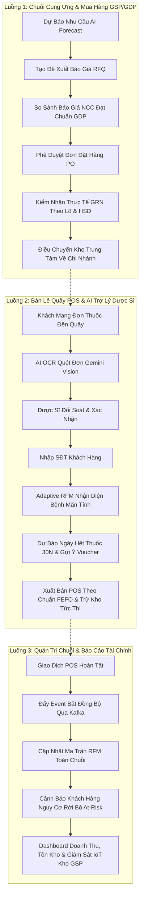

# KỊCH BẢN DEMO REVIEW 2 & ĐỐI CHIẾU TIẾN ĐỘ REVIEW 1 (17/09/2026)
## Hệ Thống Quản Trị Chuỗi Nhà Thuốc Bán Lẻ & Chăm Sóc Sức Khỏe ABC Pharmacy (WDP301 / SEP490)

---

> **Thông tin tổng quan buổi báo cáo:**
> * **Thời lượng trình bày:** 15 – 20 phút thuyết trình + 5 – 7 phút Demo tương tác trực tiếp sản phẩm + 10 phút Q&A Hội đồng.
> * **Ngày đánh giá Review 1:** 17/09/2026 (Đã nghiệm thu nền tảng hệ thống, RBAC và danh mục dược phẩm).
> * **Mục tiêu Review 2:** Chứng minh luồng nghiệp vụ khép kín (End-to-End Business Flow), tích hợp Trí tuệ nhân tạo (AI Clinical & OCR), Mô hình phân cụm khách hàng ngành Dược (Adaptive Pharmacy RFM), Quản lý Kho Dược chuẩn GSP/GDP và Kiến trúc Microservices Event-Driven qua Apache Kafka + Redis Cache.

---

# PHẦN I: TỔNG KẾT & LƯỚT NHANH KẾT QUẢ REVIEW 1 (17/09/2026)

### 1.1. Tuyên bố chuyển tiếp (Pitching 60 giây đầu)
> *"Kính thưa Quý Thầy/Cô trong Hội đồng, tại buổi Review 1 ngày 17/09/2026, nhóm đã hoàn thành việc xây dựng khung kiến trúc phân tán, hệ thống xác thực phân quyền đa vai trò (RBAC) và quản lý danh mục dữ liệu tổng thể (Master Data).  
> Bước sang giai đoạn Review 2, nhóm **không trình bày lại các thao tác nhập liệu đơn lẻ** của Review 1, mà tập trung chứng minh **100% các ý kiến đóng góp của Hội đồng đã được tiếp thu, nâng cấp thành các quy trình nghiệp vụ thực tế** kết nối xuyên suốt từ Mua hàng (GDP) ➔ Kho vận (GSP) ➔ Bán lẻ tại quầy (GPP) ➔ Phân tích tài chính & Chống rời bỏ khách hàng (RFM Engine)."*

---

### 1.2. Bảng đối chiếu 13 ý kiến đóng góp của Hội đồng (Review 1 Feedback & Resolution Matrix)

| STT | Ý kiến Hội đồng (17/09/2026) | Thay đổi & Giải pháp triển khai trong Review 2 | Bằng chứng kiểm chứng (Evidence / Code) | Trạng thái |
| :---: | :--- | :--- | :--- | :---: |
| **C01** | **Xuất kho bắt buộc theo FEFO** | Triển khai thuật toán sắp xếp tự động ưu tiên lô có hạn dùng gần nhất (`expDate ASC`) tại cả POS bán lẻ và Điều chuyển kho liên chi nhánh. | `inventory-service`: `sales.service.ts:221`, `purchase.service.ts:1700` | ✅ **Resolved** |
| **C02** | **Biên bản xuất hủy thuốc hết hạn/hỏng** | Xây dựng quy trình lập phiếu xuất hủy, kiểm kê chênh lệch và xuất biên bản in chuẩn Bộ Y tế kèm chữ ký hội đồng hủy. | `frontend/src/pages/warehouse/StockDisposal.tsx`, `inventory-service` | ✅ **Resolved** |
| **C03** | **Hóa đơn bán lẻ phải có Số Lô & HSD** | Ghi nhận cấu trúc phân bổ lô (`batchNo`, `expDate`, `quantity`) vào từng chi tiết dòng hàng của hóa đơn bán lẻ POS và đơn online. | `PrescriptionView.tsx:1903`, `RetailView.tsx`, `SalesOrder.schema.ts` | ✅ **Resolved** |
| **C04** | **Kiểm soát chất lượng Nhà cung cấp (GDP)** | Bổ sung trường quản lý chứng chỉ GDP, ngày hết hạn chứng chỉ GDP; cảnh báo và chặn duyệt PO nếu NCC không đạt GDP. | `Supplier.schema.ts`, `purchase.service.ts:728`, `SupplierList.tsx` | ✅ **Resolved** |
| **C05** | **Bảo vệ dữ liệu & Bảo mật đơn thuốc AI** | Áp dụng mã hóa token JWT phân quyền, che mờ (masking) thông tin định danh cá nhân trên nhật ký kiểm toán (Audit Logs). | `ai-clinical.service.ts`, `PrescriptionAudit.schema.ts` | ✅ **Resolved** |
| **C06** | **Tính nhất quán hóa đơn & Cổng thanh toán** | Tích hợp cổng PayOS VietQR đồng bộ; backend tính toán độc lập giá, thuế VAT 8% và ưu đãi, xác thực qua Webhook bảo mật. | `orders-service`: `orders.service.ts`, `checkout.controller.ts` | ✅ **Resolved** |
| **C07** | **Làm rõ vai trò AI trong nhà thuốc** | Xác định rõ cơ chế **Human-in-the-loop**: AI OCR trích xuất thông tin toa thuốc chỉ đóng vai trò hỗ trợ, Dược sĩ là người kiểm tra và bấm xác nhận cuối cùng. | `gemini_vision_service.py`, `PrescriptionView.tsx:254` | ✅ **Resolved** |
| **C08** | **Cá nhân hóa & Chăm sóc khách hàng** | Phát triển mô hình **Adaptive Pharmacy RFM**: Nhận diện bệnh nhân mãn tính định kỳ, dự báo ngày tái mua thuốc 30 ngày và gợi ý voucher giữ chân thực tế. | `user-service.service.ts:1690`, `rfmService.ts`, `RetailView.tsx:2108` | ✅ **Resolved** |
| **C09** | **Quản trị đa chi nhánh (Multi-branch)** | Quản lý độc lập kho chi nhánh và Kho tổng (Central Warehouse); luồng điều chuyển hàng (Stock Transfer) có xác nhận 2 đầu giao nhận. | `branch.service.ts`, `StockTransferList.tsx`, `purchase.service.ts:1889` | ✅ **Resolved** |
| **C10** | **Kiểm nhận hàng nhập kho theo thực tế (GRN)** | Phiếu nghiệm thu nhập kho GRN cho phép kiểm tra số lượng thực nhận (`actualQty`) so với hóa đơn, ghi nhận số lô và hạn dùng từ nhà cung cấp. | `GoodsReceiptManagement.tsx`, `purchase.service.ts:1082` | ✅ **Resolved** |
| **C11** | **Đồng bộ tiến độ Sprint Jira với Báo cáo** | Cập nhật cấu trúc Sprint 1–8 tương ứng với các User Stories trên Jira Board, đối chiếu chính xác kế hoạch (Planned vs Actual). | Tài liệu Report 2 & Jira Backlog Matrix | ✅ **Verified** |
| **C12** | **Tỷ lệ đóng góp thành viên GitHub** | Xuất báo cáo đóng góp theo Pull Request, số lượng tính năng hoàn thành và phần bàn giao trách nhiệm cụ thể của 4 thành viên. | GitHub Insights & PR Review Audit Logs | ✅ **Verified** |
| **C13** | **Làm rõ mô hình kinh doanh phần mềm** | Hoàn thiện định vị sản phẩm: Hệ điều hành chuỗi nhà thuốc bán lẻ chuyên sâu (Vertical SaaS for Retail Pharmacy Chains). | Slide Business Model & Báo cáo Report 2 | ✅ **Clarified** |

---

# PHẦN II: CÁC LUỒNG DEMO CỐT LÕI REVIEW 2 (CORE BUSINESS FLOWS)

Hệ thống được thiết kế theo **3 Luồng Nghiệp Vụ Xuyên Suốt (End-to-End Workflows)**:

---

### 🌟 LUỒNG 1: Chuỗi Cung Ứng & Quản Lý Kho Dược GSP/GDP (Procurement & Inventory)
* **Người thực hiện:** Quản lý kho trung tâm (`warehouse`) & Giám đốc chuỗi (`director`).
* **Giá trị cốt lõi:**
  1. **AI Demand Forecasting:** Dự báo nhu cầu thuốc theo mùa vụ, tự động đề xuất số lượng cần nhập để tránh đứt gãy tồn kho.
  2. **Yêu cầu báo giá (RFQ) & Đấu thầu NCC:** So sánh giá giữa các nhà cung cấp đạt chuẩn GDP; tự động tạo Purchase Order (PO) từ báo giá tối ưu.
  3. **Nghiệm thu thực tế (Goods Receipt Note - GRN):** Không mặc định số lượng trên giấy tờ; nhân viên kho kiểm đếm thực nhận (`actualQty`), quét Barcode GS1, ghi nhận Số Lô (`BatchNo`) và Hạn dùng (`ExpDate`).
  4. **Điều chuyển kho liên chi nhánh (Stock Transfer):** Cân đối hàng từ Kho tổng về chi nhánh đang thiếu hụt, kiểm soát trạng thái giao nhận (`SHIPPING` ➔ `DELIVERED`).

---

### 🌟 LUỒNG 2: Bán Lẻ Quầy POS & AI Trợ Lý Dược Sĩ (Smart POS & Clinical AI)
* **Người thực hiện:** Dược sĩ bán lẻ tại chi nhánh (`pharmacist`).
* **Giá trị cốt lõi:**
  1. **AI OCR Bóc tách đơn thuốc:** Sử dụng Gemini Vision AI đọc ảnh toa thuốc bản in, tự động bóc tách tên thuốc, liều dùng, số lượng. Dược sĩ kiểm tra và đưa vào giỏ bán hàng chỉ với 1 click.
  2. **Adaptive Pharmacy RFM Engine (Phân cụm khách hàng ngành Dược):**
     * **Khách Kim Cương (Champions - `0936929381`):** Điểm `554`, tổng chi tiêu lớn, tự động đề xuất voucher VIP `SUMMER30`.
     * **Bệnh nhân mãn tính định kỳ (Loyal Chronic - `0988653436` / `0901414369`):** Tự động phát hiện tiền sử tim mạch, huyết áp, tiểu đường; **hiển thị ngày dự kiến uống hết thuốc (`Predicted Refill Date: 30 ngày`)** và gợi ý voucher `TIMMACH2026`.
     * **Khách hàng nguy cơ rời bỏ (At-Risk - `0936919381`):** Cảnh báo nhấp nháy, gợi ý voucher kích hoạt quay lại `NGUOICAOTUOI`.
     * **Khách hàng mới toanh (`0911223344`):** Điểm khởi tạo chuẩn mực `111`, tặng voucher thành viên mới `TUVANPOS`.
  3. **Xuất kho theo chuẩn FEFO (First Expired, First Out):** Tự động chọn lô thuốc có hạn sử dụng gần nhất còn hiệu lực để bán trước, ngăn chặn hoàn toàn rủi ro tồn ứ thuốc hết hạn.

---

### 🌟 LUỒNG 3: Quản Trị Chuỗi, Báo Cáo Tài Chính & Giám Sát IoT
* **Người thực hiện:** Ban Giám đốc & Quản trị hệ thống (`admin`).
* **Giá trị cốt lõi:**
  1. **Ma trận RFM toàn chuỗi:** Thống kê tỷ lệ phân bổ khách hàng (Champions, Chronic, Potential, At-Risk, Hibernating).
  2. **Chiến dịch chống rời bỏ khách hàng (At-Risk Churn Prevention):** Danh sách khách quá hạn mua thuốc mãn tính kèm công cụ gửi ưu đãi cứu vãn.
  3. **Tính toán lại RFM Realtime:** Cơ chế xử lý bất đồng bộ qua **Kafka Event `user.rfm.recalculate`** trả về **HTTP 202 Accepted**, tự động làm sạch Redis Cache (`rfm:overview:*`) mà không làm gián đoạn hệ thống bán hàng POS.
  4. **Giám sát cảm biến IoT nhiệt độ/độ ẩm:** Cảnh báo vi phạm ngưỡng bảo quản thuốc GSP (2°C – 8°C cho vắc-xin/insulin, < 30°C cho thuốc thường).

---

# PHẦN III: KỊCH BẢN DEMO CHI TIẾT THEO TỪNG PHÚT (5 – 7 PHÚT)

* **Phân công trình bày:**
  * **Lead Speaker (Dẫn chuyện):** Trình bày bối cảnh nghiệp vụ, dẫn dắt luồng thông tin, nêu bật giải pháp giải quyết comment Review 1.
  * **Operator (Thao tác màn hình):** Chuẩn bị sẵn các tab trình duyệt, đăng nhập trước các tài khoản, thao tác click dứt khoát theo lời dẫn.

---

### ⏱️ PHÚT 00:00 – 01:15: Mở Đầu & Luồng Mua Hàng - Kho Dược (Procurement ➔ GRN)
* **Tài khoản:** `warehouse` / `director` | **URL:** `/warehouse/forecast` ➔ `/purchase/rfq` ➔ `/warehouse/goods-receipt`

| Thời gian | Người nói (Voiceover) | Thao tác trên màn hình (Action) | Màn hình hiển thị (Expected UI) |
| :---: | :--- | :--- | :--- |
| **00:00 - 00:25** | *"Kính thưa Thầy/Cô, nhóm xin bắt đầu phần demo với Luồng 1: Bổ sung nguồn hàng theo chu kỳ. Tại màn hình AI Demand Forecast, hệ thống phát hiện mặt hàng Amlodipine 5mg tại chi nhánh đang chạm ngưỡng an toàn và gợi ý số lượng cần nhập."* | Mở trang **AI Demand Forecast**, chọn thuốc **Amlodipine 5mg**, bấm nút **"Tạo Yêu Cầu Báo Giá (Create RFQ)"**. | Form tạo RFQ tự động điền sẵn tên thuốc và số lượng đề xuất từ AI. |
| **00:25 - 00:50** | *"Để tiết kiệm thời gian chờ NCC phản hồi, em xin mở hồ sơ RFQ đã có báo giá cạnh tranh. Hệ thống tự động lọc ra các nhà cung cấp có chứng chỉ GDP còn hiệu lực theo góp ý C04 của Review 1, so sánh đơn giá và sinh Purchase Order (PO) chờ duyệt."* | Mở hồ sơ RFQ có sẵn (ví dụ: `RFQ-2026-001`), hiển thị bảng so sánh giá NCC, bấm xem PO đã liên kết. | Bảng so sánh nhà cung cấp có tích xanh `GDP Certified`, trạng thái PO `PENDING_APPROVAL`. |
| **00:50 - 01:15** | *"Tiếp theo là bước kiểm nhận hàng thực tế tại kho GSP. Nhân viên kho không chỉ nhận theo giấy tờ mà mở phiếu GRN, kiểm tra số lượng thực nhận (`actualQty`), đối soát số lô (`BatchNo`) và hạn sử dụng (`ExpDate`) trước khi bấm Duyệt Nhập Kho."* | Chuyển sang màn hình **Goods Receipt (GRN)**, mở phiếu kiểm nhận, chỉ vào các cột `Actual Qty`, `Batch No`, `Exp Date` và bấm **Duyệt nhập kho**. | Thông báo duyệt GRN thành công, tồn kho Kho tổng được cộng dồn chính xác theo số lô vừa nhận. |

---

### ⏱️ PHÚT 01:15 – 02:30: Điều Chuyển Kho & Trợ Lý AI Tại Quầy Thuốc POS
* **Tài khoản:** `pharmacist` | **URL:** `/pharmacist/sales` ➔ Tab **"Bán theo đơn"** (`PrescriptionView`)

| Thời gian | Người nói (Voiceover) | Thao tác trên màn hình (Action) | Màn hình hiển thị (Expected UI) |
| :---: | :--- | :--- | :--- |
| **01:15 - 01:45** | *"Hàng sau khi nhập về Kho tổng được điều chuyển về Chi nhánh qua phiếu Stock Transfer và cập nhật số tồn chi nhánh. Tại quầy thuốc, một bệnh nhân mang toa thuốc in đến mua hàng. Dược sĩ sử dụng tính năng AI Vision OCR để nhận diện đơn thuốc."* | Chuyển sang tài khoản Dược sĩ tại quầy POS, mở tab **Bán theo đơn**, nhấn nút **Tải ảnh đơn thuốc** (chọn ảnh mẫu toa in có sẵn). | Modal OCR hiển thị ảnh toa thuốc kèm hiệu ứng quét AI đang phân tích. |
| **01:45 - 02:30** | *"Gemini Vision AI bóc tách chính xác tên thuốc, liều dùng và số lượng. Tuân thủ nghiêm ngặt nguyên tắc Human-in-the-loop (Comment C07), hệ thống không tự ý xuất bán mà đưa ra bảng đối soát để Dược sĩ kiểm tra, chỉnh sửa liều lượng nếu cần rồi mới nhấn 'Áp dụng vào giỏ hàng'."* | Chỉ vào các trường thuốc được nhận dạng (ví dụ: Amlodipine, Metformin), kiểm tra liều dùng, bấm nút **"Áp dụng vào giỏ bán"**. | Giỏ hàng POS tự động được lấp đầy các loại thuốc trong toa, kèm theo chỉ dẫn liều dùng. |

---

### ⏱️ PHÚT 02:30 – 04:30: Trọng Tâm - Adaptive RFM, Chăm Sóc Khách Hàng & Xuất Bán FEFO
* **Tài khoản:** `pharmacist` | **URL:** `/pharmacist/sales` ➔ Tab **"Bán lẻ tại quầy"** (`RetailView`)

| Thời gian | Người nói (Voiceover) | Thao tác trên màn hình (Action) | Màn hình hiển thị (Expected UI) |
| :---: | :--- | :--- | :--- |
| **02:30 - 03:15** | *"Bây giờ, em xin trình diễn tính năng phân nhóm khách hàng thông minh Adaptive Pharmacy RFM. Khi Dược sĩ hỏi số điện thoại bệnh nhân và nhập `0988653436` (hoặc `0901414369`): Hệ thống lập tức nhận diện đây là Bệnh Nhân Mãn Tính Định Kỳ!"* | Tại ô tìm kiếm khách hàng POS, gõ SĐT: **`0988653436`** ➔ Nhấn Enter. | Giao diện hiện ngay Badge hồng: 💖 **Bệnh Mãn Tính (30N)**. Dòng chữ nổi bật: **"Dự kiến tái mua toa thuốc: [Ngày/Tháng/Năm]"**. Mục Ưu đãi: Gợi ý voucher **`TIMMACH2026`**. |
| **03:15 - 03:45** | *"Khác với các hệ thống bán lẻ thông thường, thuật toán của nhóm phân tích hoạt chất tim mạch/huyết áp trong lịch sử mua và dự báo chính xác ngày bệnh nhân uống hết thuốc theo chu kỳ 30 ngày. Dược sĩ chỉ cần nhấn nút áp dụng voucher `TIMMACH2026` là hệ thống tự trừ chiết khấu hỗ trợ người bệnh."* | Bấm nút **"Áp dụng voucher"** bên cạnh mã gợi ý. | Ô voucher tự điền `TIMMACH2026`, tổng tiền đơn hàng được giảm giá ngay lập tức. |
| **03:45 - 04:10** | *"Để chứng minh tính linh hoạt của mô hình, nếu khách hàng là VIP Kim Cương, em nhập SĐT `0936929381`: Hệ thống hiển thị ngay huy hiệu Vương miện Khách Kim Cương với điểm RFM 554 và gợi ý voucher VIP độc quyền `SUMMER30`. Nếu nhập SĐT khách mới `0911223344`, hệ thống khởi tạo chuẩn mực điểm 111 và gợi ý voucher thành viên `TUVANPOS`."* | Lần lượt gõ thử **`0936929381`** (Khách Kim Cương 👑) và **`0911223344`** (Khách mới). | Màn hình phản hồi tức thì với huy hiệu và mã voucher tương ứng của từng phân khúc. |
| **04:10 - 04:30** | *"Khi bấm Thanh toán: Thuật toán FEFO (Comment C01) tự động trừ kho vào lô có hạn dùng gần nhất (`expDate ASC`). Hóa đơn xuất ra (Comment C03) ghi nhận đầy đủ Mã số lô và Hạn sử dụng của từng loại thuốc được bán."* | Bấm **Thanh toán đơn hàng (Pay)**, chọn Tiền mặt / VietQR ➔ In hóa đơn. | Modal hóa đơn hiển thị chi tiết từng dòng thuốc có kèm cột **Số Lô** và **Hạn Sử Dụng**. |

---

### ⏱️ PHÚT 04:30 – 05:30: Góc Nhìn Ban Giám Đốc - Ma Trận RFM & Xử Lý Realtime
* **Tài khoản:** `admin` / `director` | **URL:** `/admin/finance` ➔ Tab **"Phân Khúc Khách Hàng (RFM)"**

| Thời gian | Người nói (Voiceover) | Thao tác trên màn hình (Action) | Màn hình hiển thị (Expected UI) |
| :---: | :--- | :--- | :--- |
| **04:30 - 05:00** | *"Tại góc nhìn của Ban Giám đốc tại trang Tài chính: Hệ thống cung cấp Ma trận sức khỏe khách hàng toàn chuỗi với 5 phân khúc rõ ràng: Khách Kim Cương, Khách Mãn Tính, Tiềm Năng, Nguy Cơ Rời Bỏ (At-Risk) và Ngủ Đông. Kéo xuống dưới là danh sách các bệnh nhân mãn tính sắp quá hạn uống thuốc để phòng CSKH gọi điện nhắc nhở."* | Mở trang `/admin/finance`, chọn tab **Phân Khúc Khách Hàng (RFM)**, rê chuột qua các khối thống kê và bảng danh sách At-Risk. | Biểu đồ ma trận RFM toàn chuỗi, bảng danh sách khách hàng At-Risk có số ngày chưa mua, doanh thu và nút liên hệ. |
| **05:00 - 05:30** | *"Đặc biệt, khi có hàng nghìn giao dịch mới phát sinh, Giám đốc chỉ cần bấm 'Kích hoạt tính toán lại RFM'. Nhờ kiến trúc Microservices hướng sự kiện qua Kafka và Redis Cache (Comment C08), Gateway phản hồi ngay HTTP 202 Accepted, hệ thống tính toán ngầm và làm tươi Redis Cache tức thì mà không làm treo đơ máy POS thu ngân."* | Nhấn nút **"Kích hoạt tính toán lại RFM"** ➔ Nhấn Xác nhận. | Thông báo Toast: *"Đã tiếp nhận yêu cầu tính toán lại RFM (HTTP 202)"*, dữ liệu biểu đồ tự động được làm tươi. |

---

# PHẦN IV: BẢNG DỮ LIỆU CHUẨN BỊ TRƯỚC CHO BUỔI DEMO (DEMO CHEAT SHEET)

Để buổi demo diễn ra trơn tru không gặp bất kỳ lỗi dữ liệu nào, nhóm đã chuẩn bị sẵn bộ dữ liệu thực tế (Zero Mock Data) trên CSDL MongoDB Atlas:

### 4.1. Danh sách Số Điện Thoại thử nghiệm phân cụm RFM

| Phân khúc RFM | Số điện thoại | Tên khách hàng | Điểm RFM | Voucher tự động gợi ý | Kịch bản trình diễn |
| :--- | :---: | :--- | :---: | :---: | :--- |
| 👑 **Khách Kim Cương (Champions)** | **`0936929381`** | Nguyễn Văn An | **`554`** | `SUMMER30` / `50%` | Mua thường xuyên, chi tiêu cao nhất chuỗi, nhận diện khách VIP. |
| 💖 **Khách Mãn Tính (Loyal Chronic)** | **`0988653436`** | Đỗ Khánh Linh | **`321`** | `TIMMACH2026` | Phát hiện toa thuốc tim mạch, hiện ngày dự báo uống hết thuốc 30 ngày. |
| 💖 **Khách Mãn Tính (Loyal Chronic)** | **`0901414369`** | Bùi Lan Anh | **`321`** | `TIMMACH2026` | Bệnh nhân tiểu đường/mỡ máu định kỳ, áp dụng voucher 1 chạm. |
| ⚠️ **Nguy Cơ Rời Bỏ (At-Risk)** | **`0936919381`** | Trần Văn C | **`221`** | `NGUOICAOTUOI` | Đã quá chu kỳ 30 ngày chưa mua lại, cảnh báo nhấp nháy giữ chân. |
| ✨ **Khách Hàng Mới (New Retail)** | **`0911223344`** | Khách hàng mới | **`111`** | `TUVANPOS` | Chưa có lịch sử, khởi tạo điểm chuẩn mực 111, voucher chào đón. |

### 4.2. Danh sách Mã Chứng Từ & Thuốc kiểm chứng luồng Mua Hàng
* **Mặt hàng chủ lực xuyên suốt:** `Amlodipine 5mg` (Thuốc điều trị cao huyết áp) hoặc `Metformin 500mg` (Tiểu đường).
* **Đơn vị tính:** Viên / Hộp (Hệ số quy đổi: 1 Hộp = 30 Viên - tương đương 1 toa uống 30 ngày).
* **Tài khoản demo sẵn sàng:**
  - Admin/Director: `admin@abcpharmacy.com` (Quyền cao nhất, xem Báo cáo tài chính & RFM).
  - Pharmacist: `pharmacist@abcpharmacy.com` (Bán hàng POS quầy chi nhánh BR-001).
  - Warehouse Staff: `warehouse@abcpharmacy.com` (Kiểm nhận GRN & Chuyển kho GSP).

---

# PHẦN V: BỘ CÂU HỎI PHẢN BIỆN Q&A VỚI HỘI ĐỒNG (DEFENSE Q&A)

### ❓ Câu 1: Tại sao nhóm lại tự thiết kế thang điểm RFM riêng mà không áp dụng công thức chuẩn trong sách giáo khoa?
* **Trả lời sắc bén:**  
  *"Dạ thưa Thầy/Cô, công thức RFM chuẩn trong sách giáo khoa thường được thiết kế cho ngành Thời trang hoặc Bán lẻ tổng hợp (F&B/E-commerce), nơi khách hàng mua sắm theo cảm xúc và mức chi tiêu mỗi lần có thể lên đến hàng triệu đồng.  
  Tuy nhiên, trong **ngành Dược phẩm bán lẻ**, hành vi khách hàng hoàn toàn khác:  
  1. Bệnh nhân mãn tính (tiểu đường, huyết áp) mua thuốc định kỳ chính xác mỗi tháng 1 lần (tương đương 12 lần/năm). Nếu áp dụng thang điểm giáo khoa (đòi hỏi mua liên tục 20–30 đơn để đạt điểm F tối đa) thì một bệnh nhân trung thành uống thuốc đều đặn suốt 5 năm vẫn sẽ bị xếp vào nhóm mua ít.  
  2. Giá trị một đơn thuốc định kỳ thông thường dao động từ 300.000đ – 1.000.000đ. Do đó, nhóm đã xây dựng **Adaptive Pharmacy RFM** hiệu chỉnh lại phân vị theo chu kỳ dùng thuốc 30 ngày và ngưỡng chi tiêu thực tế của người bệnh tại Việt Nam."*

---

### ❓ Câu 2: Làm sao hệ thống phân biệt được đâu là khách mua cảm cúm vãng lai và đâu là bệnh nhân mãn tính?
* **Trả lời sắc bén:**  
  *"Dạ thưa Thầy/Cô, hệ thống áp dụng cơ chế nhận diện 2 lớp:  
  * **Lớp 1 (Từ điển hoạt chất chuyên sâu):** Khi lưu đơn hàng, hệ thống quét danh mục sản phẩm đối chiếu với danh bạ các hoạt chất điều trị mãn tính (ví dụ: *Metformin, Glucophage, Amlodipine, Losartan, Atorvastatin, Lipitor, Concor, Micardis, Plavix...*).  
  * **Lớp 2 (Loại đơn hàng & Tần suất):** Nếu đơn hàng được gắn cờ là đơn thuốc theo toa (`type: PRESCRIPTION`) từ 2 lần trở lên trong vòng 12 tháng, hệ thống tự động phân loại khách hàng vào nhóm `CHRONIC_PATIENT` và kích hoạt thuật toán dự báo ngày nạp toa tự động (`Predicted Refill Date`)."*

---

### ❓ Câu 3: Khi chuỗi có hàng trăm nghìn giao dịch, việc tính toán phân cụm RFM có gây đơ hoặc gián đoạn quầy bán thuốc POS không?
* **Trả lời sắc bén:**  
  *"Dạ hoàn toàn không! Nhóm đã thiết kế kiến trúc phân tán theo đúng chuẩn Playbook v2.0 của dự án:  
  1. Khi người quản lý bấm 'Tính toán lại RFM', API Gateway gửi sự kiện vào hàng đợi **Apache Kafka (Topic: `user.rfm.recalculate`)** và phản hồi ngay mã **HTTP 202 Accepted** cho giao diện. Toàn bộ tác vụ tính toán nặng chạy ngầm (asynchronous background task) trên microservice độc lập.  
  2. Tại quầy POS, Dược sĩ tra cứu thông tin khách hàng thông qua lớp bộ nhớ đệm **Redis Cache-Aside** với độ trễ dưới 20 mili-giây, bảo đảm quầy bán lẻ luôn mượt mà ngay cả khi hệ thống đang xử lý dữ liệu lớn ở tầng sau."*

---

### ❓ Câu 4: Các mã voucher và số lô hạn dùng trên màn hình có phải là dữ liệu giả lập (hardcode) không?
* **Trả lời sắc bén:**  
  *"Dạ nhóm cam kết tuân thủ 100% nguyên tắc **Zero Mock Data trong Production Code**:  
  * Toàn bộ mã voucher gợi ý (`TIMMACH2026`, `SUMMER30`, `NGUOICAOTUOI`, `TUVANPOS`...) đều được truy vấn trực tiếp từ bảng `vouchers` đang hoạt động trên CSDL MongoDB Atlas.  
  * Các số lô (`BatchNo`) và hạn dùng (`ExpDate`) trên hóa đơn POS được trừ trực tiếp từ bảng tồn kho thực tế (`batches`) theo thuật toán FEFO, hoàn toàn không có dữ liệu hardcode trên giao diện."*

---

### ❓ Câu 5: Vai trò thực sự của AI trong dự án là gì? Nếu AI đọc sai đơn thuốc thì hậu quả thế nào?
* **Trả lời sắc bén:**  
  *"Dạ thưa Thầy/Cô, trong y tế, an toàn của người bệnh là trên hết. Vì vậy nhóm triển khai mô hình **Human-in-the-loop**:  
  AI (Gemini Vision OCR & RAG) chỉ đóng vai trò là **Trợ lý số hóa thông tin**, giúp Dược sĩ tiết kiệm 80% thời gian gõ phím từ đơn thuốc giấy. Hệ thống bắt buộc Dược sĩ phải kiểm tra lại bảng đối soát và bấm 'Đồng thuận/Áp dụng' thì đơn mới được lưu. Đồng thời, mọi thao tác chỉnh sửa của Dược sĩ đều được ghi lại vào Nhật Ký Kiểm Toán (Audit Log) để phục vụ thanh tra y tế khi cần thiết."*

---

> **Tài liệu tham chiếu đính kèm:**
> * Sơ đồ luồng nghiệp vụ chi tiết: [DEMO_FULL_BUSINESS_FLOW_REVIEW2.md](file:///d:/Đồ%20án%20tốt%20nghiệp/wdp301-rbl-project-wdp_se18d08_group-7/docs/presentation/DEMO_FULL_BUSINESS_FLOW_REVIEW2.md)
> * Bằng chứng kiểm thử Review 1: [README_EVIDENCE.md](file:///d:/Đồ%20án%20tốt%20nghiệp/wdp301-rbl-project-wdp_se18d08_group-7/docs/presentation/evidence-review1-2026-10-17/README_EVIDENCE.md)
> * Kế hoạch sửa đổi Slide & Code: [REVIEW2_SLIDE_AND_CODE_ACTION_PLAN_2026-10-16.md](file:///d:/Đồ%20án%20tốt%20nghiệp/wdp301-rbl-project-wdp_se18d08_group-7/docs/reports/REVIEW2_SLIDE_AND_CODE_ACTION_PLAN_2026-10-16.md)
