# Review 1 Feedback — Evidence thật từ website và code
Ngày kiểm tra: **17/10/2026 (Asia/Saigon)**. Website: [abcpharmacy.store](https://abcpharmacy.store/).

## Cách dùng bộ evidence

Ảnh E01–E15 chụp trực tiếp bằng trình duyệt, không dựng lại giao diện hay sửa nội dung ảnh. E14 chụp riêng bảng thuốc để tránh đưa thông tin liên hệ vào slide. Các tệp C01–C12 là trích đoạn code có số dòng và đường dẫn GitHub gắn commit.

**Giới hạn:** source checkout là commit `288a3a302e085c48b792d721c197e8cdc75d6f6c`; chưa xác định commit đang deploy trên website có trùng checkout không. Kết luận từ code và kết quả live được tách riêng. Không thực hiện giao dịch bán thuốc, thanh toán, xuất hủy, chuyển kho hay sửa hồ sơ. Có một câu hỏi demo không chứa dữ liệu cá nhân đã được gửi tới chatbot.

Không dùng nhãn GPP/GDP/Bộ Y tế trên giao diện làm bằng chứng được chứng nhận hoặc liên thông cơ quan thật.

## 1. Bảng feedback có thể đưa vào slide

### Slide A — Review 1 Feedback and Resolution: Core Operations

| Review 1 feedback | Changes / evidence observed | Evidence | Status |
|---|---|---|---|
| Apply FEFO to all stock-out flows | Batch/expiry details are available; sale and transfer code sort batches by expiry. Expired-batch exclusion and transaction consistency still require fixes. | E07 + C01 | Partially resolved |
| Create disposal minutes for expired medicines | Disposal UI and stock transaction logic exist. The live history remained loading; a completed disposal report has not been verified. | E06 + C02 | Pending live verification |
| Display batch number and expiry on each invoice line | Customer invoice UI includes both fields, but fallback batch values and a fixed expiry date remain in code. | E14 + C03 + C12 | Partially resolved |
| Clarify supplier qualification | Supplier records show GDP validity and expiry warnings. Strict blocking in auto-routed purchase orders remains incomplete in the inspected code. | E05 + C04 | Partially resolved |
| Verify automatic invoice accuracy | Server-side pricing and PayOS signature verification exist; cross-record amount consistency still requires end-to-end tests. | C06 + E14 | Partially resolved |

### Slide B — Review 1 Feedback and Resolution: AI and Customer Experience

| Review 1 feedback | Changes / evidence observed | Evidence | Status |
|---|---|---|---|
| Explain AI integration | Chatbot responded to a demo message; saved voice records expose STT text and AI/pharmacist comparison. OCR evaluation and confirmation integrity remain open. | E02 + E09 + E10 + C08 | Implemented; validation pending |
| Add customer personalization | RFM refill reminders are visible after customer login. Display-name mapping and identity authorization require fixes. | E13 + C09 | Partially resolved |
| Implement order tracking | A tracking map and milestones are available. Current code simulates shipment progress and delivery metadata. | E15 + C07 | UI implemented; real tracking pending |
| Protect uploaded prescription data | Role checks exist; public-file fallback and branch-level authorization still require fixes in the inspected code. | C05 | Partially resolved |
| Support branch management | Multiple branches are displayed with status and inventory details. Branch isolation has not been tested in this session. | E04 + C10 | Implemented; access-control testing pending |

Ghi footnote trên slide: **Evidence captured on 17 Oct 2026. UI availability does not imply full business-rule verification.**

Nên chọn 4–5 dòng mỗi slide và để mã evidence bên cạnh. Chuyển ảnh lớn/đoạn code vào appendix; mã evidence liên kết tới đúng ảnh. Không đánh dấu tất cả Resolved.

## 2. Các comment còn thiếu evidence bên ngoài website

| Comment | Evidence hiện có | Còn cần bổ sung |
|---|---|---|
| Đồng bộ sprint Jira và Report 2 | Chưa truy cập Jira để so khớp | Ảnh sprint có ngày/scope/completed work và bảng Report 2 cùng mốc |
| Đóng góp GitHub | C11 có git shortlog và 30 commit gần nhất | Gom alias cùng người; đối chiếu issue/PR và phần bàn giao nhóm 4 người. Không đổi commit count thành % công sức |
| Tiến độ 70–80% | Đây là nhận xét lịch sử Review 1, không phải số liệu hiện tại | Requirements accepted / planned scope với ngày chốt và danh sách việc chưa xong |
| Business: bán gói cho doanh nghiệp | Website có cửa hàng khách lẻ và trang quản trị | Slide mô hình bán phần mềm cho doanh nghiệp, phân gói/phạm vi và quy tắc định giá có cơ sở; chưa có evidence subscription/tenant billing đã hoạt động |

## 3. Danh mục ảnh và câu chú thích nên dùng

### E01 — Website đang triển khai

- Ảnh: [E01-live-home.jpg](E01-live-home.jpg)
- Website: [https://abcpharmacy.store/](https://abcpharmacy.store/)
- **Chứng minh được:** Trang chủ truy cập được và có danh mục sản phẩm.
- **Giới hạn:** Các cam kết marketing/chứng nhận trên UI không phải bằng chứng kiểm định hay số liệu vận hành.

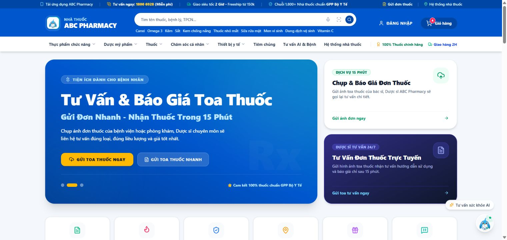

### E02 — Chatbot trả lời câu hỏi demo

- Ảnh: [E02-live-ai-chat-response.jpg](E02-live-ai-chat-response.jpg)
- Website: [https://abcpharmacy.store/](https://abcpharmacy.store/)
- **Chứng minh được:** Đã gửi câu hỏi giới thiệu chức năng, không chứa dữ liệu cá nhân; đã nhận phản hồi trong chat.
- **Giới hạn:** Chứng minh vòng gửi/nhận chat, không chứng minh độ chính xác y khoa, model thực chạy hoặc chất lượng RAG.

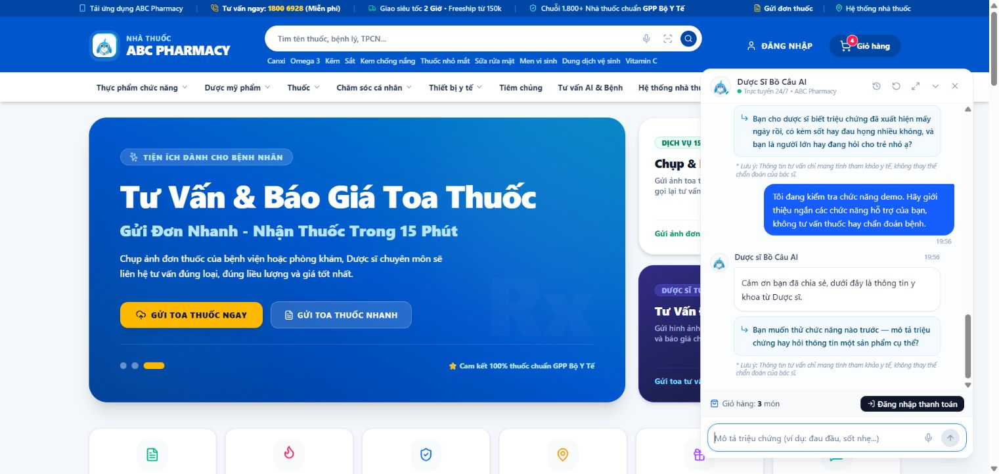

### E03 — Biểu mẫu gửi đơn thuốc

- Ảnh: [E03-live-prescription-upload-form.jpg](E03-live-prescription-upload-form.jpg)
- Website: [https://abcpharmacy.store/](https://abcpharmacy.store/)
- **Chứng minh được:** Mở được biểu mẫu nhận thông tin và tệp đơn thuốc.
- **Giới hạn:** Chưa upload ảnh; không dùng ảnh này để khẳng định OCR đã đọc đúng hoặc file được lưu an toàn.

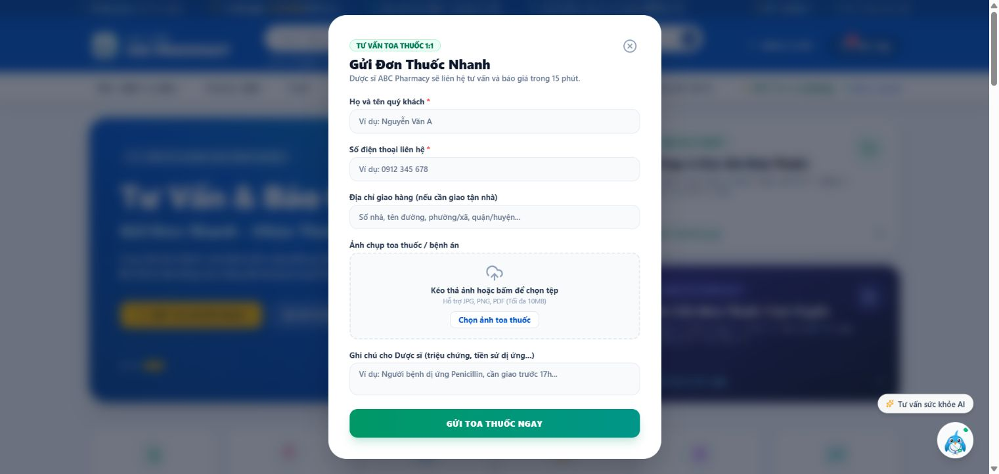

### E04 — Quản lý nhiều chi nhánh

- Ảnh: [E04-live-branches.jpg](E04-live-branches.jpg)
- Website: [https://abcpharmacy.store/admin/branches](https://abcpharmacy.store/admin/branches)
- **Chứng minh được:** Danh sách tải được nhiều cơ sở với trạng thái, địa chỉ, nhân sự và tồn kho.
- **Giới hạn:** Chưa kiểm thử tạo/sửa, cách tính chỉ số hay cách ly dữ liệu giữa chi nhánh. UI còn tên VinaPharmacy và ảnh lỗi.

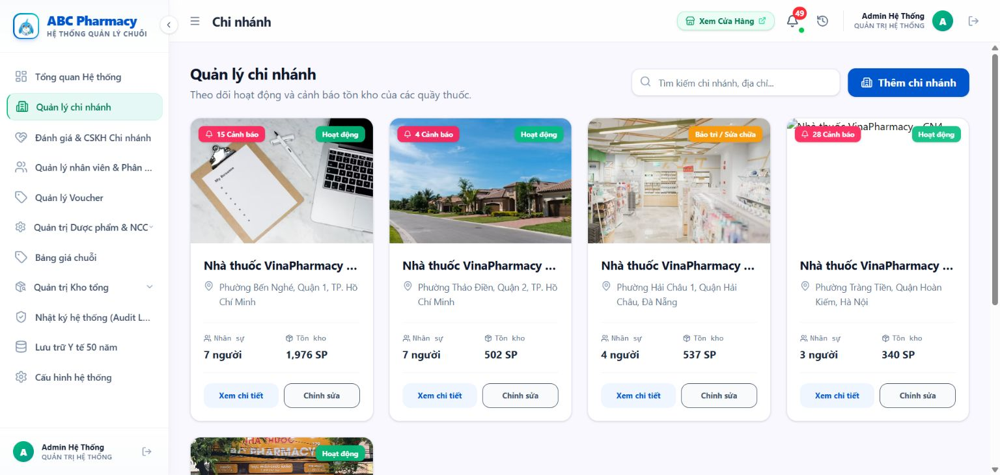

### E05 — Hồ sơ và cảnh báo GDP nhà cung cấp

- Ảnh: [E05-live-supplier-gdp.jpg](E05-live-supplier-gdp.jpg)
- Website: [https://abcpharmacy.store/admin/master-data/suppliers](https://abcpharmacy.store/admin/master-data/suppliers)
- **Chứng minh được:** Có hạn GDP và nhãn HỢP LỆ / HẾT HẠN GDP. Một số hàng hết hạn vẫn có trạng thái Đang hoạt động.
- **Giới hạn:** Ảnh chứng minh cảnh báo; chưa thực hiện PO để kiểm tra chặn. Code PO tự động hiện có đường chỉ cảnh báo rồi tiếp tục.

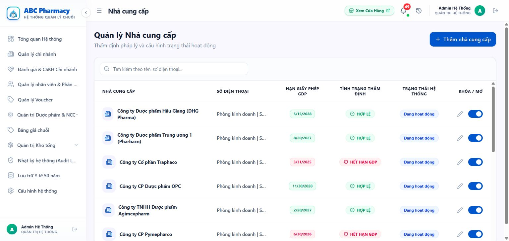

### E06 — Xuất hủy chưa tải được lịch sử

- Ảnh: [E06-live-disposal-loading.jpg](E06-live-disposal-loading.jpg)
- Website: [https://abcpharmacy.store/admin/inventory/dispose](https://abcpharmacy.store/admin/inventory/dispose)
- **Chứng minh được:** Mở được trang xuất hủy nhưng lịch sử giữ trạng thái đang tải trong các lần kiểm tra.
- **Giới hạn:** Không phải evidence biên bản hủy hoàn chỉnh. Không lấy 0 phiếu khi đang tải làm dữ liệu cuối; nhãn 100% không được kiểm chứng.

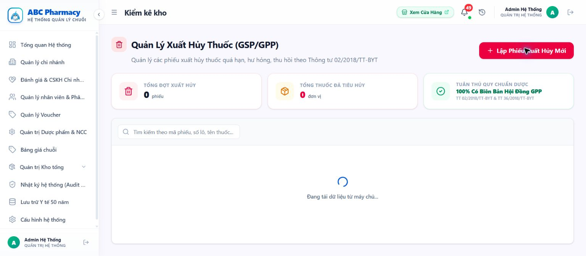

### E07 — Tồn kho theo số lô và HSD

- Ảnh: [E07-live-batch-expiry-details.jpg](E07-live-batch-expiry-details.jpg)
- Website: [https://abcpharmacy.store/admin/inventory](https://abcpharmacy.store/admin/inventory)
- **Chứng minh được:** Mở được chi tiết nhiều lô của cùng thuốc, có mã lô và ngày hết hạn.
- **Giới hạn:** Chưa bán/chuyển kho; chưa có chứng cứ lô nào bị trừ trước. Dropdown còn bị cắt ở mép bảng.

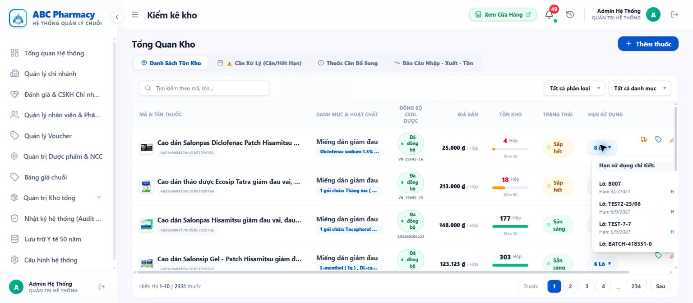

### E08 — Lịch sử OCR chi nhánh demo đang rỗng

- Ảnh: [E08-live-ocr-history-empty.jpg](E08-live-ocr-history-empty.jpg)
- Website: [https://abcpharmacy.store/pharmacist/ocr-history](https://abcpharmacy.store/pharmacist/ocr-history)
- **Chứng minh được:** Trang audit OCR tải xong, chi nhánh được chọn chưa có lịch sử.
- **Giới hạn:** Không chứng minh OCR không hoạt động ở mọi chi nhánh; chưa chạy lượt OCR mới trong phiên này.

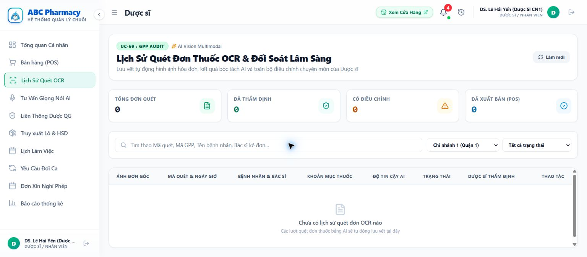

### E09 — Bản ghi voice và trạng thái audit

- Ảnh: [E09-live-voice-audit-history.jpg](E09-live-voice-audit-history.jpg)
- Website: [https://abcpharmacy.store/pharmacist/ai-consultation](https://abcpharmacy.store/pharmacist/ai-consultation)
- **Chứng minh được:** Màn hình tải 10 bản ghi, có văn bản STT, gợi ý AI và trạng thái dược sĩ; tại thời điểm chụp chỉ số là 3 xác nhận, 0 đồng bộ đơn.
- **Giới hạn:** Đây là bản ghi đã tồn tại; chưa chạy ghi âm mới, nghe đối chiếu audio hay kiểm chứng tính đúng đắn của xác nhận.

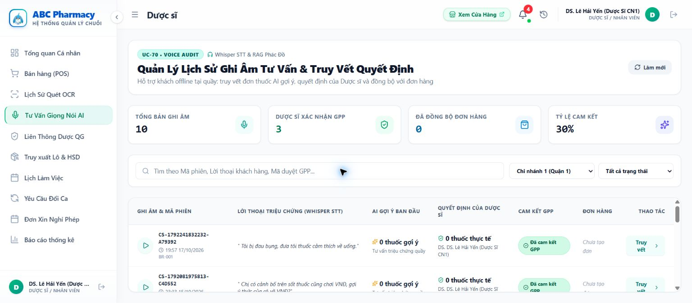

### E10 — Đối soát gợi ý AI và lựa chọn dược sĩ

- Ảnh: [E10-live-voice-ai-vs-pharmacist.jpg](E10-live-voice-ai-vs-pharmacist.jpg)
- Website: [https://abcpharmacy.store/pharmacist/ai-consultation](https://abcpharmacy.store/pharmacist/ai-consultation)
- **Chứng minh được:** Bản ghi CS-1791205166467-2EA5B4 mở được văn bản STT và hai cột 3 thuốc AI / 3 thuốc dược sĩ.
- **Giới hạn:** Chứng minh có lưu và xem hồ sơ; chưa chứng minh quyết định được xác nhận đúng người/đúng thời điểm. Code khởi tạo tự đồng thuận vẫn cần sửa.

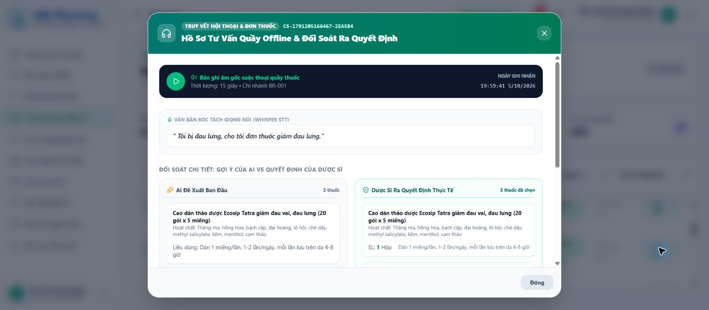

### E11 — Lịch sử hóa đơn phía dược sĩ đang tải

- Ảnh: [E11-live-invoice-history-loading.jpg](E11-live-invoice-history-loading.jpg)
- Website: [https://abcpharmacy.store/pharmacist/sales](https://abcpharmacy.store/pharmacist/sales)
- **Chứng minh được:** Tab đổi trả/hóa đơn đã mở nhưng danh sách chưa tải xong trong thời gian quan sát.
- **Giới hạn:** Chưa có bản in POS từ tab này. Đã tìm được chứng từ phía khách ở E14, có vấn đề dữ liệu ghi cứng.

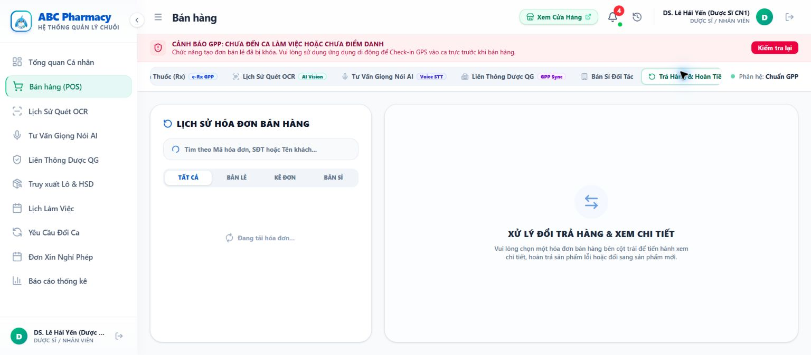

### E12 — POS thông báo chưa có ca/điểm danh

- Ảnh: [E12-live-pos-shift-guard.jpg](E12-live-pos-shift-guard.jpg)
- Website: [https://abcpharmacy.store/pharmacist/sales](https://abcpharmacy.store/pharmacist/sales)
- **Chứng minh được:** UI thông báo khóa tạo đơn khi chưa đến ca hoặc chưa điểm danh.
- **Giới hạn:** Chỉ quan sát UI, không giả lập check-in hoặc tạo đơn để kiểm thử backend guard. Chuẩn bị ca hợp lệ trước demo FEFO.

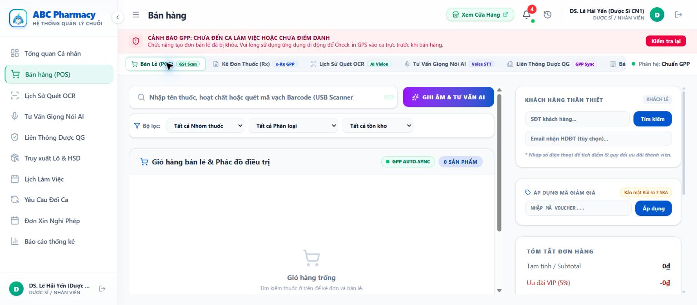

### E13 — Nhắc mua lại theo RFM

- Ảnh: [E13-live-personalized-rfm.jpg](E13-live-personalized-rfm.jpg)
- Website: [https://abcpharmacy.store/](https://abcpharmacy.store/)
- **Chứng minh được:** Sau đăng nhập khách demo xuất hiện khối nhắc mua lại và mã voucher.
- **Giới hạn:** Tên tài khoản Nguyễn Văn An nhưng khối nhắc gọi Trần. Cần kiểm tra ánh xạ profile–phone–RFM/cache; chưa đủ bằng chứng quy nguyên nhân hay kết luận lộ dữ liệu.

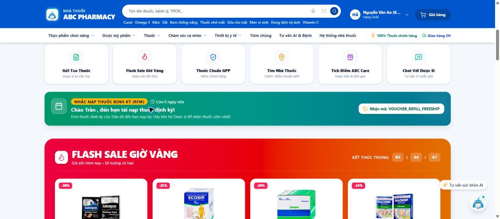

### E14 — Hóa đơn có cột lô/HSD nhưng dữ liệu ghi cứng

- Ảnh: [E14-live-invoice-table-hardcoded-expiry.jpg](E14-live-invoice-table-hardcoded-expiry.jpg)
- Website: [https://abcpharmacy.store/customer/orders](https://abcpharmacy.store/customer/orders)
- **Chứng minh được:** Chứng từ POS-D02358 hiển thị lô L-202604 và HSD 12/2027. Ảnh chỉ chụp bảng thuốc, không có thông tin liên hệ khách.
- **Giới hạn:** CustomerOrders.tsx dòng 1055 dùng batchNo fallback; dòng 1056 ghi HSD cố định. Không dùng ảnh này để khẳng định truy vết lô/HSD chính xác.

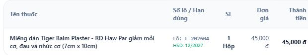

### E15 — Tracking có giao diện nhưng chưa chứng minh event thật

- Ảnh: [E15-live-tracking-ui.jpg](E15-live-tracking-ui.jpg)
- Website: [https://abcpharmacy.store/customer/orders](https://abcpharmacy.store/customer/orders)
- **Chứng minh được:** Mở được bản đồ/tracking cho đơn 10651976, có hành trình và dữ liệu giao nhận.
- **Giới hạn:** Code tạo mốc theo +8/+18/+30/+45 phút, shipper và nhiệt độ ghi cứng. Đây là evidence UI, không phải evidence tích hợp vận chuyển hay IoT thật.

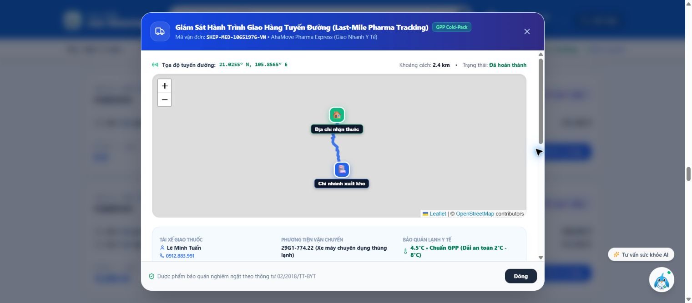

## 4. Code evidence có thể mở trực tiếp khi hội đồng hỏi

| ID | Nội dung | Tệp trích đoạn | Source chính |
|---|---|---|---|
| C01 | Sort FEFO, chọn lô POS và transfer | [C01-FEFO.txt](source/C01-FEFO.txt) | [POS](https://github.com/SEP490-Team3-FA26/SEP490-SE06/blob/288a3a302e085c48b792d721c197e8cdc75d6f6c/backend/apps/inventory-service/src/sales/sales.service.ts#L251), [Transfer](https://github.com/SEP490-Team3-FA26/SEP490-SE06/blob/288a3a302e085c48b792d721c197e8cdc75d6f6c/backend/apps/inventory-service/src/purchase/purchase.service.ts#L1683) |
| C02 | Xuất hủy + mẫu hội đồng | [C02-Disposal.txt](source/C02-Disposal.txt) | [Disposal service](https://github.com/SEP490-Team3-FA26/SEP490-SE06/blob/288a3a302e085c48b792d721c197e8cdc75d6f6c/backend/apps/inventory-service/src/medicine/medicine.service.ts#L936) |
| C03 | Schema phân bổ sale và bản in POS | [C03-Invoice.txt](source/C03-Invoice.txt) | [Batch schema](https://github.com/SEP490-Team3-FA26/SEP490-SE06/blob/288a3a302e085c48b792d721c197e8cdc75d6f6c/backend/apps/inventory-service/src/sales/schemas/sales-order.schema.ts#L5) |
| C04 | GDP validator và nhánh PO chỉ cảnh báo | [C04-Supplier.txt](source/C04-Supplier.txt) | [Auto-routed PO](https://github.com/SEP490-Team3-FA26/SEP490-SE06/blob/288a3a302e085c48b792d721c197e8cdc75d6f6c/backend/apps/inventory-service/src/purchase/purchase.service.ts#L589) |
| C05 | JWT/role; public-file fallback; filter OCR | [C05-Privacy.txt](source/C05-Privacy.txt) | [File storage](https://github.com/SEP490-Team3-FA26/SEP490-SE06/blob/288a3a302e085c48b792d721c197e8cdc75d6f6c/backend/apps/api-gateway/src/ai-clinical/ai-clinical.service.ts#L51) |
| C06 | Quote giá server, tổng tiền, PayOS verify, sale totals | [C06-Pricing-Payment.txt](source/C06-Pricing-Payment.txt) | [Order pricing](https://github.com/SEP490-Team3-FA26/SEP490-SE06/blob/288a3a302e085c48b792d721c197e8cdc75d6f6c/backend/apps/orders-service/src/orders-service.service.ts#L128), [PayOS verify](https://github.com/SEP490-Team3-FA26/SEP490-SE06/blob/288a3a302e085c48b792d721c197e8cdc75d6f6c/backend/apps/orders-service/src/orders-service.service.ts#L1322) |
| C07 | Tracking dựng theo thời gian và metadata cố định | [C07-Tracking.txt](source/C07-Tracking.txt) | [Tracking function](https://github.com/SEP490-Team3-FA26/SEP490-SE06/blob/288a3a302e085c48b792d721c197e8cdc75d6f6c/frontend/src/pages/customer/CustomerOrders.tsx#L508) |
| C08 | Whisper, OCR provider, RAG; auto-agreement khi tạo record | [C08-AI.txt](source/C08-AI.txt) | [Voice record](https://github.com/SEP490-Team3-FA26/SEP490-SE06/blob/288a3a302e085c48b792d721c197e8cdc75d6f6c/backend/apps/api-gateway/src/ai-clinical/ai-clinical.service.ts#L333) |
| C09 | RFM/search-intent và API nhận phone/userId | [C09-Personalization.txt](source/C09-Personalization.txt) | [RFM logic](https://github.com/SEP490-Team3-FA26/SEP490-SE06/blob/288a3a302e085c48b792d721c197e8cdc75d6f6c/backend/apps/inventory-service/src/medicine/recommendation.service.ts#L122) |
| C10 | Branch controller có JWT/role | [C10-Branches.txt](source/C10-Branches.txt) | [Branch controller](https://github.com/SEP490-Team3-FA26/SEP490-SE06/blob/288a3a302e085c48b792d721c197e8cdc75d6f6c/backend/apps/api-gateway/src/controllers/branch.controller.ts#L27) |
| C11 | Git history của checkout đang đọc | [C11-Git-history.txt](source/C11-Git-history.txt) | Local git history; chưa phải báo cáo % đóng góp |
| C12 | Hóa đơn khách dùng lô fallback và HSD ghi cứng | [C12-Customer-invoice.txt](source/C12-Customer-invoice.txt) | [Customer invoice](https://github.com/SEP490-Team3-FA26/SEP490-SE06/blob/288a3a302e085c48b792d721c197e8cdc75d6f6c/frontend/src/pages/customer/CustomerOrders.tsx#L1055) |

## 5. Việc mới phát hiện khi thu evidence live

1. **Hóa đơn khách:** bỏ `it.batchNo || "L-202604"` và `HSD: 12/2027` tại CustomerOrders.tsx:1055–1056; đọc từng allocation từ sale snapshot. Các mã cơ sở, chứng chỉ và mã liên thông tự sinh trong cùng modal cũng cần đối chiếu nguồn dữ liệu. Không tuyên bố đã đồng bộ cơ quan nhà nước dựa vào nhãn mô phỏng.
2. **RFM:** tài khoản hiển thị Nguyễn Văn An nhưng reminder gọi Trần. Kiểm tra profile/phone/customer segment và cache; không lấy ảnh này làm evidence cá nhân hóa đúng người trước khi sửa.
3. **Chuẩn bị demo:** tài khoản dược sĩ hiện báo chưa đến ca/chưa điểm danh. Cần chuẩn bị ca hợp lệ bằng quy trình bình thường trước demo, không bỏ guard để diễn.
4. **Tải dữ liệu:** trang xuất hủy và tab hóa đơn dược sĩ giữ trạng thái loading trong phiên; kiểm tra request, Kafka consumer, timeout và error/empty state. Không kết luận DB không có phiếu chỉ vì màn hình đang tải.
5. **OCR:** lịch sử trống ở chi nhánh đang chọn. Cần một lượt OCR có ảnh demo hợp lệ, kết quả trích xuất, chỉnh sửa và log tương ứng để đóng comment.
6. **Branding:** màn hình chi nhánh/chứng từ còn tên VinaPharmacy; thống nhất thương hiệu ABC Pharmacy trước chụp lại ảnh cuối.

## 6. Câu nói khi thuyết trình

“After Review 1, we added supplier GDP visibility, branch management, batch-level inventory details, AI consultation history, and customer refill reminders. These screenshots were captured from our deployed website. Some comments remain partially resolved: invoice expiry data, real shipment tracking, and privacy enforcement still require fixes and validation.”

Bản Việt để tập nói: “Sau Review 1, nhóm đã bổ sung hiển thị GDP nhà cung cấp, quản lý chi nhánh, chi tiết tồn theo lô, lịch sử tư vấn AI và nhắc mua lại. Đây là ảnh chụp từ hệ thống đang triển khai. Một số comment vẫn đang xử lý, đặc biệt dữ liệu hạn dùng trên hóa đơn, tracking thực tế và bảo vệ dữ liệu.”

## 7. Thứ tự chọn ảnh cho slide

- Slide feedback: E04, E05 và E10 là các ảnh rõ chức năng đã hiện hữu.
- Slide AI: E02 + E10; E09 dùng để mở lịch sử khi hỏi sâu.
- Slide inventory: E07, chú thích “Batch-level inventory and expiry visibility”, chưa ghi “FEFO fully validated”.
- Slide known issues/phase 3: E14 (invoice data), E15 (real tracking pending), E13 (RFM identity mapping).
- E06/E08/E11 là bằng chứng giới hạn hoặc trạng thái chưa đủ dữ liệu, không dùng làm ảnh thành công.

